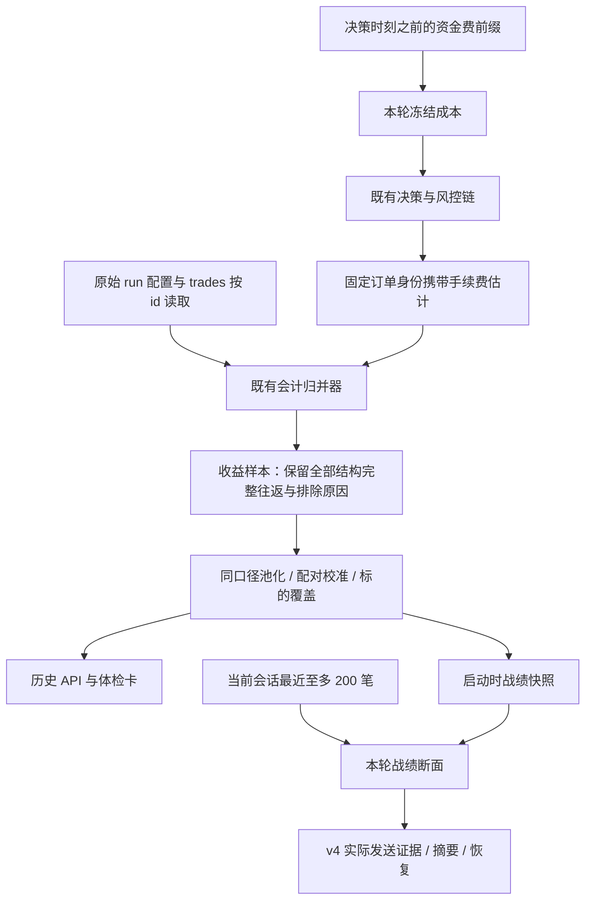

# AI 自动交易收益证据闭环增量设计

> 版本：v2；日期：2026-09-07；迭代：3/3；节点：#1 方案评审与修复。
> 实施基线：`b42f9dd`，承接第一轮 `d199687`，保留现有工作树修改。
> 下游可使用 `superpowers:executing-plans` 按第 7 节实施。
> 本节点只评审并修订本设计文档；代码实施及其测试属于下游节点。

**目标：** 让多标的历史统计、成本校准、回测和 Agent 战绩上下文使用可追溯、同口径、无未来信息的证据，消除前两轮修复后仍存在的统计偏差。

**架构：** 复用成交归并器与每标的独立会话，增加保留排除原因的收益样本投影；手续费估计与实测按往返配对；资金费查询只使用决策时可见前缀；战绩纳入现有冻结证据协议。

**技术栈：** Next.js 14 / React 18 / TypeScript / Tailwind / Zustand / TanStack Query；Python 3.11 / FastAPI / SQLAlchemy async / SQLite；Electron；pytest / Vitest。不新增第三方依赖。

## 评审记录

评审基线为当前工作树及 `b42f9dd`，逐节核对可行性、完整性、与现有约定的一致性及范围。下表状态表示**设计已修订**，不表示业务代码已实现。共 15 项：P0 2 项、P1 11 项、P2 2 项；P0/P1 均已在正文关闭。

| 编号 | 等级 | 问题与证据 | 正文修订 / 验收 | 状态 |
|---|---|---|---|---|
| RV3-01 | P0 | §3.5 只修曲线解析已太晚：REST 两个资金费方法先把空费率变成 0；历史 fundingRate 是预计值，不能充当实测计提。离线 O6 复现。 | §3.5 增入口来源保真与预计/实际分离；F45/F46，A39/A40。 | 已修订 |
| RV3-02 | P0 | §3.5 宣称去除未来信息，却保留 accrue_bars 与 _position_payload 对全曲线 available/interval_hint 的依赖；O4 同一过去区间因追加未来点变为可用。 | §3.5 补计提、持仓 payload、缺口覆盖的完整因果链；F14/F17/F48，A41/A42。 | 已修订 |
| RV3-03 | P1 | §3.4 仅收集开仓来源和最终 close 来源不能覆盖全部平仓腿；record_close 还把合成汇总腿强制标 estimated，O1 证实实测退化。 | §3.4 从归并结果传完整来源及原始最终 meta，金额与来源分开传；A43。 | 已修订 |
| RV3-04 | P1 | §3.5/§5.2 把模型默认值改为 3，却未规定旧 frozenEstimate 缺版本如何解码；O2 证明它依赖 dataclass 默认值。 | §3.4/§5.2 显式旧版本解码，新比较版本缺失为 null；A44。 | 已修订 |
| RV3-05 | P1 | §5.1 样本未列 stopBps/plannedRr/stopAtrMult 等既有消费字段，搬迁会静默清空风险卡，O3 复现。 | §3.3/§5.1 保留全套旧投影及字段来源；A45。 | 已修订 |
| RV3-06 | P1 | §3.2 费用已知笔数不能充当手续费 bps 的分母；位移/费比仍可能来自不同集合，战绩把手续费写成总成本。 | §3.2/§3.4/§3.6 单独尺度分母、同笔比值与明确不含资金费标签；A46/A47。 | 已修订 |
| RV3-07 | P1 | §3.2 的“同一事务”在当前 SQLite SELECT 路径并不自动成立，O5 证实；sinceTs 实际优先 group_started_ts。 | §3.2 单 SELECT 快照与精确时间表达式，避免接管调用者事务；A48/A49。 | 已修订 |
| RV3-08 | P1 | §3.2/§5.1 未明确零往返 run 的维度过滤、未知维度切片、正常未平仓与结构错误区别，可能污染分母。 | §3.2 固定 run 过滤与 unknown 桶、问题计数，修正 A06，新增 A50。 | 已修订 |
| RV3-09 | P1 | §3.4 在原字段上把总成本改成手续费，仅加 schemaVersion 无法保护仍按旧标签读取的客户端。 | §3.4/§4.1 改用新手续费字段，旧混比值为空；§9 兼容发布矩阵，A51。 | 已修订 |
| RV3-10 | P1 | §3.5 取曲线仍依赖计提总闸，成本总闸单独开启时不会取数；计数缺 enabledRounds，异常无时间也未定边界。 | §3.5 独立加载条件、有界分页/暖机、事件时间断点和计数恒等；A52/A53。 | 已修订 |
| RV3-11 | P1 | §3.2 只看最终 close 就排除估算，可能漏掉先前 local_mark；空来源集合或两边都缺身份也可能误升级。 | §3.2/§3.4 增全腿证据标记、非空身份及累计毛额校验；F47，A54。 | 已修订 |
| RV3-12 | P1 | §3.5 对非法间隔声称回落，但 funding_periods 现有负间隔分支算 1 期；只改展示会再次数值不一致。 | §3.5 统一有效间隔解析，known 以有效正间隔为前提；F49，A55。 | 已修订 |
| RV3-13 | P1 | §3.6 “新摘要成功即升级 v4”会把参与重摘要的 v3 旧叙述洗成完整证据；现有 refresh_summary 有 legacy 传播保护。 | §3.6 保留跨摘要 legacy 传播，新增 A56；失败及旧叙述原样保留。 | 已修订 |
| RV3-14 | P2 | §8.2 未把源码边界用例列进实际命令，TEMP/TMP 只口头要求恢复；易漏跑或污染后续终端。 | §6 增必要入口/回归文件，§8.2 补命令和 try/finally 恢复；A57。 | 已修订 |
| RV3-15 | P2 | §9 性能 1.5 倍门槛没有固定数据与测量方式，不能复现。 | §9 固定数据、查询数与五次中位数；A58。 | 已修订 |

§1–2 保留前两轮结论与生产证据边界；§3 修正因果和证据传递；§4–5 同步接口与恢复；§6–8 对齐 50 项文件计划、58 项验收；§9–10 明确发布及本节点实际验证。仅扩展收益证据所需路径，不增加策略、资金分配或新的交易门禁。

## 1. 概述

用户要求修复 AI 自动交易偏向 SOL、交易亏损和成本核算问题，并改善 Agent 上下文。第一轮已经处理低价标的指标舍入、逆势额度提前消耗、执行回执以及双腿手续费归并；第二轮进一步收紧结算身份、累计残差、恢复幂等和情报证据冻结。本轮以实际源码为基线，完善这些事实到历史统计、校准结论及模型输入的最后几段传递，避免重做已完成的交易执行改造。

目前会计核心能够保留未知费用，但历史盈利体检会把不完整往返直接删掉，随后把剩余样本作为全部分母。手续费已经准确归并，校准层却仍把含价差、冲击和资金费的总估计与单独手续费相减。回测资金费的费率虽取历史时点，周期却取完整曲线末尾；Agent 战绩虽被写入 prompt，却不在冻结与折叠证据集合中。这些缺口会让用户和模型对交易质量形成错误认识，也妨碍判断多标的无成交究竟是合理观望、历史覆盖不足，还是执行异常。

交付后的产品应同时回答“发生了多少往返”“其中多少能够可靠核算”“比较了哪些同口径样本”“本轮模型实际看到了哪份战绩”。正常不交易仍是有效结果；不要求每个标的强制成交，不修改共识、杠杆、预算或止损阈值。工程修复与收益验证分别验收：软件可以消除已确认缺陷，未来盈利不能由设计或单元测试保证，真实收益不足时明确显示证据不足。

## 2. 调研基线与新增证据

### 2.1 阅读范围与迭代继承

已阅读根目录 `README.md`、`CLAUDE.md`、项目索引、当前任务看板和完整迭代历史；根目录及上级路径未发现适用的 `AGENTS.md`。索引日期为 2026-08-31，仅用于导航，当前代码优先于旧索引及 README 中早期的“仅模拟”描述。

第一、二轮设计分别位于 `docs/plans/ai-trade-symbol-cost-context-integrity/spec.md` 与 `docs/plans/ai-trade-settlement-evidence-integrity/spec.md`。第二轮终审报告记录后端 849 项、前端 2721 项通过，这是历史证据，不是本节点重新执行的结果。本轮保留严格结算身份、恢复保护、原始成交不可改写和 v3 摘要历史事实。

当前工作树含在制 Journal 功能及其他已有修改。下游只实施第 6 节范围；涉及 `decider.py` 等共享文件时增量合并，不能覆盖 Journal 请求链、日志同步写点或其他已有工作。任务环境另列的 AgentMesh server 路径是只读工具参考，实际产品源码在本工作区。

### 2.2 已确认缺口

以下均通过源码定位，其中数值探针使用 `python -B` 调用现有纯函数，无网络交易、无源码修改。探针用于确认当前行为，不表示下游修复已完成。

| 编号 | 等级 | 当前落点和复现 | 对需求的影响 |
|---|---|---|---|
| E01 | P1 | `db/ai_auto_repositories.py::_trip_row` 对 `coverage != complete` 或口径推定直接返回 `None`；`load_profitability_trips` 只收剩余行。`build_profitability` 的总样本及 coverage 以剩余行为分母。 | 费用未知的往返及整个标的会从统计消失；“全部历史”和覆盖率表达失真。不能因此断言生产亏损方向或发生频率。 |
| E02 | P1 | `_trip_row` 仍由 `abs(gross)/abs(exit-entry)` 反推名义额。输入开平价均 100、已知归并名义 100、手续费 1、净额 −1，返回 `notionalUsd=null`、全部收益 bps 与 R 不可得。 | 最能说明成本损耗的持平价往返被排除出成本尺度比较，忽略归并器已有证据。 |
| E03 | P1 | `calibration.cost_model` 给 10 笔只有实测费、没有任何估计的样本返回 `n=10, coverage=1, conclusive=true`；`edge_numerator` 一笔估计 10/实测 2 加一笔无估计/实测 100，报告估计样本 1，却给实测中位 51。 | 不是同一批样本的两个中位被并列比较；无配对证据也得出可下结论。 |
| E04 | P1 | `trip_ledger.settle` 的 `cost_error_bps = realized_cost_bps - est_cost_bps`；前者仅为双腿手续费，后者来自 `CostBreakdown.total_bps`，含价差、冲击和资金费。历史 `_error_bps` 同形。 | 费用模型即使准确也会出现系统性负误差，模型和用户可能误认为门禁成本高估。 |
| E05 | P1 | `BacktestFundingCurve.snapshot_at` 的周期来自全曲线 `interval_hint`。同一决策时刻 57600，历史点 28800/57600 返回 28800 秒；追加未来点 61200 后，过去快照变成 3600 秒。仅一可见点也因未来点存在而可用。 | 回测成本和决策受未来结算周期影响，收益证据不满足因果约束。 |
| E06 | P1 | `cost_model.query_for_preview` 无条件把已有快照标成 `funding_interval_known=True`；明确 `interval_known=False` 的快照经调用后变成 True。 | “周期未知”被传输适配升级为已知，掩盖成本降级。 |
| E07 | P1 | `prompts.build_decision_prompt` 渲染 `trackRecord`，但 `ADVISORY_NAMES` 与 `build_evidence_fingerprint` 均不包含它。仅把战绩胜率 .2 改为 .9，指纹完全相同。 | 三段外部材料已冻结，第四段战绩仍可在摘要中作为相同证据折叠。 |
| E08 | P2 | `TrackRecordRuntime` 使用 `AttributionLedger.settled_trips()` 的最多 200 笔 deque，却称“本会话至今”。`_session_segment` 对未知净额 `None` 求和为 0。 | 滚动样本被误读成累计；虽然当前正常结算会过滤缺净额，兼容/恢复输入仍不能把未知升级为零。 |

### 2.3 外部契约与证据边界

OKX 公共接口提供资金费历史，资金费收取间隔可能变化。因此历史回测不能假定全区间固定周期，也不能把后来观察到的间隔提前使用。此处采用的是本项目的保守因果建模规则，并不宣称历史末两点能证明下一次实际结算时间。依据：[OKX API 更新说明](https://www.okx.com/docs-v5/log_en/) 与 [OKX API 公共数据文档](https://app.okx.com/docs-v5/zh/#public-data-rest-api-get-funding-rate-history)。查阅日期：2026-09-07。

本节点未重新访问生产账户或执行新的收益实验。前两轮“SOL 集中”的生产记录与低价精度复现作为历史证据继承；本轮确认的是代码缺口，不能把合成输入声称为新增生产事故，也不能把前两轮测试数量替代本轮验收。

## 3. 技术设计

### 3.1 方案选择与关键时序

选择“复用会计核心、修正证据投影”。仅改 UI 标签无法恢复已丢失的分母和因果时间；另建交易账本会产生第二套事实源和迁移负担；调整模型提示词或放松开仓门禁无法修复这些数值问题。继续由 `TradeAccountingAccumulator` 解释原始成交，新增纯样本投影，既有 API、状态和摘要读取同一产物。



决策轮不新增网络或 DB IO。历史取数仍发生于已有查询/启动阶段；运行时战绩每轮同步读取内存。平仓只追加原始成交，派生统计计算失败不能阻断落账或保护性退出。统计、校准、战绩不得写回仓位、门禁配置、策略选择或经验先验权重。

### 3.2 轴 A：保留收益总体与排除原因

将历史收益专属取数移动至新增 `db/ai_profitability_repositories.py`，新增纯投影 `ai_auto/profitability_sample.py`。`ai_auto_repositories.load_profitability_trips` 保留为兼容包装，返回可计净额行；正式 `build_profitability` 改为读取完整 dataset，任何正式统计不再用包装后的列表推断总体。

依赖方向固定：F01 只依赖标准库及既有 trade_economics/accounting_replay，不导入 DB、trip_ledger、profitability 或 calibration；费用来源分类也放在 F01。F02 可以复用 ai_auto_repositories 的只读配置/批量读取 helper，但 F03 包装函数必须在函数体内延迟导入 F02，避免模块顶层循环。F04 对新查询直接从 F02 re-export。

取数顺序固定如下：

1. F02 用一个 SQL SELECT 对 AI run 与 trades 做 LEFT OUTER JOIN，读取 run 配置/metrics 及全部成交，按 run.id、trade.id 排序；立即在内存物化为普通值后投影，不持有游标跨越模型请求。未成交 run 也被保留。单语句快照避免 Python 3.11 sqlite3/aiosqlite 对 SELECT 不自动 BEGIN 的既有行为造成两次查询读到不同断面；不对调用者 session 执行 begin/commit/rollback，不改全局 DB 引擎。现有 `_load_trades_by_run` 仍供其他历史接口使用，F02 不依赖其 ts 排序。
   `sinceTs` 保持 `_run_matches` 的既有表达式：`int(run.group_started_ts or run.start_ts or 0) >= sinceTs`（sinceTs 为 0 沿原无过滤行为）。`scope.sinceBasis=run_started` 并增加 `sinceField=group_started_ts_or_start_ts`；它不是平仓时间过滤。asOfTs 在发起该 SELECT 时冻结，属于请求观察时间；snapshotId 与本次实际读取的样本才是断面身份。该选择依据 [SQLAlchemy SQLite 事务文档](https://docs.sqlalchemy.org/en/20/dialects/sqlite.html#transactions-with-sqlite-and-the-sqlite3-driver)，不假设 AsyncSession 的逻辑事务等于驱动物理事务。
2. 按 run 独立调用 `TradeAccountingAccumulator`，context 带 `runId`、配置的 `costBasis`、配置的 `ctVal`。排序继续采用 DB `trades.id`，不按 K 线时间重排，不跨 run/标的配对。运行配置缺失不推定为当前配置。
3. 对每条 `completed_trips` 输出一条 sample，即使费用缺失也保留。正常未闭合 open 单列 `openEpochCount`，不进入 N，也不单独使“已完成往返”的结论失效。归并器数量冲突及孤立 close 用 `structuralIssues` 单列，不能伪造为零盈亏往返。每消费一个非重复事件，收集新增 issues 为 `{runId,eventKey,reason}`；相同事件/原因只计一次，累计 `structuralIssueCount`，不因字符串原因相同就合并不同事件。
4. sample 的数值从归并结果读取 `grossPnlUsd / tradingNetUsd / feeUsd / notionalUsd / entryPrice / exitPrice / qty`；元数据只提供冻结估计、止损、置信度和退出来源。禁止用展示 meta 覆盖会计核心金额。
5. `netEligible` 必须同时满足原始口径明确、归并 coverage 为 complete、净额和手续费均为有限数。不是“净额非零”，合法零和返佣必须保留。未知净额保留 null，不进入胜率和期望分母。
6. 每条不合格往返固定一个主排除原因，顺序为 `basis_unknown`、`economics_incomplete`、`net_invalid`。额外诊断存 flags，不重复计入 `excludedByReason`。结构异常独立计数，不混入这个加法恒等式。
7. 标的、bar、sinceTs 沿 `_run_matches`；preset 沿 `metrics_json.aiStats.disciplinePreset`，horizon 沿 `config_json.tradingHorizon.profile`，缺失值归 unknown。先筛选 run 的全部维度，再纳入它的样本、结构问题及 openEpochCount。无往返 run 同样执行 preset/horizon 过滤，不能把不匹配的空 run 混进 coverage。未指定某个维度过滤时，六切片的缺失/非法维度进入显式 unknown 桶；置信度非法值不进入五个数值桶，但计入该切片 unknown 行。所有切片的 N/K/X 加总等于全局对应数值。无合格净额但存在匹配 run 的标的仍进入 `coverage.byInstId`；没有任何往返时显示 0 笔，不能称为未知标的。

记 `N = totalTrips`、`K = netEligibleTrips`、`X = excludedTrips`，必须满足 `N = K + X` 与 `X = Σ excludedByReason`。`sampleTrips` 为兼容仍等于 K；新的 `coverage.totalTrips` 是结构完整的总体 N，`coverage.netCoverage = K/N`，N=0 时为 null。`feeTrips` 是总体中费用确知的笔数，可以大于 K，`feeCoverage=feeTrips/N`，绝不用过滤后 K 作总体分母。所有切片同时携带 N、K、X；`slices.*[].trips` 为兼容仍等于该行 K，新增 totalTrips/netEligibleTrips/excludedTrips/coverage（比例及原因）、rSamples。结构问题仅在有确定维度的切片归属，不凭未知 exitSource 虚构往返。

`pooled.roundTrips` 仍是净额统计所用 K；`pooled.netPnlUsd` 明确定义为 K 笔可核算交易净额合计，不含资金费，不冒充全账户余额变化。K=0 时净额、胜率、期望、t 值全部 null。为防直接调用纯函数时归零，`pooled` 自身也过滤非有限数与 bool，单独给出 `netSamples`；正式输入 `netSamples == K`。F07 向 pooled/risk 传净额合格子集，向 coverage/slices/calibration 传完整 dataset，不用 K 行重算全局分母。

`pooled.feeTrips/feeCoverage` 保留“净额子集 K 中费用已知”的旧语义，与顶层 `coverage.feeTrips/feeCoverage` 的总体 N 语义分别声明，禁止互相覆盖。新增 `feeBpsTrips/feeBpsCoverage` 只统计 K 中 feeKnown 且 realizedFeeBps 有限的子集，比例分母 K；`moveSamples/holdSamples` 分别对应有限位移/持仓时长中位数，`risk` 增 plannedRrSamples/stopUtilizationSamples/stopAtrSamples，空集比例均 null。一个净额已知但名义不可得的往返不能被显示为“可算手续费 bps”。

特别区分“费用可计算”与“交易所实测”：现有 `leg_fee_evidence` 对 measured 和 estimated 都返回有限数，故 feeKnown 不能证明实测。新增 `feeMeasurement=measured|estimated|unknown` 与逐样本 `measuredNetEligible`；`measuredNetTrips` 是后者为 True 的计数，判据由 F01 单点实现。若归并结果 feeSources 非空且全为 measured，则费用为 measured；若最终平仓已带 `settlementValidation.status=matched`、`amountCoverage=complete`，且 validation 的 epochKey/settlementKey 及同条成交 meta 的对应键均为非空字符串并一致、settlementSource=exchange、归并 feeUsd 与 exchangeFeeUsd 在 abs_tol=1e-8 / rel_tol=1e-9 内相等，则允许官方累计总费证据覆盖此前估费。不得仅凭 source=exchange 或存在一个金额字段升级。其余来源明确但含估费为 estimated，来源缺失为 unknown。`measuredNetEligible` 还要求 netEligible，且所有平仓腿均无 `settlementSource=local_mark`、`priceBasis=local_mark` 或 `pnlBasis=estimated`。F47 仅给原归并器追加 `closeEvidenceFlags`（逐腿非实测标记并集）及最终原始 close meta，不改配对、数量和金额算法。最终官方累计覆盖若满足上述非空身份条件，并且归并 grossPnlUsd 与有限 exchangeGrossPnlUsd 也在同一容差内相等，才可覆盖此前局部估算的净额证据；仅费用相等不能升级毛额。未识别的来源标记保持 unknown，不以“不是 estimated”推定为实测；正常历史执行腿仅沿既有可信落库边界读取，额外缺口不能凭合成汇总腿补齐。这只用于收益证据，不回改已记金额。

全局结论只在 `K >= minTrips`、`K == N`、`measuredNetTrips == N`、`structuralIssueCount == 0` 时允许沿既有五态表判定。存在被排除行、估算证据或结构异常时新增 `insufficient_evidence`，即使可计子样本盈利显著也不为全体历史背书。子样本数字仍显示，不删除负收益，也不把缺失样本估成亏损。该规则只控制解释，不阻断真实交易。

### 3.3 轴 B：名义额、双腿费用和可比较尺度

每笔名义额采用严格优先级：先取归并器的正有限 `notionalUsd`；缺失时尝试 `entryPrice × qty × config.ctVal`；仍缺失才允许旧历史的代数推定。推定要求 `Δprice != 0`、毛额非零且 `sign(gross) == sign(side × Δprice)`，单位量为 `gross/(side × Δprice)` 且必须正有限。输入为 USDT 线性永续合约语义，未确定合约语义时不得代数推定。

记录 `notionalSource=contract|legacy_derived|unavailable`。`legacy_derived` 可用于描述性 bps，不能进入新版本校准的配对集合。已知乘数且价格持平时正常得到名义额，不因为毛额为 0 丢失手续费、净额 bps 和 R。完全缺乘数且价格持平时金额可继续统计，但 bps/R 为 null。

核心恒等式固定为：

- `feeUsd = openFeeUsd + closeFeeUsd`，正数表示支出，负数表示返佣。
- `tradingNetUsd = grossPnlUsd - feeUsd`；费用已经反映于净额时不再扣第二遍。
- `realizedFeeBps = 10000 × feeUsd / entryNotionalUsd`。
- `realizedNetBps = 10000 × tradingNetUsd / entryNotionalUsd`。
- `riskUsd = abs(entryPrice - stopPrice) × qty × ctVal`，无止损或 risk=0 时 R=null。
- `rMultiple = tradingNetUsd / riskUsd`。显示可四舍五入，资格判断使用未舍入有限值。运行期 classify_fee_measurement 和 feeError 先读取未舍入归并金额，之后才调用 wire 的 round；不能拿 SettledTrip 已四舍五入到 6 位的小额 fee 参与 1e-8 容差认证。

持平价黄金样本：entry=exit=100、qty=1、ctVal=1、止损 95、双腿费合计 1；毛额 0、净额 −1、名义 100、手续费 100 bps、净额 −100 bps、R=−0.2。该样本必须出现在历史成本统计中。

迁移保留旧投影的 `stopBps/plannedRr/stopAtrMult/edgeSource/costConfidence/wakeKind/edgeErrorBps/costBasisAssumed`：stopBps、plannedRr 用首开腿冻结止损/止盈与归并加权入场价求得，stopAtrMult 沿开仓时已冻结信息，缺失不得用当前 ATR 重算；edgeErrorBps 从同笔有限毛额与冻结 edge 相减。holdSeconds 沿逐腿 `meta.wallTs ?? ts` 的原规则；禁止直接用 K 线吸附时间替代真实墙钟。名义额只改变其来源选择，不删除这些既有消费字段。

### 3.4 轴 C：同笔、同分母、同成本分量校准

现有 `estCostBps` 保持“开仓时总成本估计”，`realizedCostBps` 保持旧字段的“双腿手续费”语义，是否实测另读 feeMeasurement；二者不再直接相减。新增 `estFeeBps`、`realizedFeeBps`、`feeErrorBps`、`costComparisonBasis=fees`、`comparisonVersion=1`。`feeErrorBps = realizedFeeBps - estFeeBps`，仅同口径实测配对可得；估费或证据缺口时为 null。旧 `costErrorBps` / `costErrorMedianBps` 不改义为手续费误差：新的历史/API/状态输出固定 null，原始成交中旧值保持不动且不重新读入校准。运行期新聚合键为 `feeErrorMedianBps` 和 `feeComparisonTrips/feeComparisonCoverage`，覆盖分母为该滚动窗口 trips。

`trip_ledger.build_round_estimate` 从同一次 `EdgeGateOutcome.wire.cost` 读取 `feeOpenBps + feeCloseBps`，冻结为 `RoundEstimate.est_fee_bps`。不从当前 Settings 事后重算；旧 outcome 无 cost 分解时估计为 None。`comparison_version:int|None=None` 为新增末尾默认字段；只有成功读取同次分解的新建估计才显式写 1，不改变现有必填位置参数。完整 `CostBreakdown` 可保留为原有展示，但无需为本轮新建另一份费用账本。`OpenSnapshot` 新增 `fee_sources:tuple[str,...]=()`，逐腿调用既有 leg_fee_evidence 收集；`merge_open_leg` 合并去重；`record_close` 必须将原归并结果的完整 feeSources、closeEvidenceFlags、最终原始 close meta 及未舍入 totals 保存在 pending settlement 旁，并通过 SettleContext 的一个 evidence 对象交给 `settle`。当前用于金额计算的合成 close 的 feeBasis=estimated 只是适配占位，不能交给来源分类器充当原始证据。直接调用 settle 的两腿场景可从原始输入组装 evidence；多腿场景必须消费归并结果。`settle` 将 evidence 交 F01 的同一来源判据，生成 `SettledTrip.fee_measurement`，不以最后一腿代替所有平仓来源。历史投影直接使用归并器已有 feeSources，禁止运行/历史各写一套升级规则。

冻结估计经 `CostRuntime.pending_estimate` 的 asdict、`PendingOpenAttempt`、`frozenEstimate`、`AttributionLedger._take_estimate`、`OpenSnapshot` 到 `SettledTrip` 全链传递；新增字段有默认值，旧 JSON 可以恢复。F10 增集中 `decode_round_estimate`：缺失 model_version 明确取旧 2，缺 est_fee_bps/comparison_version 明确取 None；显式未知未来版本保留原版本但比较资格为 false。拒绝 bool/非有限估计，坏可选元数据只形成比较缺口，不能令已成交落库失败。不将 v3 构造默认值应用到旧 JSON；本轮新建估计 model_version 从同次 cost wire 读取。限价单跨轮等待、部分成交以及恢复后成交继续用原订单估计，禁止取成交时另一轮的费率。`trip_meta_wire` 将新比较字段写入平仓 explain；`experience.events._outcome_wire` 随同保存 feeErrorBps、比较版本与基准；不再给新事件写旧 costErrorBps，也不把 None 补 0。其他合法经验字段正常保存，不能因缺手续费估计而丢掉整笔亏损事件。旧经验资产不批量回写，也不因此自动修改已有权重。

配对规则由 `profitability_sample.py` 中的纯选择器单点提供：

| 比较块 | 进入配对集合的必要条件 | 所有比较读数与分母 |
|---|---|---|
| edgeNumerator | measuredNetEligible；实测毛额 bps 和冻结 estEdgeBps 有限；名义来自 contract | 两个中位、逐笔误差中位都在同一集合 P；`n=len(P)`，coverage=n/N。正估计子集另外给 `signSamples`。 |
| costModel | 净额合格；feeMeasurement=measured；名义来自 contract；comparisonVersion=1；estFeeBps 与 realizedFeeBps 有限 | 实测/估计手续费中位、feeError 中位都在集合 P；`n=len(P)`，coverage=n/N。 |
| confidenceReliability | 净额合格；置信度是有限数且在 [0,1] | 每个桶的胜率、期望、R 在该桶内计算，各自带净额与 R 分母；越界或 bool 单列 metadata 缺口。 |

新 UI 读取新手续费数值字段，标签为“手续费估计”和“实测手续费”；costModel 新增 `comparisonBasis=fees`、`availableEstimateTrips`、`availableRealizedTrips`。两个 available 集合先满足该比较块的公共资格（netEligible、contract 名义及允许的证据/版本），再分别要求估计或实测值有限；availableEstimateTrips/availableRealizedTrips 为各自计数，其交集才是 n。不把不合格总体行计入 available 后又声称其交集就是配对数。新比较读数为 `medianEstFeeBps/medianRealizedFeeBps/medianFeeErrorBps`。costModel 块内旧 `medianEstCostBps/medianRealizedCostBps/medianErrorBps` 一律 null，防止旧 UI 以“总成本误差”解释新手续费数字；响应 `schemaVersion=2`，`note` 明确比较口径变化。edgeNumerator 的同名 medianErrorBps 保持 edge 语义。`medianEstTotalCostBps` 可单列为描述值，绝不参与手续费误差。`modelConstantBps` 继续单列为“当前配置总成本预览，非历史预测”，不作为任何历史配对的估计填充值。

edge/cost 的 `conclusive` 要求 n 达到现有 `bucket_min_trips` 且所有净额合格行都形成配对，同时总体无排除/结构缺口、measuredNetTrips=N。edge 所称实测毛额按 measuredNetEligible 排除全腿 local_mark、pnlBasis=estimated 及未知来源，不能把估算平仓价当作真实结果。confidence 总块要求全部五个冻结桶均达到桶下限且总体实测完整，再判断 monotonic；仅总笔数够不能称全部置信度层次有结论。样本不足仍展示已知数字和分母，门槛不交由 UI 自行判断。

例如手续费真实 10 bps，冻结手续费估计 10、价差与冲击 4、资金费估计 2，则总成本估计 16，手续费误差必须为 0，而非 −6。仅有历史总估计 16 的旧样本不能倒推手续费估计，比较覆盖为 0。真实滑点已包含在成交价格形成的毛额中，不额外再从交易净额扣一次；本轮不声称已测得总执行成本误差。

描述性 `travelToCostRatio` 也使用同一集合：K 中 moveBps 与 realizedFeeBps 同时有限的行，记 `travelComparisonTrips`，两个用于该比值的中位数新增 `travelMedianMoveBps/travelMedianFeeBps`；比值为二者之比，手续费中位数 <=0 时 null。`travelComparisonCoverage=travelComparisonTrips/N`，沿原覆盖门槛决定比值可见性；原 medianMoveBps 与 medianCostBps 各自仍可描述展示。费用句必须称“往返手续费”，同时写明不含资金费；估费占比另外披露，不称全成本或实测净收益。

### 3.5 轴 D：资金费的时间因果与降级

把 `BacktestFundingCurve` 移至新增 `ai_auto/backtest_funding.py`，原 `funding_ledger.py` 保留 re-export，已有导入兼容。这样可独立测试时间索引。F14 只同步回测计提的前缀资格和缺口传播，保持收付符号、按真实点计算的金额公式及 SimBroker 权益边界；实盘 FundingWindow 的既有计提机制不扩展。

入口先保真：F45 修改 `OKXRestClient.get_funding_rate_history/get_funding_rate` 的局部归一，不改其他端点共用 `_optional_float` 的行为。资金费数值拒绝 bool、NaN、Inf、空字符串及缺席，保留有限零/负数；历史 fundingRate 与 realizedRate 分别保留 None，不能 `or 0.0`。REST 原始 `fundingTime` 为毫秒，只在此归一成秒级 fundingTs；不对已归一秒值二次除 1000。非法 ts 行保留为 `fundingTs=None` 的诊断行供曲线统计，排序有效 ts 在前，分页只用有效正 ts。

曲线点显式区分 `rateSource=realized|estimated|unknown`：实测 realizedRate 可用于历史点计提；realizedRate 缺失时有限 fundingRate 仅可用于事前成本估计，不能被 points_in 当作已结算实测费率。两者均未知时形成有 ts 的不可用断点。相同 ts、来源及值完全一致折叠；同 ts 的有效值/来源冲突，或一份有效另一份异常，均形成断点，不按行顺序挑选。invalidRows/conflictingPoints 统计原始异常行数/冲突时点数，重复有效行不计异常。

有合法 ts 的异常点只影响该时点及之后，不能影响较早决策；没有合法 ts 的行无法放到时间轴，记 untimedInvalidRows，仅在整次回测结果标数据完整性未知，不伪造一个作用于过去的断点。后续两个相邻有效点即可恢复前缀周期估计；统计未来异常数只用于最终报告，不进当轮成本、payload 或指纹。

`snapshot_at(t)` 只允许查看 `fundingTs <= t` 的点。二分查找最后可见点 j，再找紧邻、无无效/冲突断点隔开的前一点 j−1；若最后一个可见时间事件本身是断点则返回 None，不回退到断点前的旧费率。没有两点时返回 None，即使完整文件未来有一千点也不能补齐。周期为 `ts[j]-ts[j-1]`，`next_funding_ts=ts[j]+interval` 仅表示沿最近观察间隔的预测。超过 `ts[j]+interval` 且尚无新点时返回 None，避免把缺失多期当作可无限延长的已知费率。

`FundingSnapshot` 新增带默认值的 `interval_source=unknown|exchange_schedule|historical_observed`。F15 在写入实盘快照前复核 rate 有限、两个官方时间为正且严格递增、间隔与二者差一致；无合法 rate 不写零值快照，保留旧快照仅至原 ttl_s×stale_factor 有效期，失败不更新 fetched_wall。时间不成立时允许有限 rate 以 interval_known=False 保存。实盘快照在官方两个时间点有效且 intervalKnown 明确为 True 时为 exchange_schedule；历史前缀为 historical_observed，`interval_known=False`，表明上一段间隔可知、下一段安排未确认。`query_for_preview` 必须逐值传递 `funding.interval_known` 与 source，不能置 True。周期数值仍可按最近观察间隔估计，但输出 `confidence=degraded`，文案标为“按最近历史间隔估计”。实盘 query 的 known/source/正间隔必须相互一致；已知标记配非法间隔时降为 known=False/source=unknown 并回落，不保留虚假的 ok；source 缺失的旧快照不补写 exchange_schedule；其旧 known 仅在 rate/时间差/间隔一致且有效时保留，正文显示“周期值可用、来源未记录”，不能同时把该周期显示为确认安排与未知回落。

为避免未知与关闭混淆，`CostQuery` 新增 `funding_enabled: bool = True`、`funding_interval_source: str = unknown`。`query_for_preview(..., funding_enabled=False)` 明确设置 False，此时 fundingRate=0、confidence 沿旧关闭路径为 ok；开启但无快照则 fundingRate=None、confidence=degraded。已知零费率且周期未知也为 degraded，零数值不代表完整证据。`estimate_round_trip_cost` 的降级条件为启用且（rate 缺失或 interval_known 为 False）。已知完整实盘快照仍按既有公式计算。`CostQuery.funding_enabled=False` 是唯一关闭依据，纯函数必须忽略矛盾的非零 rate，不向总成本加资金费，周期披露字段为 null；启用+零费率+未知周期仍为 degraded。F49 更新原来靠 rate=0 暗示关闭的直接构造用例，使关闭含义显式。

周期显示必须跟随实际计算值：`CostBreakdown` 增 `funding_interval_source` 和 `funding_assumed_interval_s`；前者取 query，后者在未知安排时取实际用于 funding_periods 的正有限间隔（无有效值使用既有 DEFAULT_FUNDING_INTERVAL_S）。新增局部纯解析函数先拒绝 bool/非有限/非正间隔，再给正有限回落值；funding_periods、carry 和 wire 都消费这一解析结果，不能一边负间隔算 1 期、一边显示按 8h。原 `funding_interval_s` 仍只表示已确认安排。`cost_wire`、`cost_view.build_cost_view` 一并输出 `fundingIntervalSource`、`fundingAssumedIntervalS`，`cost_text._funding_periods_clause` 按 exchange_schedule/historical_observed/unknown 分别显示“当前安排”“按最近历史间隔估计”“周期未知、按模型回落间隔估计”。数值均读 wire；不得在按1h计算时仍写“按8h保守估算”。资金费关闭时不呈现一个假的已确认周期。

`backtest._cost_funding` 在设置开启且历史点不可见时返回 `(None, True)`，保留“需要资金费但缺证据”，不能退成“用户关闭资金费”。只有设置关闭返回 `(None, False)`。这是对旧缺数据降级规则的有意修订：配置阈值不变，但缺证据轮会触发已有 degraded 分支。保护性止损和平仓优先路径继续有效，不增加禁止平仓条件。

`_load_funding_curve` 在 ai_trade_funding_cost_backtest_enabled 或（ai_trade_funding_ledger_enabled 且 ai_trade_funding_backtest_enabled）任一成立时加载，不再仅依赖 self._funding.enabled。分页沿原最大页数和 limit=100（这是项目保守单页值，不宣称交易所当前上限），加载到 start_ts 之前至少两个有效时间事件或达到既有页数上限；没有足够前缀即保留降级。page 的最小有效 ts 才是下一 cursor，必须严格向前；全无效页/重复页停止并记 loadCoverage=partial。异常保留已取点、缺口原因，不补零或无界重试。

新增回测结果 `aiStats.fundingEvidence`：`version=2`、`decisionRounds`、`enabledRounds`、`disabledRounds`、`visibleRateRounds`、`degradedRounds`、`missingRounds`、`invalidRows`、`conflictingPoints`、`untimedInvalidRows`、`loadCoverage`。唯一计数点在首次 `_begin_round_cost` 的实际决策入口，以该决策轮身份去重；模型失败仍计一轮，preview、持仓盯市和重试只读。恒等式为 decisionRounds=enabledRounds+disabledRounds，enabledRounds=visibleRateRounds+missingRounds；missingRounds<=degradedRounds<=enabledRounds。visibleRateRounds 指有可用前缀快照，historical_observed 计 visible 同时计 degraded，不声称两者互斥。`_cost_basis_note` 读取同一统计，不再用全曲线末尾周期概括全部决策。`interval_hint` 仅保留离线曲线诊断，不得进入任何决定仓位的计算。

`CostBreakdown`、`RoundCostSnapshot`、`RoundEstimate` 的新写入 `model_version` 统一为 3；`cost_runtime` 和 `backtest` 的 wire 不再硬编码 2，读取冻结对象版本。旧版本估计原样标 2，不重标成新版。资金费 `points_in` 仍按 `(from_ts,to_ts]` 取 realizedRate 确知的真实已发生点，不用预计 rate 或预测时间人工补结算；单个真实点无需第二个未来点就可计提。F14 的 accrue_bars 与 F17 的 _position_payload/_acceptance_bundle 改读截至当前 ts 的 `window_evidence(from_ts,to_ts)`，不得读取全局 available/interval_hint。窗口回执为 `{points,coverage,firstVisibleTs,lastVisibleTs,invalidPointCount,estimatedPointCount}`；发现已可见异常/估计点或已知加载覆盖缺口则 coverage=partial/unavailable。窗口完全无观测时不能把空 points 当成确知零。覆盖资格也只依赖 <=to_ts 的时间事件：起点没有可用历史锚点、遇到已可见断点或最近观察间隔已经到期而无新点时为 partial/unavailable；有有效历史锚点、未到期且没有跨点时才给 complete+0（仅表示本模型的历史观察覆盖）。加载缺口必须能界定在本窗口的过去范围才影响当轮；无时间定位的整次 loadCoverage/untimedInvalidRows 只影响最终完整性结论，不改变早先 payload。已知真实点始终计入 knownAccruedUsd，即使整体窗口覆盖不足；因此追加未来点既不补早先周期，也不反向洗白其完整性。

按既有 mark_px 与 qty_coin 计算的资金费仍属“历史点本地计提”，不是账户实际结算证据。F14 保留 knownAccruedUsd 及其笔数用于诊断；任何持仓期间已发生的覆盖缺口使该 epoch 的完整 fundingCostUsd/fundingAccruedUsd 为 null，不能靠后续一笔有效费率自动补齐；平仓后缺口并入 closedCoverage。F17 在持仓 payload、验收 bundle 和最终结果共用该覆盖结果。预测周期未知并不阻止已发生真实点计提；预计/异常点不扣款，也不冒充免费。intervalKnown 不能由 historical_observed 设置 True，新增 intervalSource 说明它是历史观察。SimBroker 权益口径不在本轮更改。

### 3.6 轴 E：战绩上下文冻结与摘要兼容

将 `trackRecord` 加入 `ADVISORY_NAMES`，顺序固定为 `trackRecord, intel, experience, signalPriors`，便于 4096 字符摘要预算优先保存短小的自身战绩。`build_advisory_evidence` 使用原 `format_track_record_text` 渲染；`build_decision_prompt` 改经 `_advisory_text` 读取冻结战绩。决策、重试、反思基础材料和 commit 均复用同一 snapshot，轮中 history/provider 发生变化只影响下一轮。

该结构升级为 `evidenceVersion=4`；`factsVersion/schemaVersion=2` 不变。定义唯一 `EVIDENCE_VERSION=4` 常量置于 `decision_memory.py`，`advisory_evidence`、`decider` 所有构造及判断引用该常量，不复制数字。`build_evidence_fingerprint` 对四段完整冻结 wire 哈希；`evidenceHashes` 同步四段 sourceHash/renderedHash；不得把 fetchedAt 之类刷新噪声放进战绩经济身份。

战绩 wire 的 `history` 增加 `coverage`、`basis=trading_net_ex_funding`、`asOfTs`、`snapshotId`；renderer 必须实际输出“历史交易净额，不含资金费”及净额/手续费尺度各自分母，不能只在未呈现 wire 写 basis；snapshotId 对样本身份、配置/会计版本、关键金额及覆盖规范 JSON 计算 SHA256。asOfTs 表示启动取数断面，整个快照生命周期保持固定，不能每轮写当前时间；snapshotId 的经济身份不含这类时间噪声。冻结 sourceHash 仍覆盖实际发送的完整 wire，快照换代可以保守地阻止折叠，不以忽略字段方式损害审计完整性。关闭战绩层时冻结 enabled=false，不把空历史解释成零收益。

`build_track_record` 历史样本门禁读 K，且必须是完整总体证据；新增 `insufficient_evidence` 与旧 insufficient_samples 同样不注入绩效断言。coverage 缺席的旧启动快照不得只凭 verdict.code 恢复为完整，unknown/未来 schema 也不注入；禁用或不足时从本轮 payload 移除旧 trackRecord 键，避免调用者复用 dict 留下旧战绩。页面仍显示覆盖不足的信息。历史快照沿既有启动阶段一次性读取，本轮不新增盯市 IO 或刷新调度。

`session` 段明确为 `scope=rolling`、`capacity=200`、`sampleTrips=len(rows)`；文案改为“本次进程/恢复后可用的最近 N 笔，窗口上限 200”。不要称“本会话累计”，不要与启动历史直接相加为独立总样本，历史与当前 run 的恢复记录可能重叠。未知 net 不计为 0；输出 `netSamples`，部分未知时 `netPnlUsd=null`，另给 `knownNetPnlUsd` 与已知分母用于诊断。空窗口 sampleTrips=netSamples=0、netPnlUsd=null，不写零收益；单独给 moveSamples/rSamples 及 measuredNetSamples，含估算的滚动数据显式标为含估算，不套用历史段的“实测”标题。当前正常 SettledTrip 不会缺净额的事实不免除该边界约束。

摘要预算仍为实际 JSON 序列化后的 4096 字符，沿上一轮 `_serialized_chars` 计数，不按裸文本长度判断。按固定顺序整段回填，装不下保留哈希、原字数和 omitted；有缺失/省略证据不可折叠。外部文本仍是 user 材料，不产生 system 指令。

旧 v3/v2 摘要可以展示，但 `seed_from_snapshot` 将其置 `legacyNarrative=true`，不能和 v4 轮次折叠。v4 轮次可以形成自己的完整身份，但累计摘要若仍消费任何 legacy 旧摘要或缺失证据的 journal，成功刷新后也必须保持 legacyNarrative=true、summaryEvidenceVersion=null；沿现有 refresh_summary 的 legacy 传播规则。只有没有 legacy 输入且所有实际消费材料均完整 v4 的摘要成功时，才标为 v4。不得忽略 prev、删除历史或仅改版本数字来制造升级；失败保留旧摘要及 legacy 标记。前端识别 v3 为“历史证据 v3”，v4 为当前版本，未知未来版本显示不可读，不能一律把非 3 都拒绝或默认为最新。恢复读取 `summaryEvidenceVersion` 的现有路径必须测通。

### 3.7 产品呈现与多标的解释

沿用历史统计页的 `ProfitabilityCard` 和 `CalibrationCard`，新增紧凑 `ProfitabilityCoverage` 子组件。主行显示“可核算 K / 总往返 N”，旁边显示“实测净额 M / N”（M=measuredNetTrips）；存在估算时明确金额含估算，不能仅以 K=N 显示证据完整。K=0、N>0 时卡片必须保留，显示“费用或口径证据不足”，净额为“—”。来源为旧后端且没有 coverage 时显示“旧版未提供总体覆盖”，不推断为 100%。N=0 且无结构异常可维持空历史隐藏行为；存在结构异常必须给出可展开原因。

按标的覆盖行同时列出总往返、可核算、未纳入原因。BTC/ETH 无合格净额时行仍可见；SOL 有成交不等于系统只评估 SOL。开仓是否受阻继续查看既有成员卡的 tradability、openFunnel、pendingOpen、settlementValidation，体检卡不自行创造第二张 gate 表。自动下单多样性与统计可见性分别验收。

卡片用现有主题色、文本加徽标表达状态；负数、未知和零使用不同文本。窄容器采用 `minmax(min(100%, 140px), 1fr)` 自动列，表格 `overflow-x-auto`，数值和表头不换行；详细原因可换行或展开。不用 viewport 的 sm 列数决定嵌套窄面板。新增展开按钮使用 button、aria-expanded、明确焦点样式，200/240/360px 下验证无外部横向溢出。异步错误显示简短取数失败及重试，不把 API 错误画成无历史。

## 4. 接口设计

### 4.1 REST 与既有状态通路

保留 `GET /api/ai-trade/history/profitability`，查询参数仍为 `instId?`、`bar?`、`sinceTs?`、`preset?`、`horizonProfile?`；前端继续经 `/api/py` 代理。`sinceTs` 是秒级 UTC、筛选 run 启动时间，响应必须声明。现有路由顺序不变，仍排在 `history/{group_id}` 前。

在 `schemas.AiTradeProfitabilityOut` 显式增加以下顶层键，否则 FastAPI response_model 会丢弃新增信息：

| 字段 | 类型 | 契约 |
|---|---|---|
| schemaVersion | int，恒 2 | 新的覆盖与比较语义版本；前端允许旧版本缺席。 |
| scope | dict | `{instId,bar,sinceTs,sinceBasis:"run_started",sinceField:"group_started_ts_or_start_ts",preset,horizonProfile,basis:"trading_net_ex_funding"}`。 |
| coverage | dict | 第 5 节的总体、可计数、原因和各标的覆盖。 |
| sampleTrips / minTrips | int | sampleTrips=K，minTrips 沿现有配置。 |
| conclusive | bool | 总体证据和样本量均达标，具体收益方向另读 verdict。 |
| pooled / risk / slices / calibration / verdict | 既有 dict | 保留并添加独立分母、比较口径；null 必须保留。 |

启动、暂停、恢复及下单 REST 不增加新参数。现有状态/WS 中 `aiStats.realized` 增加 `costComparisonBasis`、`comparisonVersion`、`feeComparisonTrips`、`feeComparisonCoverage`、`feeErrorMedianBps`；旧 costErrorMedianBps 保持 null；`aiStats.integrity.context` 的证据版本为 4；最终 metrics 和历史快照带相同字段。回测 `aiStats.fundingEvidence` 使用第 3.5 节模型。复用现有状态生成和持久化函数，不新建 WS 频道或后台任务。

### 4.2 内部接口

以下是设计签名，不是本节点实现代码；参数聚合遵守项目约定：

| 接口 | 输入 / 输出 | 唯一职责 |
|---|---|---|
| `load_profitability_dataset(session, query) -> ProfitabilityDataset` | AsyncSession + 既有 TripQuery | 单 SELECT LEFT JOIN 快照读取 run/trades，返回总体与问题。 |
| `build_profitability_sample(trip, context) -> ProfitabilitySample` | 归并结果 + run 维度/配置 | 不丢往返，计算资格、名义额来源和比较值，保留旧风险投影。 |
| `select_comparison_pairs(samples, kind) -> tuple[ProfitabilitySample, ...]` | kind=edge/fees/confidence | 比较集合的唯一选择器。 |
| `classify_fee_measurement(sources, close_meta, totals) -> str` | 逐腿来源、最终平仓meta、同一往返归并金额 | 按§3.2规则返回measured/estimated/unknown，运行与历史共用。 |
| `summarize_coverage(dataset) -> dict` | 完整 dataset | 全局与各标的覆盖；所有计数恒等。 |
| `BacktestFundingCurve.window_evidence(from_ts, to_ts) -> dict` | 秒级闭右开左窗口 | 按可见实测点给计提输入及窗口覆盖，future 不参与。 |
| `BacktestFundingCurve.snapshot_at(ts, *, now_wall=0) -> FundingSnapshot \| None` | 秒级时点 | 严格前缀读取，不影响未来点。 |
| `build_round_estimate(out, decision, wake_kind) -> RoundEstimate \| None` | 原签名不变 | 从同一 cost wire 冻结 est_fee_bps。 |
| `build_track_record(history, session_trips, settings) -> dict \| None` | 原签名不变 | 完整总体门禁 + 显式滚动窗口。 |

### 4.3 验证入口

本轮不新增需要凭证的 CLI、不运行真实下单。下游测试与只读收益核查使用第 8 节命令和现有审计设施；旧 `scripts/audit_ai_trade_pnl.py` 中历史 FIFO 配对与冻结生产数字不能作为新版多腿成本真源，若用于日志签名复算必须明确其旧范围。新版结果以本设计 dataset 和原会计归并器为准。

## 5. 数据模型与持久化

### 5.1 内存与 wire 形状

| 结构 | 必备字段 |
|---|---|
| ProfitabilitySample | runId:int、tripId:str、instId:str、bar:str/null、preset、horizonProfile、side、entryTs/exitTs、costBasis、coverage、netEligible:bool、measuredNetEligible:bool、exclusionReason:str/null、flags:list[str]；金额/bps 以及估计字段均为 float/null，布尔不可转成数值。 |
| ProfitabilitySample 经济证据 | grossPnlUsd、netPnlUsd、roundTripFeeUsd、feeKnown、feeMeasurement、notionalUsd、notionalSource、realizedNetBps、realizedGrossBps、realizedFeeBps、moveBps、riskUsd、rMultiple、holdSeconds、estEdgeBps、estCostBps、estFeeBps、comparisonVersion、feeErrorBps、decisionConfidence、exitSource；兼容字段 stopBps、plannedRr、stopAtrMult、edgeSource、costConfidence、wakeKind、edgeErrorBps、costBasisAssumed、realizedCostBps；旧 costErrorBps=null。 |
| ProfitabilityDataset | samples:tuple、runDimensions:tuple、structuralIssues:tuple[{runId,eventKey,reason}]、openEpochCount、asOfTs；样本身份使用 `(runId,tripId)`，重复事件仍交原归并器去重。 |
| coverage | totalTrips、netEligibleTrips、measuredNetTrips、excludedTrips、netCoverage、feeTrips、feeCoverage、notionalKnownTrips、notionalDerivedTrips、structuralIssueCount、openEpochCount、excludedByReason、byInstId；每个标的对象带相同的计数字段，无递归 byInstId。 |
| RoundEstimate 新字段 | est_fee_bps:float/null=None、comparison_version:int/null=None；新合法分解写 comparison_version=1，新 model_version 从本轮 cost wire 读取=3，旧 JSON 缺版本显式解码为2。 |
| OpenSnapshot 新字段 | fee_sources:tuple[str,...]=()，真实开仓每条增量积累来源，恢复保留，旧值缺失即无法证明实测。 |
| SettledTrip 新字段 | est_fee_bps、fee_error_bps、comparison_version、cost_comparison_basis、fee_measurement；旧 realized_cost_bps 仍表示手续费，旧 cost_error_bps 为 None，手续费误差仅写 fee_error_bps；来源资格使用未舍入 evidence。 |
| FundingSnapshot 新字段 | interval_source:str=unknown；保留 rate、funding_ts、next_funding_ts、interval_s、interval_known、fetched_wall。 |
| CostQuery / CostBreakdown 新字段 | Query带funding_enabled及funding_interval_source；Breakdown带funding_interval_source及funding_assumed_interval_s；wire命名见§3.5。 |
| TrackRecord.history | 原统计字段 + coverage、basis、asOfTs、snapshotId、instId、bar。 |
| TrackRecord.session | scope=rolling、capacity=200、sampleTrips、netSamples、measuredNetSamples、netPnlUsd、knownNetPnlUsd、medianMoveBps、moveSamples、medianRMultiple、rSamples；旧 roundTrips 同 sampleTrips。 |
| advisorySnapshot v4 | identity 不变；wire 与各段证据增加 trackRecord；text/sourceHash/renderedHash/renderedChars/enabled/omitted/sent 契约沿 v3。 |

所有比例用 0..1，bps 为万分点，价格/金额为 USDT，时间为秒级 UTC。0 是确知零，null 是未知，字段省略只用于既有历史兼容，不允许读取端擅自补零。总体 sample 的排除不影响原始成交可见性。

### 5.2 数据库与恢复

无 DDL、无新表、无历史成交 UPDATE。使用现有 `strategy_runs.config_json / metrics_json`、`trades.explain_json` 和 group member runtime 存储新增字段。`config.ctVal` 是历史名义额首选来源；缺失不得回查当下合约配置冒充过去配置。

新估计的写点为发送前原子持久化 pending 的已有流程；成交时复用 frozenEstimate；关闭往返时写新比较 meta。金额、持仓序号、费用来源、pending/quota 的事务所有权及锁顺序沿前两轮规定。恢复经济证据字段缺席即 None，model_version 例外按 §3.4 的旧版本 2 解码；不能按新费率填历史空缺。旧比较字段不进新配对，未来未知比较版本同样不强制降成 1。

新统计查询读时重算，不存第二份 coverage 缓存。启动快照带 asOfTs/snapshotId，终止时现有 metrics 写入最后状态供历史展示；真正的历史收益仍从原始交易归并。本设计不迁移或重新计算旧经验图谱、不清空 LLM 历史来掩盖亏损。

## 6. 文件 / 模块变更计划

表中为下游实现的唯一计划清单，文档本身另计。本节点没有实施其中任何源码改动。行号可能变化，以函数符号为锚点；不执行无关格式化。已有超过 800 行的会话模块仅薄接线，新增逻辑放入本表的新小模块。F47 仅追加归并证据标签，不改既有金额/数量算法；F45 仅资金费两个端点的局部输入保真。

| 编号 | 路径 | 操作与意图 |
|---|---|---|
| F01 | `services/quant/app/ai_auto/profitability_sample.py` | 新建；总体样本、名义额优先级、排除原因、配对集合、覆盖统计纯核心。 |
| F02 | `services/quant/app/db/ai_profitability_repositories.py` | 新建；完整 dataset 单 SELECT 快照只读取数与装配，复用原归并器。 |
| F03 | `services/quant/app/db/ai_auto_repositories.py` | 修改；收益专属逻辑转发至 F02，保留旧函数兼容包装，其他历史接口不改口径。 |
| F04 | `services/quant/app/db/repositories.py` | 修改；re-export 新 dataset 查询，与现有 repo 调用习惯一致。 |
| F05 | `services/quant/app/ai_auto/profitability.py` | 修改；总体/子样本分母、未知保护和 insufficient_evidence 结论。 |
| F06 | `services/quant/app/ai_auto/calibration.py` | 修改；三块按共同配对集合计算，费用口径和各自分母。 |
| F07 | `services/quant/app/ai_auto/track_record_service.py` | 修改；读取 dataset、补 scope/coverage、启动快照身份和时间。 |
| F08 | `services/quant/app/schemas.py` | 修改；声明新响应顶层字段，保留旧接口兼容。 |
| F09 | `services/quant/app/ai_auto/trip_ledger.py` | 修改；冻结手续费估计，结算同口径误差及 meta。 |
| F10 | `services/quant/app/ai_auto/attribution.py` | 修改；集中旧估计解码、归并来源透传、滚动校准统计及比较分母。 |
| F11 | `services/quant/app/ai_auto/cost_runtime.py` | 修改；版本读取冻结对象，pending 估计沿已有持久化通路。 |
| F12 | `services/quant/app/ai_auto/experience/events.py` | 修改；新事件携带比较版本与基准，缺失误差不伪造。 |
| F13 | `services/quant/app/ai_auto/backtest_funding.py` | 新建；历史资金费点解析、冲突断点与因果前缀查表。 |
| F14 | `services/quant/app/ai_auto/funding_ledger.py` | 修改；迁出 BacktestFundingCurve，保留导出；回测计提改用可见实测点与窗口覆盖，移除全曲线资格。 |
| F15 | `services/quant/app/ai_auto/funding.py` | 修改；FundingSnapshot 增 interval_source，实盘准确填写来源。 |
| F16 | `services/quant/app/ai_auto/cost_model.py` | 修改；周期 known/source 透传、启用与缺失区分、成本模型 v3。 |
| F17 | `services/quant/app/ai_auto/backtest.py` | 修改；独立加载开关和有界暖机，缺曲线保持启用降级；持仓/验收读取因果计提覆盖，冻结版本与计数同源。 |
| F18 | `services/quant/app/ai_auto/track_record.py` | 修改；完整总体资格、滚动窗口文案、未知值及快照字段。 |
| F19 | `services/quant/app/ai_auto/advisory_evidence.py` | 修改；第四段 trackRecord、有界摘要与版本比较，缺失/禁用/未来版本保守处理。 |
| F20 | `services/quant/app/ai_auto/decision_memory.py` | 修改；v4 常量、指纹与 facts 证据哈希。 |
| F21 | `services/quant/app/ai_auto/prompts.py` | 修改；战绩与其余三段使用同一冻结 renderer。 |
| F22 | `services/quant/app/ai_auto/decider.py` | 修改；版本统一引用、摘要 seed 兼容，保留已有 Journal 请求链。 |
| F23 | `apps/web/lib/aiTradeProfitability.ts` | 修改；总体/校准字段、未知与版本格式化和 insufficient_evidence 色调。 |
| F24 | `apps/web/lib/aiTradeIntegrity.ts` | 修改；准确区分 v3 历史、v4 当前和未知版本。 |
| F25 | `apps/web/components/Agent/aiTradeStats/ProfitabilityCoverage.tsx` | 新建；总体覆盖、排除原因与多标的明细。 |
| F26 | `apps/web/components/Agent/aiTradeStats/ProfitabilityCard.tsx` | 修改；零合格样本不隐藏、未知金额与窄面板布局。 |
| F27 | `apps/web/components/Agent/aiTradeStats/CalibrationCard.tsx` | 修改；同样本手续费比较、真实分母、缺口/加载错误状态。 |
| F28 | `services/quant/tests/test_ai_trade_profitability_dataset.py` | 新建；真实 SQLite，混合标的、完整/不完整/孤立成交与过滤。 |
| F29 | `services/quant/tests/test_ai_trade_profitability.py` | 修改；总体分母、缺净额、黄金名义额与配对统计。 |
| F30 | `services/quant/tests/test_ai_trade_profitability_api.py` | 修改；response_model、真实零样本覆盖及旧参数语义。 |
| F31 | `services/quant/tests/test_ai_trade_fee_comparison.py` | 新建；总成本与手续费差异、零费返佣、估计冷恢复及事件基准。 |
| F32 | `services/quant/tests/test_ai_trade_backtest_funding_causality.py` | 新建；追加未来点不变、断点/冲突、因果快照及 degraded 路径。 |
| F33 | `services/quant/tests/test_ai_trade_backtest_funding_cost.py` | 修改；旧“全曲线有两点即可”预期替换为前缀因果契约。 |
| F34 | `services/quant/tests/test_ai_trade_funding_cache.py` | 修改；interval_source 与 unknown 透传兼容。 |
| F35 | `services/quant/tests/test_ai_trade_track_record.py` | 修改；窗口 200、coverage 门禁与未知值。 |
| F36 | `services/quant/tests/test_ai_trade_track_record_evidence.py` | 新建；实际发送冻结、v3/v4 恢复、预算、折叠及失败。 |
| F37 | `services/quant/tests/test_ai_trade_memory_integrity.py` | 修改；既有证据固定值随 v4 同步，保留所有原事实约束。 |
| F38 | `apps/web/lib/aiTradeProfitability.test.ts` | 修改；覆盖/手续费标签/null/旧版本兼容。 |
| F39 | `apps/web/components/Agent/aiTradeStats/ProfitabilityCard.test.tsx` | 修改；全部被排除时仍可见，标的缺口可读。 |
| F40 | `apps/web/components/Agent/aiTradeStats/CalibrationCard.test.tsx` | 新建；配对分母、基准说明与错误重试。 |
| F41 | `apps/web/lib/aiTradeIntegrity.test.ts` | 修改；v3/v4/未来版本展示。 |
| F42 | `services/quant/app/ai_auto/cost_view.py` | 修改；资金费周期来源及真实估计间隔沿wire透传。 |
| F43 | `services/quant/app/ai_auto/cost_text.py` | 修改；不将历史间隔或未知值描述为已确认8h安排。 |
| F44 | `services/quant/tests/test_ai_trade_cost_text.py` | 修改；1h估计/8h回落/确认安排/关闭资金费的数值和来源同源。 |
| F45 | `services/quant/app/okx/rest_client.py` | 修改；资金费两个方法保留缺失、来源与毫秒归一，隔离其他端点。 |
| F46 | `services/quant/tests/test_ai_trade_funding_rest_contract.py` | 新建；调用真实 REST 适配方法配 fake _request，验证空值/非法值/零负值及单位。 |
| F47 | `services/quant/app/ai_auto/accounting_replay.py` | 修改；仅逐腿积累 closeEvidenceFlags 及原始证据元数据，金额/数量/配对保持原算法。 |
| F48 | `services/quant/tests/test_ai_trade_funding_ledger.py` | 修改；单实测点计提、预计率不可入账、窗口缺口与未来追加不变。 |
| F49 | `services/quant/tests/test_ai_trade_cost_model.py` | 修改；显式关闭语义、负/零/非有限间隔回落同源、模型 v3。 |
| F50 | `services/quant/tests/test_ai_trade_trip_ledger.py` | 修改；多平仓腿来源、旧字段兼容、新手续费误差及未舍入认证。 |
| F51 | `services/quant/tests/test_ai_trade_economics_integrity.py` | 实施补充；仅同步新写入成本模型版本3，保留旧outcome版本2。 |
| F52 | `services/quant/tests/test_ai_trade_journal_prompt_rebuild.py` | 实施补充；新摘要版本改读EVIDENCE_VERSION，保留在制Journal链路。 |
| F53 | `services/quant/tests/test_ai_trade_advisory_snapshot.py` | 实施补充；当前v4/旧v3/未来版本fixture同步，保留原证据验证。 |
| F54 | `services/quant/tests/test_ai_backtest_runner.py` | 实施补充；明确原用例关闭资金费的CostQuery语义。 |
| F55 | `services/quant/tests/test_ai_trade_edge_gate.py` | 实施补充；原关闭资金费fixture显式设置funding_enabled=False。 |
| F56 | `apps/web/components/Agent/aiTradeStats/IntegrityCard.test.tsx` | 实施补充；旧v3卡片按历史证据标签展示，保留其他来源/摘要断言。 |
| F57 | `services/quant/tests/test_ai_trade_integrity_api.py` | 实施补充；新状态证据版本使用EVIDENCE_VERSION，保留结算同源断言。 |
| F58 | `services/quant/tests/test_ai_trade_prompts.py` | 实施补充；当前Journal fixture顶层版本与实际冻结材料一致，保留折叠保护断言。 |

不新增策略、不改资金分配、不接入真实资金账户；`open_attempts.py`、`resume.py`、状态 mapper 的现有泛型传递须用集成测试核验。若验证发现显式手抄字段吞键，先在本文登记具体落点、对应验收和文件清单，再做薄接线修正，不能以“沿用现有链路”跳过端到端检查。

## 7. 实施步骤

1. 记录当前基线与工作树，先实现 F28/F29 的失败用例；对 E01/E02 各用一个最小数据集确认旧代码失败。写 F01/F02/F47，再做 F03/F04 转发；旧风险键全量对拍，真实 SQLite 同语句快照与过滤一致。完整/未知费用与多标的计数恒等后进入下一步。
2. 写 F31 的 16 bps 总成本与 10 bps 手续费反例；实现 F09–F12/F50 新比较字段与归并来源透传，经真实 SQLite 验证 pending 估计重载和历史读时重算，再实现 F05–F08 配对与响应。
3. 写 F32 的未来点不变测试和未知周期适配测试，确认旧版两处失败；先完成 F45/F46 入口保真，再实现 F13–F17、F42–F44/F48/F49；更新 F33/F34 的旧断言时说明是有意修订因果与缺失语义，不放宽数值断言。
4. 写 F35/F36：以完整历史启动、调用模型 fake port 捕获实际请求，再改变 payload 的战绩并 commit；实际发送和摘要必须引用旧冻结值；旧叙述参加摘要时 legacy 不得清除。完成 F18–F22；与已有情报、经验、先验和 Journal 测试联跑。
5. 实现 F23–F27，并完成 F38–F41；页面仅渲染服务端口径，不复制分母/资格计算。验证空、失败、全未知、部分覆盖、已知零和负数六态。
6. 运行第 8 节相关回归、类型检查和构建。记录每次验证的命令、退出码、样本来源和结论；只读历史收益核查单独记账。最后按任务节点流程进行审查/提交，不能将本设计完成状态当作代码完成。

## 8. 测试与验收标准

### 8.1 行为矩阵

| 验收 | 输入或动作 | 必须结果 | 文件 |
|---|---|---|---|
| A01 | 2 个完整净额往返 + 3 个缺费往返 | N=5、K=2、X=3、coverage=.4；不完整数据仍可见，结论 insufficient_evidence。 | F28–F30 |
| A02 | SOL 有可计净额，BTC/ETH 往返全部缺费 | 三个标的覆盖行都存在；不生成交易或强制分配资金。 | F28/F39 |
| A03 | 有匹配 run 但没有往返 | N=K=X=0，比例 null；不能计为 0% 胜率。 | F28/F30 |
| A04 | 全部往返被排除 | sampleTrips=0 但 N>0，卡片显示证据不足，金额“—”。 | F30/F39 |
| A05 | 同一往返同时缺口径和费 | 主原因只计 basis_unknown 一次，N=K+X。 | F28/F29 |
| A06 | 孤立 close / 数量冲突 / 正常尚未平仓 | 前两者产生 structuralIssues 并阻止整体结论；正常未平仓仅计 openEpochCount，不进入往返分母也不否定已有完整往返。 | F28 |
| A07 | 零费、负返佣、负收益 | feeKnown 正确，金额保留符号，亏损计入净额。 | F29/F31 |
| A08 | 净额 None/NaN/Inf/bool | 不归零、不进胜率分母，序列化无非有限数。 | F29/F35 |
| A09 | 持平价黄金样本 | 名义 100、fee=100bps、net=−100bps、R=−.2。 | F29 |
| A10 | 名义只可由旧价格盈亏代数推定 | source=legacy_derived；描述值可见，新费用校准不纳入。 | F29 |
| A11 | 已知乘数但 meta 伪造金额/名义 | 金额及名义用核心与 run 配置，不用 meta 覆盖。 | F28/F29 |
| A12 | 一笔 edge 估计10/实测2，另一笔无估计/实测100 | paired n=1；实测中位2、误差−8；不能得到51。 | F29 |
| A13 | 10笔实测费用，没有任何冻结估计 | paired n=0、coverage=0、误差 null、conclusive=false。 | F29 |
| A14 | 总成本估16、手续费估10、手续费实10 | feeError=0，总估16仅描述展示。 | F31/F40 |
| A15 | 旧样本仅存 estCostBps | 不按当前配置补 estFeeBps；误差 null，排除原因可解释。 | F31 |
| A16 | 限价跨轮、部分成交、冷恢复后最终平仓 | 最初订单的费估计与版本不变；仅结算一次完整往返。 | F31 |
| A17 | 置信度只有一个桶样本很多 | 全部桶未达标时 monotonic=null，整体 conclusive=false。 | F29 |
| A18 | 时点57600；曲线28800/57600，随后追加61200 | 时点57600的快照、成本和门禁结果逐值相同，周期28800。 | F32 |
| A19 | 时点只有一个可见点、后续有足够未来点 | snapshot=None；不因未来文件长度变成可用。 | F32/F33 |
| A20 | 当前点前有异常/冲突点 | 不跨断点推测周期；缺失/冲突计数准确。 | F32 |
| A21 | 确知零/负历史费率与重复相同点 | 零/负保留，同 ts 同值去重，不双计实际资金费。 | F32 |
| A22 | 过期前缀与后来新增结算点 | 过期返回 None；只有新点已可见才恢复，历史前缀结果不变。 | F32 |
| A23 | interval_known=False 的实盘或历史快照 | query/wire 不升级为已知；按已有 degraded 路径处理。 | F32/F34 |
| A24 | 总闸关闭 vs 开启但历史缺失 | 关闭保持原行为；缺失为 enabled+degraded；保护性平仓仍可达。 | F32/F33 |
| A25 | 同轮模型重试3次 | fundingEvidence 计决策轮1次，冻结成本一致，版本3。 | F32 |
| A26 | 曲线改为1h/4h/8h且截断在不同时间 | 任意 t 的结果与只含 <=t 前缀结果一致；实际入账仅用真实结算点。 | F32/F33 |
| A27 | 仅改变 trackRecord 数值/coverage/snapshotId | v4证据hash变化，相邻hold不能折叠。 | F36/F37 |
| A28 | 初次发送后修改战绩，再进行重试/反思/commit | 同轮实际请求与摘要均使用原冻结值；下一轮才接纳新值。 | F36 |
| A29 | 摘要预算含换行、引号及四段长文本 | 完整JSON<=4096字符；省略保留身份，不能折叠。 | F36 |
| A30 | v3摘要冷恢复 / 纯v4成功摘要 / 摘要失败 | 旧版legacy，纯v4同版可读；参与旧摘要的刷新仍legacy；失败不伪造升级或清空旧叙述。 | F36/F41 |
| A31 | 201笔会话结算 | 战绩明确最近200笔；历史和滚动段不相加冒充201或累计数。 | F35 |
| A32 | 恢复输入的滚动段有未知净额 | knownNet单列、netPnl=null，不变成0收益。 | F35 |
| A33 | response_model序列化 + 历史/WS/恢复 | coverage、比较基准、版本字段全部实际可读，不被手抄mapper吞掉。 | F30/F31/F36 |
| A34 | 旧后端缺coverage、旧比较基准缺席 | UI明确未知覆盖/旧口径，不画100%、不推定手续费比较。 | F38–F41 |
| A35 | 200/240/360px、键盘展开、取数失败重试 | 卡片无外部溢出，长原因可读、焦点可见；错误非空历史。 | F39/F40 |
| A36 | 既有低价多标的/额度/pending/结算回归 | 旧约束仍通过；阈值、预算与执行顺序无非计划变化。 | 既有相关套件 |
| A37 | feeKnown=true但feeBasis=estimated；另有合法官方累计费覆盖估费 | 估费可计金额但非实测校准，measuredNetTrips不足不下整体结论；完整匹配官方覆盖可升为measured，弱身份不可升级。 | F28/F31 |
| A38 | 周期1h历史估计、未知回落8h与资金费关闭 | prompt与wire均使用相同来源/数值，关闭不显示已确认安排。 | F32/F44 |
| A39 | REST 原始空/bool/NaN/Inf 与毫秒 fundingTime | 经真实适配至曲线/缓存仍未知；合法零/负值保留，时间只转换一次。 | F46/F34 |
| A40 | realizedRate 缺失、fundingRate 有值 | 可作为 degraded 预测；points_in 不计为实际费，窗口完整成本为 null。 | F32/F48 |
| A41 | 一个已发生实测点，追加多个未来点/冲突点 | 当时累计已知计提、持仓 payload、验收、cost wire 逐值不变；单点计提不要求未来点。 | F32/F48 |
| A42 | 已发生断点，之后重新有可见有效点 | 预测可在两个新点后恢复；受损 epoch 累计仍为部分覆盖，knownAccrued 单列，不补零。 | F32/F48 |
| A43 | 两开三平，前三腿实测/中间平仓估费/最终实测 | 运行与历史 feeMeasurement 一致；全部实测时不被合成 estimated 覆盖；中间估费不因最终 measured 消失。 | F28/F31/F50 |
| A44 | 旧 frozenEstimate 缺 model_version/新字段；未来版本 | 旧恢复为 model=2、comparison=null；新建3/1贯穿pending到成交；未来值保留但不配对。 | F31/F50 |
| A45 | 同一黄金往返搬迁前后全套旧风险/维度键 | plannedRr/stopBps/stopAtrMult/holdSeconds 等保持；仅经设计明确改变的名义额/误差变化。 | F28/F29 |
| A46 | 费用已知但名义不可得；位移/手续费存在不同缺口 | feeTrips 不冒充 feeBpsTrips；travel 两个中位及覆盖来自同笔集合；N=0 比例 null。 | F29/F38 |
| A47 | 历史完整但资金费未知、滚动段有估算和未知 | 实际 prompt 明示不含资金费；最近窗口与历史分开，未知不显示0，费用句称手续费并带尺度分母。 | F35/F36 |
| A48 | 真实文件 SQLite 两连接，写入事务与收益查询交错 | run/trade 来自单 SELECT 同断面，查询不提交/回滚调用者事务、不执行DML；仅2种完整快照结果可得。 | F28/F30 |
| A49 | group_started_ts 与 start_ts 分居 sinceTs 两侧 | 按既有 group 优先表达式过滤；响应 sinceField 准确，bar/preset/horizon 不变。 | F28/F30 |
| A50 | 不匹配preset的空run、无维度往返、重复事件问题 | 空run不污染分母；unknown桶保留；六切片N/K/X各自加总等于全局；问题事件去重。 | F28/F29 |
| A51 | 新后端配旧前端fixture；新前端配旧后端fixture | 旧混比字段为空且 note 可读；新手续费仅新键；旧响应不被按新basis展示，费用比较不伪造0。 | F30/F38/F40 |
| A52 | 成本总闸开/计提关；成本关/计提开；两者关 | 前两种均按需要有界取曲线；两者关零取数；首决策最多用已取得的过去两点。 | F32/F33 |
| A53 | 失败模型、重复preview/重试、无效分页与未来无时间行 | 决策计数恒等；无进展分页终止；无时间异常仅最终诊断，不影响已有历史决策指纹。 | F32/F33 |
| A54 | 中间local_mark、最后实测；空来源/双空身份；小额原始费 | 不因最终腿或None==None升级；仅合法完整官方累计毛额/费额同源覆盖可升级；认证不先舍入。 | F28/F31/F50 |
| A55 | 非法间隔-1/0/NaN/bool与funding_enabled=False但rate非零 | 启用回落间隔与期数/文案一致；关闭不收资金费、不伪造确认周期；无除零。 | F32/F44/F49 |
| A56 | prev为v3 legacy且新journal全部完整v4，再成功摘要 | 摘要仍legacy且summaryEvidenceVersion=null；纯v4起始路径可得4，旧叙述保留。 | F36/F37 |
| A57 | 按§8.2执行命令，模拟中途退出码非零 | 立即记录失败，finally恢复原TEMP/TMP/位置，不把后续成功当整组成功。 | 验收记录 |
| A58 | 固定规模数据各五次测量及SQL计数 | 中位耗时可复现、查询不按往返数增长；超过旧基线1.5倍先定位。 | F28/验收记录 |

### 8.2 下游命令和验证边界

以下命令属于下游实现验收，本评审节点未执行它们。Windows PowerShell 中逐条执行，不用 `&&`；从项目根开始，按显式Set-Location切换。TEMP/TMP指向工作区独立目录，使conftest的临时SQLite与pytest产物留在工作区，进程结束后恢复终端环境。若新增套件超过 30 秒，先按 AgentMesh wait_async 规则登记长任务，再启动并持续报告。

每条原生命令后立即检查 $LASTEXITCODE，非零就停止该组并记录。下面用函数封装退出码检查，不把 PowerShell try/catch 当作原生程序非零退出自动抛错。

```powershell
$reviewTempBefore = $env:TEMP
$reviewTmpBefore = $env:TMP
$reviewLocationBefore = Get-Location
function Assert-ReviewCommandExit {
    if ($LASTEXITCODE -ne 0) {
        throw "验收命令失败，退出码 $LASTEXITCODE"
    }
}
try {
    New-Item -ItemType Directory -Force 'M:/takoAI/AragonTrading/tmps/profitability-evidence-tests'
    $env:TEMP = 'M:/takoAI/AragonTrading/tmps/profitability-evidence-tests'
    $env:TMP = $env:TEMP
    Set-Location 'M:/takoAI/AragonTrading/services/quant'
    .venv/Scripts/python.exe -m pytest tests/test_ai_trade_profitability_dataset.py tests/test_ai_trade_profitability.py tests/test_ai_trade_profitability_api.py tests/test_ai_trade_fee_comparison.py tests/test_ai_trade_trip_ledger.py -q
    Assert-ReviewCommandExit
    .venv/Scripts/python.exe -m pytest tests/test_ai_trade_backtest_funding_causality.py tests/test_ai_trade_backtest_funding_cost.py tests/test_ai_trade_funding_rest_contract.py tests/test_ai_trade_funding_cache.py tests/test_ai_trade_funding_ledger.py tests/test_ai_trade_cost_model.py tests/test_ai_trade_cost_text.py -q
    Assert-ReviewCommandExit
    .venv/Scripts/python.exe -m pytest tests/test_ai_trade_track_record.py tests/test_ai_trade_track_record_evidence.py tests/test_ai_trade_memory_integrity.py -q
    Assert-ReviewCommandExit
    Set-Location 'M:/takoAI/AragonTrading'
    pnpm --dir apps/web exec vitest run lib/aiTradeProfitability.test.ts lib/aiTradeIntegrity.test.ts components/Agent/aiTradeStats/ProfitabilityCard.test.tsx components/Agent/aiTradeStats/CalibrationCard.test.tsx
    Assert-ReviewCommandExit
    pnpm --dir apps/web exec tsc --noEmit
    Assert-ReviewCommandExit
    pnpm --dir apps/web build
    Assert-ReviewCommandExit
} finally {
    $env:TEMP = $reviewTempBefore
    $env:TMP = $reviewTmpBefore
    Set-Location $reviewLocationBefore
}
```

成功标准为每条退出码0、无新增失败。相关 Journal、情报证据和前两轮执行恢复回归也须通过；若全量测试有既有故障，应记录基线差异，不允许把失败宣称为全部通过。新测试需要先在修复前观察到对应失败，不能只测试新 helper 自洽。

### 8.3 收益证据的独立验收

功能通过不自动产生收益结论。沿第二轮要求，对不可变的真实成交样本只读重算，至少分别报告 total/netEligible/资金费完整样本数、按标的分布、双腿费用、交易净额以及完整成本净额。若资金费无法绑定到相同 run/epoch，仅报告交易净额；不能从公共费率估算推定账户实际资金费已确知。

收益评估固定至少50个净额完整往返、14个UTC日期块，按所有标的同日先聚合，再做日期块 bootstrap，seed=43603、2000次、95%区间。样本选择先固定时间、版本与过滤条件，不按盈利标的/日期事后筛选；零交易日进入已声明完整观测区间，缺日志/缺费日期标缺口，不能当零收益。没有完整观察区间时不做均值置信结论。

样本不足、存在未解决覆盖缺口或资金费不全时判 inconclusive；足额证据下完整成本净额均值区间下界>0才支持该样本期正收益；区间包含0或为负均未达到收益目标。此规则不授权新增实盘实验、不保证样本期之后收益。正常多标的观望不算功能失败，异常门禁必须以原漏斗和执行回执核验。

## 9. 风险与缓解

| 风险 | 处理方式 |
|---|---|
| 修复覆盖后，历史可计样本少、旧绿色结论消失 | 同屏展示 N/K/X 与排除原因，保留原成交和已知数值；这是证据更准确，不重写收益。 |
| 旧总成本估计无法拆出手续费 | 新比较覆盖诚实为0；不追溯使用当前费率、不能把空误差填0。 |
| 周期未知降级使回测交易路径变化 | modelVersion=3、fundingEvidence版本与覆盖公开；用冻结前缀做对照，旧收益不与新版直接混称同模型。 |
| 历史间隔无法预知下一次调频 | historical_observed 明确为估计、known=false；未到时间不看未来，真实入账使用实际结算点。 |
| 纳入第四段后摘要预算更紧 | 4096实际JSON预算不增加、完整段优先、省略显式并停止折叠；不影响原始成交落库。 |
| 工作树存在其他未提交功能 | 仅按文件清单增量改动；保留Journal实际请求审计和现有测试，不重置工作树。 |
| 新旧前后端版本交错 | response schemaVersion、比较basis、evidenceVersion逐项兼容；未知字段不产生结论，旧摘要只作legacy参考。 |
| 测试合成数据被当作盈利证据 | 验证记录标synthetic；真实收益另列结果和覆盖，禁止串用。 |
| 历史查询全量读取性能 | F02 单 SELECT 物化，无每往返DB查询；纯归并按run处理，不重复保存完整JSON。固定300个run、10000条成交、5个标的及20%费用缺口，使用同一不可变数据库和同机Python。旧/新各预热1次、测5次端到端中位数，记录SQL次数/返回N/K/X；超过原耗时1.5倍先定位，不能以删除未知样本换取速度。 |

上线顺序为离线失败复现→修复后回归→真实只读历史对照→兼容构件发布。兼容矩阵必须包含新前端+旧后端、新后端+旧前端及同版；新手续费值只在新字段展示，旧混比字段为空，旧后端无 coverage 则不据此画完整证据。原始 explain 和已持久化旧版本不回填。不得在 unknown 订单或成交未持久化时绕过原暂停恢复保护。回滚保留新增 JSON 字段；只有能够识别旧摘要为legacy且不恢复错误费用比较/未来周期的兼容构件才允许继续交易。没有兼容回滚构件时采用前滚修复，不能删除状态来制造干净启动。

## 10. 设计与评审交付记录

### 10.1 上游方案设计记录

上游 #0 节点实际完成：读取任务与两轮历史、核对当前提交及相关源码、以只读 Python 调用执行9项契约观测，并写出本中文设计。9项观测在 AgentMesh runlog 中作为一个 result 记录；数值见第2节，当前行为中暴露的缺陷是下游验收的失败基线。

源文件范围基线覆盖1730个已跟踪文件及相关未跟踪源码/设计，聚合SHA256为 `52e250a48f77ba4eaa6ec2193dd078059265d9bdcae845a1e5cf3f4cbb217027`。交付检查应排除本新目录后复算同范围，并检查 Git 可见性、文件计划路径、章节完整性和篇幅；检查结果写入运行记录。上游设计节点没有执行下游单测、构建、部署或收益实验，不把它们标为已通过。

上游节点完成百分比100%仅表示设计交付完成。代码实施、审查、提交和收益达标仍按各自节点与证据独立报告。

### 10.2 本轮评审记录

本节点读取完整两轮 history、CLAUDE.md/项目索引及相关源码；重新查阅官方资金费和 SQLite 事务契约。目标是文档评审，不执行真实账户交易或收益实验。使用 verification-before-completion 技能，在最终上报前核验文档结构、所有严重问题的正文落点、文件/验收编号、路径和工作树范围。

通过 `services/quant/.venv/Scripts/python.exe -X utf8 -B -` 执行六项合成观测（零网络、无文件写入，SQLite 为内存连接），退出码 0：O1 原归并 measured 来源在 settle 输入变成 estimated；O2 旧 JSON 缺版本依赖默认 2；O3 漏掉三个旧风险键使 2/.5/1 三个读数均变 null；O4 同一过去的 points_in 在追加未来点后全局 available 从 false 变 true；O5 SELECT 后 SQLite 驱动事务仍未启动；O6 真实 REST 方法将空历史/实盘费率归为零。观测验证的是设计修订依据，不是下游实现已通过。结果已登记 AgentMesh runlog。

评审前保存 1786 个工作区文件的 SHA256 于本次工具会话内存（排除运行日志及既有临时目录），最终按同一列表核验仅目标 spec 发生变化，并检查新增/删除路径。现有未提交源码、其他设计及 Git HEAD 保留。最终结构/范围验证结果登记运行日志；本节点不运行计划中的业务测试、类型检查或构建，不用前两轮通过数冒充本轮测试。

## 评审结论

**通过。**

15 项评审意见均已在正文修订，P0 2 项、P1 11 项无设计遗留；文件计划 F01–F50 与验收 A01–A58 已同步。修订方案可用现有技术栈实施，不新增依赖、DDL、策略或真实下单流程。

本结论仅批准 v2 设计进入下游实施。代码正确性须完成第 8 节验收，收益须单独按 §8.3 的真实完整证据判断；现阶段仍无新增证据证明收益目标已达成。

## 实施过程发现的方案缺陷

1. **IMP3-01（验证范围）**：模型与摘要版本升级还会触发计划外两个既有硬编码断言：
   `services/quant/tests/test_ai_trade_economics_integrity.py:248` 的新成本估计仍断言2，
   `services/quant/tests/test_ai_trade_journal_prompt_rebuild.py:173` 的新摘要仍断言3。
   将这两个测试文件分别补列F51/F52，只同步新写入版本3/4的断言；
   缺cost wire的旧outcome仍保持2，Journal请求链其余断言全部保留。
   对应A36/A44/A56的版本兼容回归，不扩展业务范围。
2. **IMP3-02（样本版本字段）**：F01经济样本表未显式列出费用配对所需
   `modelVersion`，但A44规定未来版本不得配对。补充此字段并从同次冻结估计/
   原始平仓meta读取，缺席不补新版本；费用配对仅接受modelVersion=3、
   comparisonVersion=1，运行与历史共用资格函数。
3. **IMP3-03（旧证据回归）**：`services/quant/tests/test_ai_trade_advisory_snapshot.py`
   是上一轮完整发送/重试/取消/摘要预算回归，硬编码当前版本3与未来版本4。
   补列F53，仅同步当前版本常量为4，旧/未来版本样本为None/2/3/99，
   保留全部发送、预算与Journal断言，对应A28/A29/A30/A56。
4. **IMP3-04（关闭语义回归）**：扩大联跑发现
   `test_ai_backtest_runner.py` 与 `test_ai_trade_edge_gate.py` 原本通过
   rate=0隐含关闭资金费。补列F54/F55，只将原明确关闭fixture改为
   funding_enabled=False，保留原成本及门禁数值断言，对应A24/A38/A55。
5. **IMP3-05（前端旧版本fixture）**：前端全量回归定位IntegrityCard测试仍要求
   v3显示“当前记录”，补列F56，仅同步为历史证据v3，与A34/A41兼容语义一致。
6. **IMP3-06（扩大回归版本fixture）**：3408项扩大后端回归发现
   integrity_api仍断言新状态版本3，prompts fixture顶层写3但调用的新冻结材料为4。
   独立单变量探针确认，仅同步fixture版本就能通过原来的全部折叠断言。
   补列F57/F58并改读唯一EVIDENCE_VERSION；不放宽实际版本校验或旧材料保护。
   同轮thin_seam静态检查在基线b42f9dd也为7处而断言最多6处，
   且该测试文件与基线逐字相同；保留此既有失败，不扩大业务修改范围。

## 11. 实施内部评审与验证记录

本轮实施在原50项计划上补充F51–F58共8个必要兼容测试文件，
全部业务修改仍在原定范围内。保留开工前的Journal及其他未提交工作，未执行Git提交。

### 11.1 内部评审修复

- 旧冻结估计缺版本按2恢复；显式坏值不得借用平仓展示字段配对。
  非有限/布尔版本、非法可选文本及run维度归未知，不破坏严格JSON响应。
- 实施时PowerShell旧管道编码曾将新手续费说明写成问号，已恢复中文，
  新增真实响应文案断言并扫描全部计划文件，未发现连续问号乱码。
- 归并证据兼容既有 `exchange_position_average` 和
  `exchange_aggregate_residual`；非法来源容器只形成缺口，不抛出落账异常。
- 持仓保本价使用未舍入资金费，覆盖状态读取wire；保持既有1e-9精度断言。
- 计提窗口与预测快照区分到期边界：窗口已到期无点则partial，
  防止到期平仓永久记录为零资金费；预测快照仍按设计的严格超过才过期。

### 11.2 真实收益边界

2026-09-07T20:25:40.630485Z，只读事务读取本机桌面生产数据库的
`strategy_runs/trades`两表原始值形成工作区快照，未读取凭据表或写入生产库。
快照SHA256为`6b120836764562389abbc51272c9aeaf712dc0124902e9ccf2b14a737bdaff38`，
核查前后不变。数据库不归档、不提交；只归档脱敏统计与验证脚本。

AI往返N=310、K=121、X=189、实测M=0，结构问题0、未平周期2；
排除原因为basis_unknown188、economics_incomplete1。
可核算121笔的往返手续费30.996662015 USDT（估算来源），
交易净额−42.313902015 USDT，不含资金费。
完整绑定官方资金费的样本0笔；连续完整观察期未证明，未执行bootstrap。
收益结论为inconclusive，工程测试不能替代收益达标证据。

### 11.3 最终实施验收

2026-09-07最终源码已执行全部计划内22个后端测试文件，分三个独立进程：
收益与费用170通过、资金费因果152通过、上下文兼容279通过，合计601通过，
每个进程退出码均为0。覆盖§8.2全部后端必验命令及补充版本兼容回归。
相关Journal、情报、经验及恢复套件此前也已执行，详见领域验证记录。

前端全量245个文件、2800项测试通过，`tsc --noEmit`及Next生产构建退出码0。
真实产品组件与CSS在200/240/360px面板的浏览器验证通过，
无外部横向溢出，键盘展开和焦点可见，BTC/ETH/SOL明细均可读。

扩大后端180个文件的一次运行正文为3403通过、5失败、1排除；
其中4个版本fixture失败已在上述最终601项中复跑通过。
剩余thin_seam检查经HEAD源码与原测试精确对照确认为既有失败。
该扩大进程在测试汇总后退出0xC0000005，Windows事件指向python311.dll；
现有证据不足以确定原生崩溃原因。保留原日志及诊断，不将扩大回归描述为全绿。
最终三个分组均正常退出。

A58固定合成基准：300个run、10000条成交、5个标的、20%费用缺口；
旧/新各预热1次、实测5次，端到端中位数1.323782/1.203556秒，
新旧比0.90918低于1.5阈值；SQL由2次变1次，N/K/X为5000/4000/1000。
同一测试库前后SHA256不变，此结果仅为性能证据。

最终F01–F58全部落盘且有变更，新增跟踪变更无计划外路径；
开工前18个跟踪修改全部保留，HEAD仍为b42f9dd，未执行Git提交。
全部计划Python文件Ruff检查、`git diff --check`退出码0，
全计划文件乱码扫描及最终SHA256记录已保存。

总交付报告与命令/退出码索引见
`tmps/profitability-evidence-tests/实施交付报告.md`；
真实收益核查见`tmps/profitability-benchmark/真实历史核查报告.md`。
工程实施完成，收益目标尚无充分证据支持。
