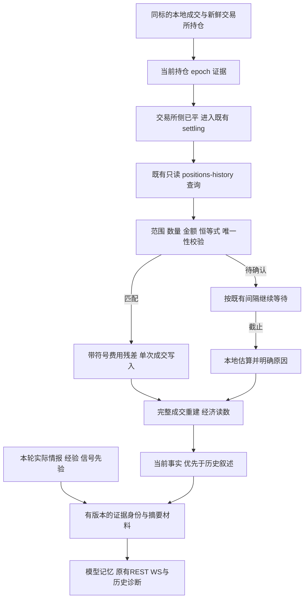

# AI 自动交易结算与决策证据完整性增量设计

> 版本：v2；日期：2026-09-07；迭代：2/3；节点：#1 方案评审与修复。
> 实施基线：`d199687c0c45e09719a18c25abc07112b415b83b`，并保留既有工作树修改。
> 下游按本文顺序实施，可使用 `superpowers:executing-plans`；本节点评审并修订设计，只修改本 spec，不修改业务代码，不提交 Git。

**目标：** 在第一轮多标的、成本和事实记忆修复之上，消除错误结算被采纳、合法费用调整被拒绝、恢复时持仓身份漂移和变化的决策证据被折叠的问题。

**架构：** 保留每标的独立 `AiTradeSession`、共享组敞口、现有确定性门禁和 `LiveExecutor`。为现有外部结算增加可验证的持仓范围，为现有摘要增加完整证据身份；所有新增状态经原有 REST、WebSocket 和历史快照传递。

**技术栈：** Next.js 14、React 18、TypeScript、Tailwind、Zustand、TanStack Query；Python 3.11、FastAPI、SQLAlchemy async、SQLite；Electron；pytest、Vitest。

## 评审记录

评审依据：第一轮 history、当前工作树、根目录 `CLAUDE.md` 与项目索引，以及 OKX 官方持仓历史及分页契约。以下“已修订”仅指设计正文，不代表下游代码已实现。对每一节核对可行性、完整性、一致性和范围；没有将历史测试通过数当成本次验证。

| 编号 | 等级 | 问题、证据与影响 | 正文修订及验收 | 状态 |
|---|---|---|---|---|
| RV2-01 | P0 | `_merge_members` 保留整块旧 runtime，普通 `patch_member_state` 丢弃新 runtime，而 authoritative patch 整块替换；只增加 `state_member_row` 无法持久保存观察值，贸然改覆盖又可能丢 pending/quota。离线探针确认新 context 被丢弃。 | §3.3、§5.2 明确按字段所有权合并、epoch 核对及事务写点；F29；A18/A31。 | 已修订 |
| RV2-02 | P0 | `settle_closed_offline` 缺行后仍继续 adopt flat；DB 遗留未闭合 open，后续新 open 会与旧 epoch 合并。仅写 offlineGap 不能维持会计连续性。 | §3.6 缺口阻断冷续跑，保留暂停契约和重试入口；无伪造成交或孤立新组绕过；A32。 | 已修订 |
| RV2-03 | P1 | `trade_client.get_position_history(after_ms)` 注释为“晚于”却发 `after`；官方 after 实为更早记录。离线探针确认实际参数。只收紧 matcher 会让离线结算持续缺失。 | §2.3、§3.6 改映射为 before，保留内部参数语义；明确单页覆盖边界；F30/F32；A33。 | 已修订 |
| RV2-04 | P1 | validator 的 bool 拒绝太晚：`_history_number(True)` 已变成 1.0；历史用 mgnMode，观察值用 marginMode。SWAP 非零 settledPnl 与“不适用”规则也冲突。 | §3.4 在原始适配边界拒 bool/非有限数，规定模式映射和不适用值；A01/A09/A34。 | 已修订 |
| RV2-05 | P1 | 秒级 cTime/uTime 构成唯一 key 会把同秒两次更新合并；query 未显式携带 tol、离线下界，未规定无关坏行、已认领行和有效候选并存的裁决。 | §3.3–3.4、§4.2 保留毫秒字符串身份，明确集合校验顺序、范围和 terminal 去重；F31；A35/A36。 | 已修订 |
| RV2-06 | P1 | 累计 closeAvgPx 直接写到最后增量腿，会把最后一腿成交价写错；热路径仍可能按官方全量 pnl 再累加。 | §3.5 共用数量、价格、费用、pnl 增量，单次传给交易与 realized 累加器；A12/A37。 | 已修订 |
| RV2-07 | P1 | “可信终结推进 seq”未明确 epoch 边界是否依赖费用完整；缺费不能让已经全平的仓与新仓合并。原 close 分支还有额度清理、峰值和学习等终结副作用。 | §3.6 明确结构闭合与金额完整性分开，先重建再赋值，所有终结消费者同源；A16/A38。 | 已修订 |
| RV2-08 | P1 | decide 深拷贝 payload，commit 只复用 frozen facts，其余 advisory 重新渲染；反思还有 experienceCounter/intelExpand。只复用 renderer 不能证明“实际发送”。 | §3.7 冻结请求来源与原文，重试不重取，反思扩展独立记账；F33/F34；A24/A39。 | 已修订 |
| RV2-09 | P1 | 当前运行支持 v3 不等于落库 finalSummary 由 v3 材料生成；重新摘要旧叙述可能把 legacy 标志洗掉。 | §3.7 分开生产能力版本与摘要来源版本，保留 legacy 和成功原子更新；A40。 | 已修订 |
| RV2-10 | P1 | 表格只有 fee_adjustment 内部名，公共 validation 没有 feeAdjustment/detailReason 宿主；卡片仅收 integrity，无法读取 trade meta。签名和结构字段也有未定义引用。 | §3.8、§4–5 补完整 wire、当前/历史恢复写点、DTO 与失败字段；A26/A41。 | 已修订 |
| RV2-11 | P1 | 4096 上限未规定序列化器、单位和省略回填算法；先按裸文本计算会被引号、换行及 JSON 转义突破。 | §3.7 按实际摘要 JSON 字符计数、固定算法和稳定 envelope；A23/A42。 | 已修订 |
| RV2-12 | P1 | “旧代码不得跨版本折叠”对旧二进制无约束力，且旧 matcher 仍弱校验；直接回退部署会重新启用已确认缺陷。 | §9 限制可回退构件，未兼容时保留暂停；A43。 | 已修订 |
| RV2-13 | P2 | 原文件清单漏状态 repository、底层 GET 客户端、原始持仓毫秒字段和冻结测试；Vitest DOM 断言不能证明真实窄栏几何。 | §6–8 补 F29–F34、命令和浏览器检查边界。 | 已修订 |
| RV2-14 | P2 | 原交付检查仍指向 node #0，正文“只新建”与评审任务不符；上游实测与本节点评审证据应分开。 | §2.4、§6、§10 更新节点、验证范围与交付声明。 | 已修订 |

逐节结论：§1–2 的增量目标及收益证据边界保留；§3–5 修正状态、会计、请求与传输契约后可在现有栈实现；§6–8 补齐实际写点与验收；§9–11 明确兼容回滚、节点交付和实施记录。范围仍限结算与证据完整性，不引入账单仓库、SQL 迁移、新下单策略或盈利承诺。

## 1. 概述

用户要求解决近期只有 SOL 成交、成本核算不可信以及 Agent 上下文影响交易质量的问题。第一轮已完成低价通道精度、逆势配额、订单接收回执、双腿费用和事实优先记忆，并提交了 `d199687`。本轮在这份实现上继续检查真实资金结果进入决策链的接缝。保留上一轮已经通过的多标的能力，补齐结算事实和上下文证据的剩余缺口，让每个标的的交易结果能够解释和重建。

本次确定性调查发现：`positions-history` 的严格归一结果进入旧结算匹配器后，又被零值兜底和弱身份判定破坏；合法负费用残差会被拒绝；`posId` 被错误地视为不可复用的往返身份。另一方面，当前事实指纹没有覆盖真正进入提示词的市场情报、经验和信号先验。结果可能同时表现为成本失真、错误学习和没有依据的重复观望。方案采用共享校验核心、当前持仓证据和版本化折叠条件，修复这些具体路径。

收益要求落实为可靠记账、成本来源可见、当前证据可追溯以及样本外净收益评估。功能完成不等于未来盈利得到保证；历史会计重算的改善不能解释为策略收益提升。各标的满足规则即可交易，只有 SOL 满足规则时允许只有 SOL 成交。组合预算、置信度、共识、成本、仓位和保护性退出的现有约束继续作为验收前提。

## 2. 调研基线、已完成工作与新增证据

### 2.1 项目和迭代边界

已阅读根目录 `README.md`、`CLAUDE.md`、`.claude-index/index.md`、本轮任务看板、迭代历史，以及第一轮的 `docs/plans/ai-trade-symbol-cost-context-integrity/spec.md`。README 开头的模拟交易 Phase 1 描述较旧；当前实现已经包含 AI 实盘会话、分组暂停恢复、成本门禁和持久化交易日志，以源码为准。

任务历史记录第一轮完成 58 项原计划及补充修复，最终审查报告后端功能集合 899 项、前端 2709 项通过。这些是上一轮记录，不冒充本节点测试结果。本节点没有重复规划低价精度模块、开仓身份协议、quota 锁或基础双腿归并器。进入本节点前已有日志功能等未提交源码，实施节点应逐文件核对并保留，不覆盖整文件、不批量暂存。

本次在 `2026-09-07 17:19 UTC` 只读探测本机 `127.0.0.1:18760`，服务不可达；未启动、暂停或替换服务。桌面 SQLite 以 URI `mode=ro` 打开，只查询 `strategy_runs` 与 `trades`。正确 mode 为 `ai-trade`；最初使用 `ai_trade` 查询为空，核对枚举后已纠正。最新成交锚为 `1788787800`，即 `2026-09-07 13:30 UTC`。锚前 12 小时开区间内只有 SOL 的 16 条成交腿，原始 `SUM(pnl)=-2.485110010000052`、`SUM(fee)=1.39491001` USDT。不得从该 pnl 合计再扣一次 fee，也不能用这个窗口证明修复版本已部署或收益已经改善。

### 2.2 新增发现

以下行号用于导航，实施时优先定位函数名。除特别注明外，结论来自当前工作树直接调用现有函数的离线合成输入，未调用真实交易端口。

| 编号 | 等级 | 事实及代码依据 | 影响与本轮处理 |
|---|---|---|---|
| S01 | P0 | `live_auto/settlement.py::_matches/match_settlement` 只检查标的、可选方向、posId、单侧时间窗和正价格；`_num(None)` 返回 0。`okx/trading.py::_history_amounts` 已正确保留 None，但下游重新抹掉未知。 | 缺 pnl/fee、非 USDT、未全平、恒等式不成立的行均可被接受。增加严格结算结果对象和共同校验。 |
| S02 | P0 | 本地 entryTs=1000、detectTs=2000、tol=60；行 cTime=100、uTime=2001、同标的同方向、closeTotalPos=999，现有 matcher 返回命中。 | 该输入证明旧时间窗不能证明本次持仓归属，不证明生产曾发生串账。增加实际持仓快照、数量覆盖和歧义拒绝。 |
| S03 | P1 | `executor.py::_poll_settlement` 的 `fact.fee_usd - entry_fee_usd < 0` 在总费 .2、已记开仓费 .5 时返回 `fee_residual_negative`。 | 合法返佣或估费偏高导致真实结算回落本地标记价；统一带符号残差和来源，不能简单删除守卫而不补身份验证。 |
| S04 | P1 | `executor.py::_settled_pos_ids/_claim_pos_id` 和 `settlement.py` 的注释将 posId 当单个生命周期唯一身份；官方文档说明最后一次全平后超过 30 天才过期。 | 相同 posId 的后续真实结算可能被旧认领状态拒绝。改为本地 epoch 与结算行复合身份。该项为源码与官方契约核对，未验证生产发生率。 |
| S05 | P1 | `decision_memory.py::_EVIDENCE_FIELDS` 缺少 `intel/experience/signalPriors`；`prompts.py::build_decision_prompt` 实际渲染三者。改变三段输入后指纹不变，`can_fold_rounds` 返回 True。 | 变化的外部证据被摘要当成相同 hold；新增证据版本、实际文本摘要和三段来源哈希。 |
| S06 | P1 | `resume.py::_adopt_group` 在离线补 close 后重读 continuity，只更新 executor 成交和 pnl，没有再次更新 `_position_seq`；旧 `_entry_wall_ts` 仅读顶层 wallTs，恢复后的墙钟位于 explain.meta。 | 恢复后的下一仓可能使用旧序号或 K 线开盘时间。统一恢复断面和当前 epoch 时间选择；以真实 SQLite 回归验证，不声称本节点已复现整个冷恢复场景。 |

直接探针输出为：`other_epoch_accepted=true`、`missing_amounts_accepted=true`、`missing_fee_coerced=0.0`、`missing_pnl_coerced=0.0`、`invalid_currency_partial_identity_accepted=true`、`negative_residual_reason=fee_residual_negative`、`changed_advisory_same_fingerprint=true`、`changed_advisory_foldable=true`。早期探针误导入不存在的 `SettlementPending`，已更正重跑；仅上述成功输出作为证据。

上游方案设计节点实际运行 `test_ai_trade_numeric_integrity.py` 与 `test_settlement_core.py`：**37 passed in 4.23s，退出码 0**。这证明现有价格尺度回归仍通过，也证明现有结算测试没有覆盖上述边界。pytest 输出了既有异步 loop scope 弃用提示。

### 2.3 外部接口依据

官方 `positions-history` 的金额关系包含手续费、资金费、清算费及结算调整；fee 的原始正号表示返佣。posId 有过期属性，不能单独代表一次本地往返；历史记录包含部分平仓类型，`closeTotalPos` 是累计已平张数。上述定义用于本方案的字段校验和去重设计。[OKX 官方 API 文档](https://www.okx.com/docs-v5/#trading-account-rest-api-get-positions-history)

官方分页规定 after 返回比 uTime 更早、before 返回更晚的记录，边界值不包含在结果内；当前客户端的 after_ms 内部语义是“晚于”，须映射到 before。采用这一修正是本项目的适配决定，不新增翻页循环。[OKX 官方分页说明](https://www.okx.com/docs-v5/trick_en/#pagination)

本文其余阈值、模块拆分和失败行为属于本项目的设计决策。没有将官方持仓级读数直接等同于某个 run 的已认证收益。

### 2.4 本节点评审证据

评审直接调用现有适配器、状态 merge 和 GET 客户端替身，得到 `bool_pnl_after_adapter=1.0`、`bool_fee_after_adapter=-0.0`、`same_second_identity_collides=true`、`snapshot_context_persisted=false`，且 after_ms=1234000 实际发送 `after=1234000`。探针退出码 0，结果已登记 runlog；没有访问交易账户或下单。§2.2 的 37 项测试属于上游设计节点。本节点完成时只将实际运行的文档检查与离线探针作为评审验证，不声称下游功能测试已通过。

## 3. 技术方案与执行顺序

### 3.1 方案选择

| 方案 | 取舍 | 决定 |
|---|---|---|
| 在现有结算链加入归属与金额验证，在现有记忆链补证据身份 | 直接覆盖 S01–S06；复用成交和 JSON 契约；不增加 LLM 调用 | 采用 |
| 全量引入交易所逐笔账单仓库、重写收益历史 | 可以支持更细对账，但需要新的同步、分页和迁移状态机 | 后续独立需求，本轮不引入 |
| 调整提示词要求更多币种交易、降低开仓阈值 | 无法修正结算或证据丢失，会改变真实资金风险 | 不采用 |

### 3.2 总体时序



已有的行情、共识、趋势、成本、反思、仓位、开仓身份与执行顺序保持第一轮契约。新增校验只决定外部结算能否被视为匹配事实，不新增下单、撤单或强制轮转交易。收尾等待沿用当前 settling 的既有上限；保护订单由原有路径维护。

### 3.3 当前持仓证据与复合身份

新增 `live_auto/settlement_identity.py`，包含不可变 `SettlementContext` 及纯内存 `SettlementIdentityTracker`。在 `AiTradeSession.__init__` 已知 runId 且完成 executor 接线后，调用 `executor.configure_settlement_identity(IdentityConfig)`；配置聚合 accountId/runId/instId/tickSz/marginMode，以及现有 tol/deadline 设置的只读引用；账户与 run 内部沿用既有整数类型，只在身份 canonical_json 内规范为十进制字符串。该方法只在 `settlement_fn` 已装配时创建实例，普通 executor 默认 None。所有金额和数量使用未舍入有限值；稳定 ID 保持字符串，不转换为浮点。进入 settling 时深拷贝 context，后续观察不能改写在途结算的提问范围。

本地 epoch 的身份是 `(accountId, runId, firstOpenEventKey)`：`firstOpenEventKey` 优先使用 `accountingEventId`，恢复旧记录使用数据库 `Trade.id`；没有稳定 ID 的旧持仓返回 `identity_unavailable`。它不取墙钟、轮号或当前 Python 对象 id。后续部分开仓属于同一个 epoch。可信已平数量消耗完整持仓才结束 epoch；这是数量与方向的结构性边界，不要求费用或收益已知。缺费的完整 close 仍关闭 epoch，但经济 coverage 保持未知。当前执行器不新增部分平仓协议。

tracker 在 `_record_trade` 完成 `open_attempts.decorate_trade` 后记录原始增量；以事件身份幂等消费。维护当前 epoch 的总开仓张数、已平张数、加权开仓价、已记各腿费用和来源，不另存完整历史成交副本。恢复时在 `restore_trades` 裁剪 UI 台账前消费完整数据库列表；派生量不写第二份权威数据库列。

从 `reconcile` 已读取的持仓列表采集交易所身份，落点在 `_on_reconcile_ok` 检测消失之前，零新增网络请求。只在下列条件全部成立时更新观察值：当前自管有仓、沿用 _positions_taken_wall 与 _snapshot_outranks_last_write 判定读数新鲜（未知来源时间不认证身份）、只有一条同 instId/立场/保证金模式的非零仓位、数量与自管剩余量一致、均价与自管均价在交易所 tick 容差内。未知数量、冲突账户范围或多条候选使本 epoch 的 `ownershipConflict=true`，冲突在该 epoch 内不可被下一次正常快照抹去；先消费已有 fill grace，不把交易所短暂未同步误记为永久冲突。

观察值保存 `posId/cTimeS/uTimeS/exchangeCTimeMs/exchangeUTimeMs/posSide/marginMode/observedAtTs`；不可由模型或本地交易价格推测 posId。`accounts._normalize_position` 与历史适配器均在转浮点前保留原始毫秒时间为规范十进制字符串；外部既有秒级字段不变，新增 Ms 字段仅为精确身份，不参与 UI 时间显示。缺失或非法原始时间为 null，禁止由截断后的秒数乘 1000 伪造精度。

在 `runtimeIntegrity.settlementContext` 保存上述不可重建观察、epochKey、schemaVersion、ownershipConflict；版本另存于 runtimeIntegrity.settlementStateRevision。写点是 reconcile 消费观察后、释放成员执行锁前调用 session 的异步持久化接线；纯同步 tracker 不执行 IO。首次观察、身份变化、冲突、新 epoch 重置及进入 settling 的冻结断面都经此写点确认。新 epoch 显式以新 epochKey 的空观察替换旧 context，最终无仓可写 settlementContext=null；runtimeIntegrity.settlementStateRevision 是独立单调整数，context 为空仍保留，不能靠省略键清除。

`ai_trade_state_repositories._patch_member` 在原组写锁下按字段所有权合并 runtime：开仓事务只更新 pendingOpenAttempt/pendingTrades/adoptedOrder/entryQuota 等现有键；结算观察 patch 只更新 settlementContext；缺席键保留，显式 null 才清空。检查 accountId/runId/instId 及 expectedEpochKey/expectedSettlementRevision（旧状态的比较值），在同一事务接受新 epoch/context 并递增 settlementStateRevision；迟到 patch 拒绝，不覆盖新仓或较新观察。revision 不由墙钟计算，冲突后重读并在成员锁内重新评估；不能原样重放旧观察。session 统一组装 patch，不能继续用 `{**state_member_row(), runtimeIntegrity: integrity}` 整块替换。普通心跳/组快照保持原先不覆盖事务状态的纪律；初次 authoritative patch 负责真正落盘，不能指望 `_merge_members` 写入新 context。`state_member_row` 仅展示当前已持有状态；`_state_position_snapshot` 只回填同 epoch 已知 posId。

观察保存失败保留内存事实并沿原 `_execution_state_persist_failed` 保护阻断新开仓、按已有节拍重试，保护性减仓不被关闭；不得给未落盘状态标记 durable。暂停成功必须等在途结算观察和 pendingTrades 保存完成；未完成时保留恢复入口并报告失败。

冷恢复优先读取同 account/run/epoch 的 settlementContext，并用当前持仓评估结果复核；旧状态没有该键时，暂停契约 posId/openCTime 只作 legacy 候选线索；仍有仓时用本次新鲜交易所读数补全毫秒身份，且必须与完整本地未平 epoch 对得上。已离线全平且仅有截断秒级身份时返回 identity_unavailable，不将它升级为精确匹配。无法证明归属继续原有缺口路径，不能用最新一条同币种历史代替。新开仓重置观察值；另一个账户、run、标的不能继承。

### 3.4 唯一结算校验核心

在 `settlement.py` 定义 `validate_settlement(rows, query, claimed, now_ts) -> SettlementValidation`。现有 `match_settlement` 保留薄兼容包装，返回 validation.fact；保留其 claimed/tol_s 关键字，并将 tol_s 传入新 query，未知 context 必须返回 None，不能回退弱匹配。生产调用方迁往 validator，以保留失败信息。`SettlementQuery` 的原四字段 inst_id/direction/entry_ts/detect_ts 保留，新增 context、tol_s、mode=hot/offline、paused_ts；accountId/runId/epochKey 从不可变 context 读取，不能引用不存在的 query 字段。所有新字段提供安全默认值，未知 context 不能给出 matched。validator只产生matched/pending/unavailable/already_claimed，调用方在deadline显式转local_estimate；身份永久缺失可用unavailable描述，但热路径仍遵守原deadline，不立即写估算。claimed 是该 run 已持久化记录的 `settlementKey -> {epochKey, accountingEventId}` 映射，包含旧事件 alias 索引。

运行/冷恢复调用方在创建新的结算提问前，先用冻结 epochKey 查询完整 DB 的已持久结算事件；若该 epoch 已结构闭合，恢复其连续量并返回 already_claimed，不要求已清空的 tracker 重造 context，也不经过“remainingQty必须>0”的新成交校验。单纯在 claimed 中找到同posId不能走此终态。未落库但位于 pendingTrades 的固定事件先沿已有重放通路落库，再做这个检查。

校验先核对 context，再按 row.instId 严格等于 query.inst_id、非空 posId 精确相等筛出本次候选。其他标的/posId 的坏行只计排除数，不能抢占本次 reason；每个候选独立完成以下检查，任意一条无关坏行不能遮掉唯一有效行。所有候选失败时按下面固定优先级汇总首个 reason，输入行顺序不改变结论。

按固定顺序校验，首个失败作为 reason，多个不同有效候选作为 ambiguous：

1. scope：context 的 accountId/runId/instId/epochKey 与装配会话一致，row.instId 必须相等；context 不存在或 ownershipConflict 时分别返回 `identity_unavailable/ownership_conflict`。抓取函数只能使用该 account 的既有凭据，不从历史 row 虚构 runId。
2. 产品与闭合：本轮只采纳 USDT 结算的 SWAP；归一行必须 `instType=SWAP`、`currency=USDT`、`closed is True`。部分平仓、其他计价币、未知产品返回明确不支持原因。普通 live_auto 的无 settlement_fn 路径不改变。
3. 归属：row.posId 与观察值相等，row.exchangeCTimeMs 与观察的原始毫秒身份完全相等。历史 mgnMode 显式映射 marginMode，必须是 cross/isolated 并与 config/观察一致。观察 posSide 必须为 long/short/net；历史 direction 若明确 long/short 必须同向。历史不保证提供 posSide，不得将缺失该字段当成无条件拒绝；有值时须与观察一致。direction 缺失或 net 仅在其余强身份完整、且新鲜观察以带符号 pos 或 long/short posSide 证明本地方向时允许。缺失模式、方向证据不足均为 identity_unavailable。
4. 时间：原始 cTime/uTime 必须为有限正整数毫秒，uTime 不早于 cTime，并严格晚于最后一次非零持仓观察的 exchangeUTimeMs；同一时间粒度无法证明先后的行继续 pending。用于窗口的秒数由原始整数派生，uTime 不晚于 now_ts+tol，也不早于 firstOpenWallTs-tol；hot 下界为 detect_ts-tol，offline 为 paused_ts-tol，均与其他下界取 max。tol 使用既有 ai_trade_settlement_match_tol_s，检测及恢复时间来自真实墙钟；缺暂停时间不能取 0 放开离线窗口。没有开仓墙钟时 timeBasis=legacy，必须依靠完整毫秒观察身份和最后非零观察之后的时间；禁止用 K 线时间伪装墙钟。
5. 数量与价格：要求 `closeTotalPos > 0` 且等于本地本 epoch 总开仓量；本地待补平量必须等于总开仓量减已可信采纳 close 量，且大于零。数量容差 `max(abs(a),abs(b))*1e-9`；价格必须有限正数，openAvgPx 与本地加权均价允许 `max(tickSz,abs(localAvg)*1e-8)` 差。不得用 closeTotalPos 的 max 值或当前仓位非零推测完整归属。缺 tickSz 时仅用相对项，缺本地均价则不匹配。
6. 金额：pnl、fee、fundingFee、liqPenalty、settledPnl、realizedPnl 均须 finite，bool 不算金额，允许合法 0 和负 fee/fundingFee。归一恒等式 `realized=pnl-fee-funding-liq+settled` 的残差须不超过 `max(1e-8,1e-6*max(abs(realized),abs(pnl),abs(fee),abs(funding),abs(liq),abs(settled)))`。任何缺失不经 `_num` 转 0。
7. 唯一性：定义 settlementKey=sha256(canonical_json([accountId,instId,posId,exchangeCTimeMs,exchangeUTimeMs,closeTotalPos,direction,marginMode]))。ID/毫秒为规范字符串，数量采用适配后统一的规范十进制表达，1 与 1.0 相同；direction 取已证实的本地方向，不能将缺失历史字段拼成不同 key。相同 key 的校验相关金额、数量、价格、type 和模式完全相同则去重，不比较 fetch 时间等诊断元数据；同 key 的这些内容冲突返回 conflicting_duplicate。同 epoch 多个不同有效行返回 ambiguous。其他 epoch 的已认领行先排除，不挡当前唯一有效行；只有同 epoch/同 key 已有持久事件、且无未认领有效行时返回 already_claimed。既有旧 offline alias 必须同时匹配本 run、epoch 归属及时间，不能全局仅按 posId/uTime 串联。

不能仅以 posId 在集合中出现过就拒绝新 row。同 posId 的另一 uTime/数量/本地 epoch 必须重新做全套归属验证；这既支持复用，也不保证复用就应接受。认领 key 从已落库 close meta 全量重建；运行期先暂存于当前 settling，成交进入现有持久化成功通路后再作为已完成认领。失败仍使用相同事件身份重试，不能另造一次 close。already_claimed 是恢复/核对既有事件的终态，重读同一 DB 事件后同步连续量并清等待，不得等待到 deadline 再生成 local_mark。若持久事件不能对应当前 epoch 则返回 ownership_conflict 并保持保护，不能凭已认领字符串吞掉当前仓。

归一层 `_normalize_position_history` 保留 closeTotalPos/openMaxPos/posSide/type，并将 mgnMode 加法映射为 marginMode，保留旧 mgnMode 供既有消费者读取。金额、数量、价格、时间在最初原始值边界拒绝 bool、NaN/Inf、对象和非法字符串；保留 amountSources/invalidFields 以区别 missing_amount 与 invalid_amount，不能在适配后让两类都变为无来源的None；尤其 `_history_number` 必须在 `_optional_float` 前拒 bool。合法数值字符串和真实 0 保留，validator 仍对单测/内部直传进行契约校验。

settledPnl 空字符串或缺失仅在明确 instType=SWAP 时置为 0 并记 amountSources.settledPnl=not_applicable；实际为 0 可标 exchange，非零、bool 或非有限值不能当成“不适用”，返回 invalid_amount。此规则不得推广到 FUTURES。其他五项缺失全部保留 None；币种缺失不由 symbol 字符串单独补成 USDT。currency 确认为其他币种返回 unsupported_currency，缺失返回 currency_unknown。

### 3.5 结算金额、费用残差和来源

原始腿不可回写。用已匹配本 epoch 的官方总额形成待补 close：

```text
F_residual = exchange_fee_total - sum(booked_local_leg_fees)
P_trading_net_total = exchange_pnl - exchange_fee_total
P_local_basis_total = exchange_pnl                  # run costBasis=gross
P_local_basis_total = P_trading_net_total            # run costBasis=net
P_close_increment = P_local_basis_total - sum(booked_local_close_pnl)
Q_close_increment = local_total_open_qty - local_closed_qty
V_booked_close = sum(booked_local_close_qty * booked_local_close_price)
Px_close_increment = (exchange_close_avg_px * exchange_total_closed_qty
                      - V_booked_close) / Q_close_increment
```

数量单位统一为合约张数；价格单位 USDT，累计价量残差不乘 ctVal，pnl 是官方 USDT 金额，不能再乘合约面值。全部本地已记 close 的 qty/price/pnl/fee 必须可验证；均价公式的分子、分母和结果必须有限且结果为正，否则 pending/increment_invalid。trade meta 的 priceBasis 在没有历史 close 时为 exchange_position_average，有历史 close 时为 exchange_aggregate_residual；后者是根据累计均价和本地已记价反推的增量，不称逐笔实测成交价。此来源同时进 settlementValidation 的安全简报。没有历史 close 时增量价格等于官方 closeAvgPx；已有 4 张 @110、官方累计 10 张均价116 时，待补 6 张的价格为120，不能写116。核对剩余数量与暂停/执行器剩余投影相等；本轮不实现历史补差后新开仓加仓的任意调仓协议。

`resolve_settlement_increment` 只在 validator matched 后调用一次，返回 Result（increment 或失败 reason）；热路径的合成 trade.price/qty/pnl/fee 与 `realized_pnl_usd += increment.pnl` 使用同一实例，不能继续调用旧 `_settlement_pnl(fact)` 加上整笔官方总额。持久化重试只重写这条固定事件，不再改变内存盈亏、计数或学习。离线补记也使用同一核心。

残差可以小于 0。例如毛额 10、官方总费 .2、本地开仓估费 .5，新增 close.fee=-.3；净口径 close.pnl=9.8，原始两腿总费=.2，`gross-fee=net`。该 -.3 表示本地费用调整，不能展示成已测得的该平仓腿返佣。若所有已记腿费用来源为 measured，残差来源为 measured；只要含 estimated，新增 close.feeBasis=estimated，meta 使用统一对象 `feeAdjustment={kind:aggregate_residual,exchangeTripFeeUsd:.2,bookedLocalFeeUsd:.5,residualFeeUsd:-.3,feeBasis:estimated}`；不另造一套平铺 feeAdjustmentKind 键。缺少任一本地已记费用则不能凭 0 得出残差。

真正官方总费为 -.1 的完整匹配往返，毛 10 的交易净额是 10.1；费率符号只在 OKX 适配层取反一次。不使用 abs、非负 clamp 或 `fee > 0` 作为完整性条件。`_poll_settlement` 删除旧 residual_negative 否决，替换为 validation；`_synthesize_external_close` 的 override_fee_usd 与 meta 来源必须一致。`FeeLedger.on_trade` 为调用方增加来源 override 输入，通过聚合对象避免继续增加平铺参数；其他调用方默认行为不变。

官方交易净额不减资金费或清算费；`exchangeNetAfterFundingUsd=exchange_pnl-exchange_fee_total-exchange_funding`，`exchangeRealizedPnlUsd` 保留官方原值。仍使用第一轮 `TradeAccountingAccumulator` 和经济快照核心，不建立第二套收益计算器。新 meta 的 validation 是来源证据，不能越过 `comparisonCoverage` 将整个 run 自动标为官方完整覆盖。

### 3.6 运行、离线和异常路径

热运行 `_poll_settlement` 使用同一 validation。没有可用 row、金额尚未齐全、歧义或网络错误时保留 settling，按既有 poll interval 再查，到 deadline 才按既有 local_mark 路径结清。临时坏行不能触发立即降级。最后一次 validation.reason 写入诊断。已确认持仓恢复非零的原有幻影取消路径仍优先。

deadline 的本地估算必须 `settlementValidation.status=local_estimate`、`priceBasis=local_mark`，并保留缺失/冲突原因；不能标为官方成交或已核实盈利。不为改善完整率而不断延长等待，也不新增轮询调用。离线恢复没有可信 row 时沿用 `_mark_offline_gap` 保存原因，不生成零价、零量或零收益交易；同时抛现有 `AiTradeResumeBlocked`（blockedReason=settlement_unresolved），本次整组不启动。不能在数据库仍有未闭合旧 epoch 时 adopt flat 后开放新仓。下一次既有 resume 请求重新只读核验；找到完整结算或已持久化事件后才恢复。超出可查询窗口仍标缺口，不能新建组绕过本份暂停契约。此项是会计连续性保护，不是提高/降低策略开仓阈值。

`resume_cold_group` 必须将 `_adopt_group` 纳入与启动同一失败清理范围，解除未启动实例的 W5 回调、释放其本地资源，不发送 flatten/新订单，不将原组写成 ended/running，不改变 resumedCount。部分成员已成功持久补记的 close 保留，重试按稳定事件去重；其他成员不产生新交易。

历史客户端 `get_position_history` 保留 after_ms 这个内部“严格晚于”的参数名与调用语义，改为发送 OKX before；其现有调用方一并检索，不能倒置调用者的时间范围。离线查询边界采用 max(0, paused_ts-tol_s)*1000-1（再夹到非负），以覆盖同秒边界，validator 再按精确毫秒与时间窗筛选。保持单页且不新增请求：默认 limit=50，允许上调到既有最大100但本轮不增加分页状态机；缺目标行仍为 not_found 并报告 queryCoverage=single_page。即使找到唯一候选，显示也只是“返回候选中与本次持仓匹配”，不认证完整历史覆盖。任何满页或保留窗口缺口不得伪装成全历史无其他候选。下游用 GET 替身核对 before 方向、边界与调用次数。

`resume.settle_closed_offline` 不再用 `next(posId相同)` 选行，按完整 epoch 和暂停快照构造同一 query。`_offline_exit_trade` 只接收通过校验的 fact/context，价、量、费用和 pnl 都来自共同增量核心；`_offline_exit_meta` 使用 `settlementKey` 形成稳定 accountingEventId。兼容旧 `offline:{posId}:{uTime}`，必须证明旧事件属于当前 run 的同 epoch，才只读取而不补记；秒级 alias 存在歧义时不猜测。离线写入复用 `trade_persistence.append_trade_once`，不能继续用读取全表后直接 append_live_trade 的独立去重通路；调用位于既有 manager 准入锁内，热路径位于成员执行锁内，单进程约束不变。

`_adopt_group` 在离线补记、再次 rebuild_continuity 后统一调用 `restore_member_continuity`：恢复 executor.trades、realizedPnl、成本池、remaining fee、完整 `_position_seq` 和 tracker；然后接管持仓、恢复 pending、播种模型摘要。该顺序不能把第一次重建的旧 seq 留给新仓。rebuild_continuity 和 tracker 均按整数 DB id 排序；会计核心识别的结构完整 close（数量闭合且非 duplicate/invalid）才推进 epoch 序号，不以 close 腿数计数，也不以经济 coverage=complete 作前提。未知金额保留未知，禁止 `or 0` 补齐。remainingOpenFeeUsd 取第一轮归并器当前剩余费池，不再每见 close 清零；总开仓费、剩余开仓费及已记全腿费是不同字段，按各自用途传递。

`AttributionLedger.restore_accounting` 与 session 热路径使用同一次 `accounting.last_result` 的 complete/duplicate 判定。session 的 close 分支先调用 _cost.record_close，再读取结果：只有结构闭合才推进 seq、清 knownClOrdIds、消费峰值和触发 horizon/sizing/experience/intel 的“往返终结”；部分 close 仅记该腿并更新敞口，不提前终结。普通全额 close 的行为不变；不能为得到判据重复喂同一 trade。缺费的完整 close 推进身份但不产生“收益已完整验证”标签。当前部分 close 不扩展到真实订单协议。

恢复辅助函数统一读取 `trade.wallTs -> explain.meta.wallTs -> 缺失`，选择本 epoch 第一笔可信开仓墙钟，不选择最后一笔部分成交。恢复交易所观察值时检查 epochKey；不因 schemaVersion 缺失猜测身份。零开仓费和负开仓费传给经验 adopt_open，删除 `entry_fee > 0` 对来源完整性的错误替代。

### 3.7 Agent 证据身份、摘要和兼容

保留 `DecisionFacts.schemaVersion=2`，新增独立 `evidenceVersion=3`，放在 DecisionFacts 和 RoundDecisionRecord 顶层，不能只藏在 advisoryEvidence 内。`build_decision_facts` 的字段投影明确加入 settlementValidation 简报与三段 evidenceHashes，避免由 `_FACT_FIELDS` 手抄列表丢弃。新的证据哈希覆盖现有字段、runId，以及完整 `intel/experience/signalPriors` 三段 wire。三段 advisory 使用完整规范 JSON，不对其递归删除 `ageS/updatedTs` 等键，避免把时效越界折叠成未变；普通行情字段继续原有去墙钟噪声处理。哈希只出摘要身份，不把外部文本变成确定性事实或门禁指令。

prompts.py 增加薄纯函数 `build_advisory_evidence(payload)`，复用 _format_intel/_format_experience/_format_signal_priors；规范哈希、预算和冻结结构放新模块 advisory_evidence.py，不复制渲染逻辑。该新模块不反向导入 prompts，避免循环依赖。返回每段 sourceHash/renderedHash/renderedChars/text、enabled/omitted 和总 evidenceVersion。sourceHash 来自完整 wire，renderedHash 来自本次 renderer 全文；空渲染不等同于用户关闭，enabled 取本次有效输入是否启用，关闭来源明确 null，已启用但无条目保留空文本的 hash。

会话在最终payload组装完成、最后一次build_session_facts及保存_round_facts之前，一次性准备三段wire、渲染文本及runId/instId/round/bar身份；facts.evidenceHashes从这份快照产生，factsHash只在字段齐全后计算。decide深拷贝并锁定同一快照，禁止为advisory再改一份与session._round_facts不同的factsHash。旧回测/直接调用未传快照时，由decider在首次发送前补建并通过其既有_with_round_facts传播；这条兼容分支不得影响会话已冻结事实。build_decision_prompt 在原三个位置直接使用这份冻结全文，保持先验→战绩→经验→情报原顺序，不用摘要预算裁掉实际请求。首次发送、同轮重试和深度追问共用同一基础快照，禁止 commit 从调用方可变 payload 重算 advisory。瞬时 hint/追问后缀仍只进入当次 finalUserText，不能混入长期 context；采用既有 last_request_shape 的实际请求 hash，不用“摘要文本相同”代替实际请求重建校验。

decider 保存只属于该 run/round 的冻结快照，commit 和 RoundDecisionRecord 深拷贝读取；若本轮实际请求未发出或身份不匹配，记录 evidenceUnavailable=true、sent=false，不从上一轮补证据。反思以同一基础快照构造，但 experienceCounter/intelExpand 是反思阶段的新材料，在发送反思前独立冻结并记为 reflectionEvidence；不能声称它们与最初决策三段相同，也不能回填首次请求的 hashes。journal 已有反思 payload 保存完整实际请求，摘要只在反思材料有预算时加其摘录，缺失/省略则禁止该轮折叠。重试失败、未采纳追问和取消保持既有次数及控制流；任何附加记录不新增 LLM 请求。

decider.commit_round 将此冻结证据的有界摘要副本写入 journal 和 RoundDecisionRecord.advisoryEvidence；facts 只存三个 hash、evidenceVersion、settlementValidation 简报，不把 advisory 全文塞进 8192 字符必要事实预算。原文只在当轮请求快照存在，其长期副本受预算限制。

摘要材料总包（advisoryEvidence 加可选 reflectionEvidence）设 ADVISORY_SUMMARY_MAX_CHARS=4096，单位为 Python Unicode 字符。先构造保留所有 hash/状态/字符数、text=null 的固定元信息；再依次尝试 intel、experience、signalPriors 以及反思附加材料整段回填。每次用 `json.dumps(envelope, ensure_ascii=False)` 与 build_summary_prompt 完全同样的实际序列化器计数（包括空格、转义、键和外围结构），最终必须 <=4096；不能按裸文本长度、UTF-8 字节数或紧凑 canonical_json 长度冒充。超过预算的段保留 text=null/omitted=true/renderedChars/sourceHash/renderedHash，不截字符串。固定元信息自身超限返回有界 evidenceUnavailable 信封及原因；不能把超限长 source ID/raw wire 再塞回信封。任何省略或不可用都不折叠，但不触发 factsUnavailable 或拦截合法交易。既有 journal 轮数上限、摘要失败退避和 context 裁剪保持，不能为了降低成本偷偷移除必要事实。

`can_fold_rounds` 同时要求：两轮 evidenceVersion=3；runId/instId/bar 完全一致；原有真实 hold、无 veto、无执行副作用判据；现有 evidenceFingerprint 相同；三段 sourceHash/renderedHash 相同；无 evidenceUnavailable/omitted。缺版本和 v2 历史一律保留，不能将旧哈希解释成新哈希。相同字数或相同情报 ID 但文本、可信状态、样本数、方向先验变化必须不折叠。

摘要指令明确：sourceHash 变化不证明市场结论改变；材料省略表示证据不足；外部资料仅供参考且不得改写系统/工具规则；没有事后价格或结算不得写“观望已证明正确”。外部 text 仅作为 JSON 字符串序列化，不提升为 message role/system 指令。第一轮 facts 优先、gateVeto 保留、失败保留旧 summary 仍成立。

memory.evidenceVersion 表示当前决策生产能力3；新增 memory.summaryEvidenceVersion 表示当前 finalSummary 的证据来源版本，没有摘要时为 null。seed_from_snapshot 增加 keyword-only evidence_version=None，读取持久的 summaryEvidenceVersion，而非当前能力字段；仅 facts_version==2 且 evidence_version==3 且旧 legacyNarrative 不为 true 时可标为非 legacy。缺失、v2 或未来未知版本都保持 legacyNarrative。一次摘要成功后，text/asOfTs/summaryEvidenceVersion/legacyNarrative 同步更新并进同一既有 metrics 快照；失败或取消全部保留前值。摘要沿用了旧 summary、含任何 legacy/证据省略轮时继续 legacyNarrative=true、summaryEvidenceVersion=null；不能只因“新代码生成”将旧证据升级为3。允许以既有清摘要操作重新积累完整 v3 材料，但本轮不自动丢弃历史来洗掉标志。journal 关闭仍维护内存摘要；开启时沿用 payload、contextTurn 和 prompt hash 验证，不改审计导出协议。

### 3.8 多标的与产品呈现

本轮不改变标的选择器。保留 BTC/ETH/SOL/DOGE/SATS 五成员独立决策与共享 `GroupExposureBook`，新增 tracker、claim、advisoryEvidence 都由单会话持有，不能使用模块级可变字典。相同 posId 字符串出现在另一账户、标的或 run 不互相屏蔽；相同情报编号在不同标的也不共享哈希缓存。

`integrity_view.build_integrity_snapshot` 增加 `settlementValidation` 的最后一次简短状态，memory 增加 evidenceVersion/summaryEvidenceVersion。`build_session_facts` 在必要事实中携带状态、reason 和 key，不塞原始交易所行；失败原因来自服务端枚举。主 diagnosis 的 pending 开仓、市场不可用、持仓管理优先级保持既有行为，结算质量在详情独立展示，不把历史一次失败长期覆盖“正常研判”。

integrity_view.memory统一调用decider.memory_wire()，避免另写summaryEvidenceVersion默认值；恢复和metrics使用同一数据来源。

snapshot 的 settlementValidation 只包含最后一次校验的安全简报和可空 feeAdjustment；epochKey/settlementKey/asOfTs 明确它属于哪笔历史结算。新仓建立时清除“当前 pending”，历史最后结果可以保留但必须标为“上次结算”，不能当作当前仓已 matched。恢复时从完整 close meta 取同 run 最新已持久结果；pending 从当前 settling/tracker 取得（每次poll更新最后reason与时间，节流不覆盖），REST/WS/metrics 统一经 integrity_view 装配。feeAdjustment 从同一条成交 meta 复制，字段为 kind/exchangeTripFeeUsd/bookedLocalFeeUsd/residualFeeUsd/feeBasis，不从卡片可见成交列表重算。费用调整缺失仍为 null；未知零与已知0区分，类型与明细同步 F12/F13。

现有 `IntegrityCard` 的展开区增加“结算依据”和“上下文证据版本”两行；local_estimate 文案为“本地估算：{服务端原因}”，matched 为“本次持仓匹配通过”，旧数据为“旧记录未提供校验结果”。费用调整显示“往返费用调整”，不写“手续费返现”。沿用设计 token、Tabular 数字和 details/summary 的键盘行为，200/240px 侧栏与 360px 详情不增加横向页面溢出，不增加弹窗或新的顶层入口。

## 4. 接口设计

### 4.1 现有传输接口的加法字段

| 方法与路径 | 本轮契约 |
|---|---|
| `GET /api/ai-trade/status` | 各成员原有 integrity 中增加可空 settlementValidation（含 feeAdjustment）、memory.evidenceVersion/summaryEvidenceVersion；顶层结构不变。 |
| `WS /api/ws/ai-trade/{session_id}` | 原 status/snapshot 的 integrity 与 REST 同形；trade.explain.meta 带 settlementValidation 和 feeAdjustment。 |
| `GET /api/ai-trade/history/{group_id}` | 从已持久化 aiStats.integrity/trade meta 读取新增字段；旧记录缺失保持缺失。 |
| 前端 BFF `/api/py/*` | 继续使用既有代理，不新增路由或超时常数。 |

不新增用户可写设置、下单接口或产品 CLI。本文验证命令为开发流程命令。所有展示时间保持秒级 UTC；exchangeCTimeMs/exchangeUTimeMs 仅为内部持仓与成交 meta 的毫秒身份字符串，公共 integrity 不输出原始持仓行。新增 source/event ID 保持字符串，既有 accountId/runId 的数值 wire 不改。未知 reason 前端显示服务端 message 或“原因暂不可得”，不解析中文反推枚举。

### 4.2 内部接口签名

```python
IdentityConfig(account_id, run_id, inst_id, instrument, policy)
SettlementIdentityTracker(context_config)
tracker.record_trade(trade) -> None
tracker.observe_position(observation) -> ObservationChange | None
tracker.restore(trades, persisted_observation) -> None
tracker.context() -> SettlementContext | None
tracker.claim(persisted_claim) -> None
executor.configure_settlement_identity(identity_config) -> None
validate_settlement(rows, query, claimed, now_ts) -> SettlementValidation
resolve_settlement_increment(fact, context, cost_basis) -> IncrementResolution
build_advisory_evidence(payload) -> AdvisoryEvidence
build_advisory_summary(frozen_evidence) -> dict
restore_member_continuity(member, continuity, contract) -> None
```

IdentityConfig.instrument 聚合 tickSz/marginMode；policy 聚合 tol/deadline 既有配置。ObservationChange 包含 expectedEpochKey/expectedSettlementRevision 和下一份 context，由 session 异步保存。SettlementQuery 是配置结构而非继续堆平铺函数参数；IncrementResolution 包含 status/reason/increment，失败时 increment=null。tracker.claim 的输入带 epochKey/settlementKey/accountingEventId，只有成交持久化成功回调或全量 DB 重建可以调用。

新增/抽取函数遵守 CLAUDE 的 5 参数、50 行、圈复杂度10和80列约定，新增模块不超过800行。现有 session/executor/prompts/resume 等历史超长文件不被宣称合规：只保留必要薄接线，新实现下沉到列出的职责模块；若下游需拆分超长方法，先按 F27 记录其最小范围，不能在本轮顺带重构整个会话。本文仅修改设计，不变更 CLAUDE 阈值或擅自修改其配置。

## 5. 数据模型和持久化

### 5.1 结构定义

| 结构 | 字段与语义 |
|---|---|
| SettlementContext | schemaVersion=1；accountId/runId（沿用原类型）、instId、epochKey；direction、marginMode、posSide；posId、exchangeCTimeMs、exchangeUTimeMs（精确字符串）、cTimeS、uTimeS、observedAtTs；firstOpenWallTs、timeBasis；totalOpenQty、closedQty、remainingQty、entryAvgPx、tickSz；bookedFeeUsd、bookedClosePnl、bookedCloseQtyPrice、feeBasis；ownershipConflict。无观察的字段为null。缺必要归属/金额时不匹配；派生值从完整成交重建。 |
| SettlementValidation | schemaVersion=1；status=`matched/pending/unavailable/local_estimate/already_claimed`；reason、detailReason、message、asOfTs、epochKey、settlementKey、identityBasis=`observed_position/paused_position/unknown`；amountCoverage=`complete/partial/unavailable`；queryCoverage=single_page；priceBasis=`exchange_position_average/exchange_aggregate_residual/local_mark/unknown`；feeAdjustment可空；fact 仅内部持有，不出公共快照。matched 的 reason/detailReason=null，其 amountCoverage=complete 不代表整个run完整。 |
| SettlementFact | 延续当前 pos_id/close_px/gross_pnl_usd/fee_usd/funding_usd/liq_usd/close_ts，增加 settlement_key、realized_pnl_usd、settled_pnl_usd、total_closed_qty、open_avg_px、close_ctime_ms/close_utime_ms 和 amount_sources。仅 validator 可创建可采纳实例。 |
| SettlementIncrement | qty、price、pnl、fee、price_basis、fee_basis、fee_adjustment、accounting_event_id；fee_adjustment 写出时统一变为 feeAdjustment，内部 source fee_basis 统一变为 feeBasis；以 `settlement:{runId}:{epochKey}:{settlementKey}` 唯一标识 close 事件。 |
| AdvisoryEvidence | evidenceVersion=3；runId/instId/round/bar、sent；sources 包含 intel/experience/signalPriors，每项 enabled/sourceHash/renderedHash/renderedChars/text/omitted；evidenceUnavailable；serializedChars；reflectionEvidence可空。关闭来源 enabled=false/sourceHash=null/renderedHash=null/text=null/omitted=false，和已启用空文本、预算省略区别。 |
| FeeAdjustment | kind=aggregate_residual；exchangeTripFeeUsd、bookedLocalFeeUsd、residualFeeUsd（有限带符号数）；feeBasis=measured/estimated。该形态用于 trade.explain.meta.feeAdjustment 和 integrity.settlementValidation.feeAdjustment。 |
| SummaryMemory | factsVersion=2、evidenceVersion=3、summaryEvidenceVersion=3或null、legacyNarrative、summaryAsOfTs；summaryEvidenceVersion只在全部输入有证据、且无legacy来源的成功摘要时为3。 |

reason 枚举固定为：`identity_unavailable`、`ownership_conflict`、`unsupported_product`、`currency_unknown`、`not_closed`、`identity_mismatch`、`time_mismatch`、`quantity_mismatch`、`invalid_price`、`missing_amount`、`identity_failed`、`conflicting_duplicate`、`ambiguous`、`not_found`、`already_claimed`、`fetch_failed`、`deadline_exceeded`、`invalid_amount`、`unsupported_currency`、`increment_invalid`。matched 的 reason=null。先按 §3.4 的候选集合规则排因，deadline 状态 reason=deadline_exceeded，detailReason 保留最后一次实际校验失败；未取得候选为 not_found，网络失败为 fetch_failed；节流未发请求不覆盖旧 reason。fetch_failed 的 message 经既有脱敏，不把原始响应、凭据或 Python 异常正文交给模型/UI。结算缺口阻断恢复的 settlement_unresolved 属恢复 blockedReason，不混入 validator 的 reason。

### 5.2 数据库边界

无需 SQL 迁移。`trades.explain_json.meta` 保存 settlementValidation、settlementKey、accountingEventId、费用来源及调整字段；原有 Trade.fee/pnl 仍沿用该 run 的 costBasis。`ai_trade_group_states.members_json[].runtimeIntegrity.settlementContext` 只持久化不可重建的观察值、epochKey、schemaVersion 与冲突标记，旁路 settlementStateRevision 保存事务版本；数量/费池从 trades 重建。原有 pendingOpenAttempt、entryQuota、adoptedOrder 及未知 JSON 键必须全部保留。

run.metrics_json.aiStats.integrity 保存快照。结算 key 认领集合从完整本 run 的 close meta 重建，不能依赖 200 条归因缓存或 executor 裁剪后的显示台账。SQLite 仍只支持一个持有该会话的进程；运行内使用已有成员执行锁与组状态锁顺序。新逻辑不得持有组状态锁做网络调用。失败重试沿用既有 `_unpersisted_trades` 和固定事件身份；本轮不另建消息队列。

旧成交仅按原始来源解释，不批量回写错误历史。没有 v1 settlementValidation 的旧净额仍保留其既有历史显示，并单列“未校验”，不自动提升为 measured。不将资金费缺失填成 0，也不因为修好了部分新结算就宣称全部历史资金费覆盖完整。

## 6. 文件 / 模块变更计划

本节点评审实际只修改本 spec；以下为下游允许实施的完整清单（F01–F34）。文件标注“修改”均已核对存在；新增文件应按目标名创建。测试中需要对旧弱契约做有说明的替换，保留原来有效的场景断言。

| 序号 | 操作 | 文件 | 唯一意图 |
|---|---|---|---|
| F01 | 新建 | `services/quant/app/live_auto/settlement_identity.py` | 当前 epoch、持仓观察、范围冲突和认领身份的纯内存组件。 |
| F02 | 修改 | `services/quant/app/live_auto/settlement.py` | 严格校验结果、复合 key、金额恒等式、共享残差核心和来源 wire。 |
| F03 | 修改 | `services/quant/app/okx/trading.py` | 历史保留数量/模式/type，明确 SWAP 不适用 settledPnl 的来源。 |
| F04 | 修改 | `services/quant/app/live_auto/executor.py` | tracker 接线、新鲜持仓观察、结算重试及固定事件身份，替换 posId 黑名单。 |
| F05 | 修改 | `services/quant/app/live_auto/fee_ledger.py` | override 费用的真实来源透传，保留带符号聚合调整。 |
| F06 | 修改 | `services/quant/app/ai_auto/resume.py` | 离线共用 validator，完整二次恢复、epoch 墙钟和零/负费用来源。 |
| F07 | 修改 | `services/quant/app/ai_auto/session.py` | 观察变更的异步事务写点、revision重试、持久化成功认领、统一结构终结副作用及冻结证据接线。 |
| F08 | 修改 | `services/quant/app/ai_auto/decision_memory.py` | evidenceVersion=3、三来源完整哈希、严格折叠和 record 字段。 |
| F09 | 修改 | `services/quant/app/ai_auto/prompts.py` | 复用 advisory renderer 的薄包装与固定请求快照；明确摘要证据缺失和未验证边界。 |
| F10 | 修改 | `services/quant/app/ai_auto/decider.py` | commit/journal/summary memory 传递实际证据及版本。 |
| F11 | 修改 | `services/quant/app/ai_auto/integrity_view.py` | REST/WS/历史/当前facts 共用结算简报与证据版本。 |
| F12 | 修改 | `apps/web/lib/aiTradeIntegrity.ts` | 新增可选结构、来源和原因显示兼容。 |
| F13 | 修改 | `apps/web/components/Agent/aiTradeStats/IntegrityCard.tsx` | 既有展开区展示结算依据、费用调整与证据版本。 |
| F14 | 新建 | `services/quant/tests/test_settlement_identity.py` | epoch/账户/标的隔离、复用、观察冲突和全量恢复测试。 |
| F15 | 修改 | `services/quant/tests/test_settlement_core.py` | 匹配完整性、歧义、符号和不适用字段测试。 |
| F16 | 修改 | `services/quant/tests/test_external_close_settlement.py` | executor 实际接线、截止降级、返佣、幂等与网络调用数。 |
| F17 | 修改 | `services/quant/tests/test_ai_trade_fill_truth_wiring.py` | 新身份范围和原有非 AI 隔离的接线契约。 |
| F18 | 修改 | `services/quant/tests/test_ai_trade_resume_cold.py` | 真实 SQLite 二次重建、残差补记和旧 JSON 保留。 |
| F19 | 修改 | `services/quant/tests/test_ai_trade_economics_integrity.py` | 毛净恒等式、返佣及来源与完整费池对拍。 |
| F20 | 修改 | `services/quant/tests/test_ai_trade_fee_ledger.py` | measured/estimated override 来源和负数/零费用。 |
| F21 | 修改 | `services/quant/tests/test_ai_trade_memory_integrity.py` | 三来源变更、预算、v2/v3、标的隔离与真文本记录。 |
| F22 | 修改 | `services/quant/tests/test_ai_trade_prompts.py` | 原文顺序、纯渲染、摘要指令及关闭来源行为。 |
| F23 | 修改 | `services/quant/tests/test_ai_trade_integrity_api.py` | REST/WS/历史/持久化往返可空字段和数据同源。 |
| F24 | 修改 | `services/quant/tests/test_ai_trade_journal_prompt_rebuild.py` | 新证据下实际请求重建与旧日志兼容，不放宽漂移判定。 |
| F25 | 修改 | `apps/web/lib/aiTradeIntegrity.test.ts` | 未知版本、缺字段、结算来源与费用调整文案。 |
| F26 | 修改 | `apps/web/components/Agent/aiTradeStats/IntegrityCard.test.tsx` | 显示、键盘、长原因及 null/零/负数区别。 |
| F27 | 修改 | `docs/plans/ai-trade-settlement-evidence-integrity/spec.md` | 下游评审记录及有证据的最小方案修订。 |
| F28 | 修改 | `services/quant/app/ai_auto/attribution.py` | 恢复epoch按基础归并器的结构终结推进，金额缺失不改变已证实的仓位边界。 |
| F29 | 修改 | `services/quant/app/db/ai_trade_state_repositories.py` | runtime 按字段所有权合并，检查旧epoch/revision并更新；保留pending、quota和未知键。 |
| F30 | 修改 | `services/quant/app/okx/trade_client.py` | after_ms内部“晚于”契约正确映射OKX before，不新增分页循环。 |
| F31 | 修改 | `services/quant/app/okx/accounts.py` | 归一持仓保留精确毫秒身份，既有秒字段及公开账户API形状不变。 |
| F32 | 新建 | `services/quant/tests/test_settlement_history_transport.py` | 原始bool/非法数、模式与时间适配，实际GET before参数和边界方向。 |
| F33 | 新建 | `services/quant/app/ai_auto/advisory_evidence.py` | 不含IO的证据冻结、哈希、实际JSON预算与摘要版本辅助；不反向导入prompts。 |
| F34 | 新建 | `services/quant/tests/test_ai_trade_advisory_snapshot.py` | 实际决策/重试/反思/commit请求快照、转义预算与旧摘要来源回归。 |
| F35 | 修改 | `services/quant/app/ai_auto/manager.py` | IMP2-01/02：价格步长及50条单页装配，暂停未决回执传输。 |
| F36 | 修改 | `services/quant/tests/test_ai_trade_execution_receipts.py` | IMP2-03：已知非USDT币种按真实来源断言。 |
| F37 | 新建 | `services/quant/tests/test_ai_trade_resume_settlement.py` | IMP2-05/10/11：独立承载真实SQLite冷恢复、故障重试及纯资源清理。 |
| F38 | 修改 | `services/quant/tests/test_ai_trade_pause_identity.py` | IMP2-06：精确毫秒内部键契约。 |
| F39 | 修改 | `services/quant/tests/test_ai_trade_session.py` | IMP2-07：真实开仓会计夹具与v3字段回归。 |
| F40 | 修改 | `services/quant/app/ai_auto/accounting_replay.py` | IMP2-11：未知开仓费估算投影不进入认证收益及恢复累计值。 |

源码调查显示现有 API 使用通用 integrity 字典，store 保留整块 integrity；这些文件不因新增两个可选字段而重复修改。若实际验证发现某个 Pydantic DTO 或手抄映射会过滤新增键，实施节点必须先在 F27 记录具体字段、文件和最小补充，再修改并增加传输回归。不能以“兼容”为由将 null 改成 0。新增实施逻辑限于 S01–S06 及本节点评审发现的必要接线缺口；不借由清单扩展策略或账户产品功能。

## 7. 实施步骤

1. 记录 dirty 基线，核对 F01–F34 路径。为 S01/S02/S03/S04 写反向行为测试，先运行验证它们因当前行为而失败，不能以导入错误作为有效红测试。
2. 完成 F01–F05/F29–F32：先修原始适配与GET方向，再纯身份/金额核心和executor事务接线。对真实执行器替换交易端口，检查本轮不增加 POST/GET 次数，原无 settlement_fn 路径输出不变。
3. 完成 F06/F07/F28：真实 SQLite 写开仓、暂停契约、离线补 close，关闭会话重新构造；检查 DB 行数、费用、seq、认领 key 与下一仓。持久化失败测试必须经过真实事务和故障注入，不能 mock 掉整个 repository。
4. 为 advisory 文本变化写失败用例，完成 F08–F10/F33/F34，验证首次请求、commit journal、摘要材料、重试和反思读取同一实际文本；不增加 LLM 调用。
5. 完成 F11–F13 及传输、UI 回归。在已有模拟数据场景检查 200/240px 侧栏与 360px 详情，长 reason 可以完整展开。
6. 运行 §8 的相关集合、类型检查和构建；全量回归按下游节点任务执行。先前因子测试基线失败必须有逐项对照，不能直接算本轮通过。记录净收益验证为独立结果。
7. 逐文件审阅 diff，确认未涉及真实订单和无关工作树。回写本文件实施发现、验证输出与风险，由后续 Review 节点处理提交；本方案节点不执行 git commit。

## 8. 测试与验收标准

### 8.1 行为验收矩阵

| 编号 | 输入或操作 | 必须得到的结果 | 文件 |
|---|---|---|---|
| A01 | 缺 pnl、缺 fee、NaN/Inf、bool 金额 | 不产生 matched；未知不变成 0。 | F15 |
| A02 | 非USDT、未知 currency、partial type=1/4/5 | 不认领；price 为正也不能绕过。 | F15 |
| A03 | 六金额完整，但 identityGap 超容差 | identity_failed；实际重算不信任外部传来的 gap=0。 | F15 |
| A04 | S02 的旧cTime/999张数，或另一run同币种行 | 归属/数量失败，不写入本run。 | F14–F16 |
| A05 | 两条满足弱时间窗的不同结算候选 | 必须用身份范围排除或返回 ambiguous，不能取最早。 | F15 |
| A06 | 同 key 重复页，及同 key 不同金额 | 相同内容去重；不同内容 conflicting_duplicate。 | F15 |
| A07 | 同 posId 的下一 epoch，另一 uTime 的有效结算 | 可以重新匹配；同一 key 重复回调只记一次。 | F14/F16 |
| A08 | 不同账户/标的/组有相同 posId 字符串 | tracker 和 claimed 相互隔离。 | F14 |
| A09 | SWAP settledPnl 空，其他金额齐全 | 仅该项按 not_applicable=0；缺 fee 仍失败。 | F15 |
| A10 | Fopen=.5、官方Ftotal=.2、G=10，gross/net各一次 | close.fee=-.3；往返 F=.2、N=9.8；来源estimated，不称该腿实测返佣。 | F16/F19/F20 |
| A11 | 完整实际返佣总费-.1；真实零费 | N=10.1/10；符号和来源在恢复后保持。 | F18–F20 |
| A12 | 多段open及已记close，官方累计结果补最后增量 | qty/pnl/fee只补差额；两腿核心恒等式成立，原行不修改。 | F18/F19 |
| A13 | 第一次缺费、第二次完整；以及全部超时 | 前者等待后匹配；后者原deadline回落local_estimate并带原因；无新增高频请求。 | F16 |
| A14 | settling中仓位重现、保护close已结清 | 幻影取消及单次结清保持原行为，不重复下平仓单。 | F16/F17 |
| A15 | 多段open墙钟不同，DB ts为K线开盘秒 | 使用最早本epoch meta.wallTs，不能用末段或跨epoch记录。 | F14/F18 |
| A16 | 冷恢复先读open、离线补close、再开新仓 | 第二次continuity赋完整seq；成本池为新仓独立状态。 | F18 |
| A17 | 结算成交写入前/后故障，再恢复同一事件 | 实际SQLite最多一个close；计费与认领不重复；新open仍受原持久化失败保护。 | F16/F18 |
| A18 | 两成员并发patch、pause和heartbeats | settlementContext、pending、quota及未知JSON键均保留。 | F18/F23 |
| A19 | 仅改变intel文本/可信状态/引用，价格不变 | evidenceFingerprint不同；两轮不能折叠。 | F21 |
| A20 | 仅改变experience条目文字/样本或signalPriors净方向 | sourceHash不同；rendered改变时renderedHash也不同。 | F21 |
| A21 | 同文本但来源状态/时效变化，或跨run/币种相同文本 | 不因文本相同跨范围折叠；完整 wire 变化被记录。 | F21 |
| A22 | 完全相同v3证据真实hold；v2/缺版本；veto轮 | 前者允许折叠，后两者保持独立；第一轮所有veto约束继续成立。 | F21 |
| A23 | 三段长文本超4096预算 | 整段省略且hash/字符数保留，摘要标证据不足，不进行该轮折叠。 | F21/F22 |
| A24 | 请求→commit→summary→重试→journal重建 | 三段原文、来源和hash对应实际发送payload；无额外LLM调用。 | F21/F22/F24 |
| A25 | 摘要失败、历史错误结论、当前相反事实 | 当前facts仍优先；没有事后数据不输出程序认证的正确/盈利标签。 | F21/F22 |
| A26 | REST首载→WS更新→重连→历史详情 | 相同范围同字段一致；unknown/null不过滤、不转零。 | F23/F25 |
| A27 | 200/240px卡片、360px详情、键盘展开 | Vitest检验内容与键盘；实际浏览器验证无横向页面溢出、完整原因和费用调整来源可读。 | F26及浏览器检查 |
| A28 | BTC/ETH/SOL/DOGE/SATS分别有合法信号和充足预算 | 五标的均可被执行器接收；价格尺度、当前图表和成员顺序不影响资格。 | 既有numeric/execution_receipts集合 |
| A29 | 只有SOL满足规则，其余合法被拦截 | SOL可交易，其余有真实reason；不为了平均交易放宽阈值。 | 既有execution_receipts/integrity集合 |
| A30 | settlement_fn=None、情报/经验关闭、旧API无新增键 | 普通live_auto、回测执行结果和旧UI兼容；回测可使用新记忆版本但不装配结算IO，没有额外交易/网络调用。 | F17/F21/F25 |
| A31 | 实际SQLite普通patch、authoritative patch、两成员交错、旧revision迟到 | 观察确实落库；pending/quota/未知键保留；旧epoch不能覆盖新epoch；保存失败阻止新开仓但不关保护减仓。 | F18/F23/F29 |
| A32 | 离线已平但缺行/缺身份/缺费，随后重试取得有效行 | 首次组保持paused，无新会话start、无新open、无假close；重试只补一次并恢复；已补成员不重复。 | F18 |
| A33 | after_ms=1234000，目标uTime分别早于/等于/晚于边界；GET替身 | 发before=1234000而非after；严格“晚于”；含tol的秒边界由validator二次筛；单页缺口如实标注。 | F32/F18 |
| A34 | 原始bool数值、缺模式、不同模式、SWAP非零settledPnl | 适配前拒bool，mgnMode映射一致；不得将非法非零或bool当成not_applicable=0。 | F15/F32 |
| A35 | 同秒不同毫秒两次结算、缺原始毫秒、历史缺posSide | 精确key不碰撞；缺精确身份不matched；历史缺posSide可按§3.4强身份和方向证据判定。 | F14/F15/F32 |
| A36 | 无关坏行/旧已认领行与唯一新有效行并存；同epoch已认领 | 行排列不影响结果；无关行不遮挡有效行；already_claimed恢复已有事件，绝不deadline补第二条。 | F15/F16/F18 |
| A37 | 本地4张close@110，官方累计10张均价116；剩余6张 | 最后一腿price=120；pnl/fee补差，热realized只加增量；非法分子/价格返回increment_invalid。 | F16/F18/F19 |
| A38 | 一部分close、重复close、缺费但完整close，随后新open | 部分/重复不推进seq、不消费终结副作用；缺费全平推进边界且coverage未知；新仓费池独立。 | F18/F19 |
| A39 | decide后修改调用方intel，重试/未采纳追问/反思扩展/commit | 初始三段沿用冻结证据；反思扩展另记；未发请求与取消不复用上一轮；模型请求数量不增加。 | F21/F24/F34 |
| A40 | 旧finalSummary+新v3能力、旧摘要再摘要、失败/取消 | summaryEvidenceVersion不冒充3；legacy保留；失败不更新任何摘要来源字段。 | F18/F21/F34 |
| A41 | 有feeAdjustment的matched/local_estimate，经重连/历史恢复 | integrity含同一成交的安全feeAdjustment与归属、detailReason；不从UI环形缓存计算；旧数据不升级。 | F23/F25/F26 |
| A42 | 引号、反斜线、换行、中文/emoji长文本和恰好4096字符 | 以实际summary JSON序列化计数<=4096，保留整段或省略；metadata超限有界且不可折叠。 | F21/F22/F34 |
| A43 | 选择旧matcher/不识别v3的构件回滚 | 不允许恢复交易；保留暂停及JSON证据。兼容构件须通过S01–S06和新增验收才可恢复。 | 版本及发布证据检查 |

货币恒等式使用未舍入核心值、绝对误差不超过 `1e-9` USDT；适配器公布精度另用显式上界，不通过降低精度掩盖误差。低价回归继续覆盖 `1e-8/1e-5/.1/100/60000` 和多空两侧。验收 A28/A29 属功能验证，不代表真实市场每个币种必须成交。

### 8.2 下游验证命令

从仓库根目录每行独立运行；不使用 PowerShell 5.1 不支持的 &&。这些完整命令供实施后执行；§2.2 的37项基线属于上游，本节点评审验证见§2.4及文末结论。

```powershell
services/quant/.venv/Scripts/python.exe -X utf8 -m pytest services/quant/tests/test_settlement_identity.py services/quant/tests/test_settlement_core.py services/quant/tests/test_external_close_settlement.py services/quant/tests/test_ai_trade_fill_truth_wiring.py services/quant/tests/test_settlement_history_transport.py -q
services/quant/.venv/Scripts/python.exe -X utf8 -m pytest services/quant/tests/test_ai_trade_resume_cold.py services/quant/tests/test_ai_trade_economics_integrity.py services/quant/tests/test_ai_trade_fee_ledger.py services/quant/tests/test_ai_trade_integrity_api.py -q
services/quant/.venv/Scripts/python.exe -X utf8 -m pytest services/quant/tests/test_ai_trade_memory_integrity.py services/quant/tests/test_ai_trade_advisory_snapshot.py services/quant/tests/test_ai_trade_prompts.py services/quant/tests/test_ai_trade_journal_prompt_rebuild.py services/quant/tests/test_ai_trade_numeric_integrity.py services/quant/tests/test_ai_trade_execution_receipts.py -q
pnpm --dir apps/web exec vitest run lib/aiTradeIntegrity.test.ts components/Agent/aiTradeStats/IntegrityCard.test.tsx
pnpm --dir apps/web exec tsc --noEmit
pnpm --dir apps/web build
```

A27另用实际浏览器打开既有测试数据界面，量取200/240px侧栏与360px详情的 scrollWidth/clientWidth，验证键盘展开及长原因可完整读取；Vitest/jsdom无布局计算，不能用其通过冒充几何验收。浏览器不可用则该项记未验证，不能宣称UI验收完成。

每个验证产生一条 runlog result，保存退出码、用例数和失败清单。测试临时 SQLite 与报告放工作目录内；不要打开真实凭据表或操作在线会话。调试网络错误使用替身，不把合成行情展示成真实生产证据。

### 8.3 收益与可靠性的独立验收

实施后先用同一份不可变交易原始腿输出旧/新会计结果、调整原因和覆盖分母；这只验证会计一致性。再按预先固定的真实 K 线窗口与模型输入做回放或纸上跟踪，记录成交数、毛额、双腿手续费、资金费覆盖、交易净额、费用占比、最大回撤和各标的未成交原因。

候选策略评估至少覆盖 50 个完整往返及 14 个 UTC 日期块；不足标为 inconclusive，不补造样本。所有标的同一 UTC 日聚合后再做日期块 bootstrap，固定 seed=43603、重采样次数=2000，报告组合日净额均值的 95% 区间与缺资金费样本比例。含资金费证据缺失时只报告交易净额区间，并禁止把它称为完整成本净收益。区间包含 0 或整体负收益即未通过收益目标，不能通过提高杠杆或增加交易次数改变测试门槛。

本节点不执行新交易、不进行长时间收益实验。下游功能验收可以完成，收益验证必须独立保留通过/失败/证据不足，不能用单次盈利代替统计证据。

## 9. 风险、上线与回滚

| 风险 | 缓解和明确边界 |
|---|---|
| 严格匹配降低官方结算命中率 | 展示具体缺口；复用既有持仓观察获取身份；保持有上限的local_estimate回落。覆盖率下降不作为撤销数据校验的理由。 |
| posId复用与历史聚合范围混淆 | 本地epoch、posId、观察cTime、数量、均价与复合结算key共同约束；歧义不采纳，孤儿历史不假装完整。 |
| 负费用调整被误当盈利来源 | 聚合残差单独命名，保持estimated/measured来源；原始费用不重写。 |
| 当前版本已包含旧错误摘要和旧结算 | 旧记录标未校验，当前facts每轮优先；不进行无证据批量修史。 |
| 摘要折叠减少导致成本增加 | 4096字符材料上限、既有消息数量上限与摘要退避继续生效；无额外LLM请求，测量实际字符增长。 |
| 保存身份失败或并发覆盖 | 使用现有组锁/事务与失败保护，真实SQLite重启及并发回归；pending身份不得清空。 |
| 普通交易产品意外受AI逻辑影响 | tracker只在AI settlement_fn装配时存在；非AI无新增字段与副作用。 |
| 当前生产服务未运行，无法证明部署版本 | 文档明确证据窗口；下游仅在安全运行流程部署后采样，不能把历史样本当修复后样本。 |

上线先后固定为离线回归、模拟/测试执行器验证、只读历史对照、原有部署与暂停恢复流程。正在有 unknown 开仓或未持久化成交时不能替换进程或创建新组绕过状态保护。回滚前保存现有状态并完成在途核对；回滚不删除新增 JSON 键和交易 meta。只允许恢复已验证兼容该状态、保留严格金额/身份校验和版本折叠规则的构件；d199687 的弱 matcher 与只看旧指纹的二进制不能作为可继续实盘的回滚目标。没有兼容构件时保留暂停，先修复或以前滚方式恢复；不可声称给旧进程加一句“不得折叠”就能改变其行为，也不虚构尚不存在的摘要折叠开关。收益验证未完成不阻塞文档交付，但必须独立列证据不足，功能完成不等于允许宣称盈利。

## 10. 设计交付检查

本节点评审完成标准：本文版本v2，顶部含评审记录、文末含评审结论；P0/P1全部在正文修订；F01–F34与A01–A43互相对应；文件路径和范围检查通过，只修改本spec、不提交Git。上游探针、本节点评审证据和待实施测试分别标明。完成报告指向本文件，100%只表示设计评审完成，不代表代码实现、部署或收益达标。

报告最后执行任务工具 complete 并检查 success=true，随后 status 确认 index=1 的状态为 completed。下游在§11补充有证据的实施发现；不能重复把第一轮已完成的价格精度修复列为待开发工作。

## 11. 实施过程发现的方案缺陷

### IMP2-01：执行器缺少交易所价格步长的装配入口

`AiTradeSession` 与 `LiveExecutor` 均未保存 tickSz，实际值仅存在
`manager._build_executor` 的 `config.instMeta`；其历史查询仍固定 limit=20，
与 §3.6 的单页50条契约不一致。为落实 F01/F07，最小增加 F35：修改
`services/quant/app/ai_auto/manager.py`，将 instrument 元信息传给执行器并将
已有查询改为 limit=50，不新增网络调用。对应 A04/A13/A30/F17。

### IMP2-02：暂停收尾的原有提前估算与统一截止契约冲突

`executor.drain_settlement` 原实现在暂停时无条件提前 local_mark，违反
§3.6 热路径坚持原 deadline 的要求。保持一次有超时的只读查询，未到
deadline 且尚无可信结果时保留 settling，由 session 报暂停尚未完成并保留
恢复入口；不延长 deadline、不关闭保护订单。对应 A13/A17/A31。

`manager.pause_group` 原实现不读取成员收尾失败，必须在保存暂停契约后检查
成员新增 `persistencePending` 回执并返回既有 409 错误类型。该接线并入 F35；
成功暂停不可早于观察与成交保存，失败时组仍为 paused 且原持仓断面保留。
成交合成异常同样不能强制清空 projected：保留固定 settling 供原节拍重试，
仅实际生成成交后推进覆盖计数和 realized。对应 A17/A31/A32。

`flatten` 在只读drain后若仍未决，必须直接返回pending失败并保留恢复入口，
避免沿原流程再发平仓单；官方证据随后完成结算时清除此临时失败回执。

### IMP2-03：旧币种断言与原始来源契约冲突

`test_ai_trade_execution_receipts.py` 的7个参数化用例将已知BTC币种期望为
None；§3.4 要求保留BTC以区别 unsupported_currency 与 currency_unknown。
增加 F36，最小修改该测试的币种断言，保留金额及覆盖率原断言。对应 A02/A34。

### IMP2-04：反思审计并未保存完整实际请求

`journal.records` 原字段只有输入payload与reflection分析，不含实际反思
user文本/hash；仅从commit时可变payload重建不能证明请求同源。在 F10 增加
只读冻结payload接口，在 F07 审计装配时取该副本，并以加法字段保存反思
实际文本/hash与独立材料，继续沿用现有审计容量和导出协议。对应 A24/A39。

### IMP2-05：冷恢复测试文件容量不足

F18 原文件约760行，加入必需的结构终结、真实SQLite结算重试和二次恢复
矩阵后已超过800行。增加 F37：新建
`services/quant/tests/test_ai_trade_resume_settlement.py`，只承载本轮新增的
结算冷恢复矩阵；F18 保留原场景与严格契约替换，不借此整理其他旧测试。
对应 A12/A16/A17/A31/A32/A36/A38/A40。

### IMP2-06：旧持仓适配键集合需同步精确时间契约

`test_ai_trade_pause_identity.py::test_added_keys_are_exactly_three` 冻结了
归一层仅新增posId/cTimeS/uTimeS的旧集合，F31有意增加两个内部毫秒身份键。
增加 F38：仅同步该测试的内部键集合及测试名称，保留公共响应模型过滤规则
和旧秒字段断言。对应 A35/A30。

### IMP2-07：会话测试绕开会计开仓事实

扩展会话回归157通过、4失败。其中三项保护退出夹具只赋执行器projected，
没有向共用会计核心记录open；旧断言因此要求孤立close结束epoch。增加 F39：
最小更新`services/quant/tests/test_ai_trade_session.py`的持仓夹具，使开仓数量
与会计流一致，孤立第二条close不消费峰值；同步v3工具结果的新增字段。
不放宽结构终结规则。对应 A24/A38。

### IMP2-08：摘要总包身份与字符计数的明确落点

AdvisoryEvidence/ReflectionEvidence 各保存 runId/instId/round/bar；三个来源
沿用现有 renderer 名称直接放在信封的 intel/experience/signalPriors 键下，
不另造冗余sources副本。advisoryEvidence.serializedChars 为整个
`{advisoryEvidence, reflectionEvidence?}` 经实际摘要JSON序列化后的字符数，
包含该数字自身的位数，使用固定点计数；折叠比较scope及完整来源哈希，
不比较轮号或字符计数字段。对应 A21/A22/A42。

### IMP2-09：未知费池恢复后保护性退出必须仍可计算

`executor.entry_fee_usd` 恢复为None后，原开仓增量执行None+fee，
`FeeLedger.net_close_pnl/net_unrealized` 执行float(None)，会在已发生交易或
保护退出时异常。F04累计规则改为未知继续未知；F05在执行投影中使用既有
费率与当前价格估计未知开仓费用，成交明确标pnlBasis=estimated、
entryFeeBasis=unknown。原始开仓腿、剩余费池及经济coverage仍为未知，
不将估算回写权威费用，不以0兜底、不新增交易调用。对应 A11/A18/A30/A38。

### IMP2-10：恢复失败清理误入运行终结流程

冷恢复失败调用 `stop(resume_failed, flatten=False)` 原本仍会收尾结算、写
run终态及覆盖metrics。F07在该失败路径只取消本地任务、关闭本地资源，保留
paused数据库契约和原成交，供重试恢复；F37使用实际stop和SQLite验证无
结算、无订单、无run终结。对应 A17/A31/A32。

### IMP2-11：未知累计损益不能阻断结构落账或升级为已知收益

恢复出的realizedPnlUsd=None会在执行器累加、会话净值/阈值/指标中触发异常。
F04与F07保留None，照常完成真实平仓结构，不合成累计净值或触发未知阈值。
未知净值时仍更新敞口；单腿保护继续使用显式估算投影。

IMP2-09新增的pnlBasis标记必须有经济消费者：增加 F40，最小修改
`services/quant/app/ai_auto/accounting_replay.py`，将标明开仓费未知的估算
close.pnl排除出认证交易净额与胜率样本，原始成交投影金额不重写。
F19/F23/F16补覆盖，防止未知历史完整平仓后仍为旧持仓，或估算净额被当作
完整成本收益。对应 A11/A18/A38。

### IMP2-12：停止后的结算重试缺少推进步骤

停止在原deadline前保留settling后会取消monitor；再次stop原只重试成交写库，
不会再drain或同步观察，即使后续官方行可用也永久停留未决。F07的已停止
重试在同一执行锁内先drain、同步观察，再flush并决定是否终结；不发送
交易订单。F23验证截止前仍保留、后续官方证据到达后可完成。对应 A13/A17/A32。

## 评审结论

**通过。** 本节点评审共列出14项关注点（2项P0、10项P1、2项P2），均已直接修订正文，并同步为34项文件计划、43项验收。现有栈可实现该增量方案；无未解决的P0/P1设计问题。

本结论仅批准设计进入代码实施。离线契约探针已完成并归档；文档版本、评审条目、文件计划/验收编号、路径和修改范围以本节点最终校验记录为准。未修改源码、未运行git commit，未执行实盘交易。下游须完成§8功能验证与§9兼容发布检查；净收益仍按独立统计证据判定，当前不宣称达标。

## 12. 第二轮代码实施交付记录

以上评审结论保留为上游设计记录。本节记录代码实施结果：F01–F40均已落盘，
其中F35–F40按§11先登记缺口再实施；没有新增依赖、没有运行git commit，
没有部署、替换生产进程或执行真实交易。

### 实施结果

- 官方结算按账户、run、标的、epoch、精确毫秒、持仓模式、数量与六金额
  恒等式校验；缺证据保留原因，热路径只在原deadline后估算，冷恢复保留暂停。
- 热路径与冷恢复共用累计残差核心；负费用调整保留原始来源。完整数据库
  重放、稳定事件身份和真实SQLite事务恢复防止重复平仓或计费。
- 观察按字段所有权和revision持久化；写失败阻止新开仓。部分平仓不结束
  epoch，未知金额不阻断已经证实的结构闭合，也不生成已知净收益。
- 模型决策、重试、反思、commit与审计共用实际冻结材料；v3来源哈希、
  身份、4096字符实际JSON预算和旧摘要版本共同约束折叠。
- 完整性卡片展示结算缺口、费用调整及记忆版本，兼容旧数据与未知值。

### 最终验证

| 项目 | 本节点实际结果 |
|---|---|
| 后端联合回归 | 30个相关测试文件，855 passed，122.97秒，退出0；含§8.2全部后端集合和新增恢复/暂停/停止/日志回归。 |
| 前端组件与适配 | Vitest 19项通过，TypeScript检查退出0。 |
| 浏览器布局 | Chrome实测200/240/360px，clientWidth等于scrollWidth，子元素横向溢出数0；Tab、Enter、Space及长原因展开通过。 |
| 项目构建 | `pnpm --dir apps/web build`退出0，完成编译、类型检查、静态页面生成和构建追踪。 |
| 静态检查 | 35个Python文件Ruff通过、AST解析通过；新增核心模块满足文件800行/函数50行约束，diff空白检查通过。 |
| 事务故障 | 真实SQLite覆盖观察UPDATE失败、成交INSERT前及COMMIT后故障；恢复只补一个close并保持费用/epoch一致。 |
| 范围 | 对照开始时1768文件哈希，实际修改/新增40项，均属F01–F40，无文件删除；原有其他未提交工作保持原样。 |

联合测试输出保留了1条`CostRuntime._maintenance_round`未await警告，以及
`_FakeSession`缺少experience的后台任务异常；用例均通过，但本记录不将
该次执行描述为零告警。未扩展修改这两处既有测试/后台任务模块。

### 会计对照与收益边界

同一份不可变合成成交腿分别送入d199687和当前归并器，原始数据哈希保持
一致。该对照是功能验证，不能计入真实收益样本：

| 输入 | 旧结果 | 新结果 | 覆盖分母 |
|---|---|---|---|
| 开仓费0.5、平仓聚合残差−0.3、毛额10 | 总费0.2、净额9.8 | 总费0.2、净额9.8 | 两版净额样本均1/1，保留已有正确会计结果。 |
| 开仓费未知、平仓净额9明确标为估算投影 | 净额9、胜率100% | 净额null、胜率null，结构仍完整闭合 | 新版净额样本0/1；未知证据不升级为收益。 |

两场景资金费覆盖均0/1，不能称完整成本净收益。另以SQLite `mode=ro`
只读工作区服务数据库及两份桌面打包数据库的strategy_runs/trades，均无
ai-trade成交。当前没有修复版本的50个完整往返和14个UTC日期块证据，
独立收益结论为 **inconclusive（证据不足）**；未补造样本、未执行新交易，
未用历史亏损或单次合成盈利代表修复后的策略表现。

## 13. 节点 #3 终审与提交

终审逐项覆盖 F01–F40 与 A01–A43，实际修复 10 项边界问题，详见
同目录 `review.md`。补充 F41：
`services/quant/tests/test_ai_trade_settlement_recovery_review.py`，
覆盖真实 SQLite 提交回执丢失、取消清理、孤立成交、整仓终结和
部分恢复数量缺口；补充 F42 为本目录 `review.md` 审查记录。

对 §3.6 作最小实施澄清：正常数量结构下的金额缺失仍遵守原 deadline
估算；已证实执行仓量与完整成交流冲突时，无法生成真实数量的
flat 结算，因此保留未决与恢复入口，禁止借估算或反向信号开启新仓。
这不延长正常结算窗口，也不改变开仓风险阈值。

独立提交快照的后端 849 项、前端 2721 项通过；构建、类型检查、
Ruff 均退出 0。真实 Chrome 在 200/240/360px 无横向溢出，键盘
展开和完整长原因读取通过。暂存仅包含 41 个功能文件，排除既有
Journal 产品及其他工作区改动；F24 的依赖边界和对应直接模型端口
验收见 `review.md`。原实施记录保留各自采样时刻，不覆盖历史结论。

本节点只进行本地代码审查、修复、验证和提交；未部署或执行真实
交易，独立收益结论仍为证据不足。

全部验证已逐项登记本节点runlog；最终回归为seq108，会计对照和收益
证据分别独立记录。下游负责代码审查、提交和兼容发布验收；不得使用旧弱
matcher构件绕过§9的状态兼容要求恢复交易。
