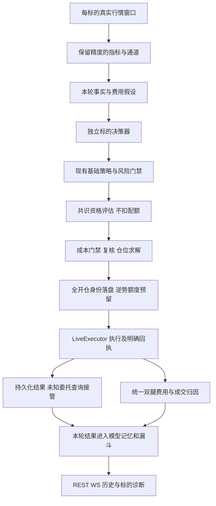

# AI 自动交易多标的、成本与上下文一致性修复方案

> 版本：v2；日期：2026-09-07；节点：#1 方案评审与修复（保留节点 #0 的调研证据）。
> 下游实施按本文任务顺序执行，可使用 `superpowers:executing-plans`。
> 本节点交付设计与验证依据；生产代码修复、完整测试和发布由下游节点执行。

**目标：** 消除低价标的失去交易资格、未下单即消耗试探配额、费用归因错误及错误记忆持续影响决策的问题，并使每个标的的运行状态和不交易原因可核对。

**架构：** 保留一组多成员、每标的独立 `AiTradeSession`、确定性门禁和 `LiveExecutor` 执行的架构。增加小型纯函数模块统一价格文本、往返经济口径、执行回执及记忆事实；既有会话模块只增加接线调用。REST、WebSocket、历史统计和模型上下文读取同一份服务端事实。

**技术栈：** Next.js 14、React 18、TypeScript、Tailwind、Zustand、TanStack Query；Python 3.11、FastAPI、SQLAlchemy async、SQLite、pandas；Electron 桌面外壳；pytest / Vitest。

## 评审记录

评审范围为 v1 全文，按可行性、完整性、现有约定一致性和范围适度逐节检查。依据为当前工作树源码、`CLAUDE.md`、项目索引及官方接口资料；第2节生产数字是上游采样，本次不重新操作生产账户。下列“已修订”仅表示设计缺口已在正文消除，不表示代码已经实现或回归已通过。

| 编号 | 等级 | 问题、代码依据及影响 | 正文修复与验收 | 状态 |
|---|---|---|---|---|
| R01 | P0 | §3.4只持久化逆势 reservation，普通同向未知单无恢复记录；`executor._poll_resting` 仅查询已存在的 resting，不能恢复超时前未建的订单。`rounds_completed` 在执行后才增加，冷恢复又读旧 metrics，`(runId, round)` 会复用。 | §3.4.1–2、§5增加全开仓待核实记录、独立唯一身份、发送前持久化、按固定ID查询与成交采纳；T34–T35。 | 已修订 |
| R02 | P0 | §5只要求quota写时加锁；`manager._persist_group_state`、`_note_session_stopped` 和仓库 `patch_member_state` 都能重写members JSON，仍可覆盖其他成员的新预留，锁顺序也未定义。 | §3.4.2、§5.3明确全部members写点、事务和执行锁顺序；T18、T36。 | 已修订 |
| R03 | P1 | §3.4.3把所有异常都算unknown，且只定义unknown转accepted；发送前取消、明确拒绝、旧运行段的查询结果无法准确闭合。 | §3.4.3按实际发送阶段统一终态并定义双向移桶及epoch身份；T20、T37。 | 已修订 |
| R04 | P1 | `resume.rebuild_continuity` 按 `(ts,id)` 排序，丢掉id/explain/订单身份，并用当前配置决定历史净毛口径；`_adopt_group` 在恢复后才补离线平仓。v1重放输入不足且可能漏末笔。 | §3.5.4冻结完整重放字段、顺序、run口径、离线补记后的重读及全量累计；T26、T38。 | 已修订 |
| R05 | P1 | `trip_ledger._leg_fee` 与 `realized_cost_bps` 使用abs，历史 `_fee_known` 用总费大于0；仅增加新核心无法保住返佣/零费。`Trade.fee` 非空，旧0也可能是未记账。 | §3.5.1–2、§5定义逐腿来源、缺失值和持久化写点，更新旧读点；T7、T39。 | 已修订 |
| R06 | P1 | 历史 `_pair_round_trips` 仅保留最后一条open，`settle_close` 遇close即清池；v1的分批配对与T6没有具体落点，而executor明确不支持增量部分平仓。 | §3.5.1定义共享数量/费用归并及完成往返边界；部分平仓协议保持原范围，未确认残仓不记完成；T6、T40。 | 已修订 |
| R07 | P1 | `CostRuntime.apply_trip_meta` 被 `ai_trade_trip_ledger_enabled` 控制，关闭时不会清 `_open`；v1把旧快照当基础费用真源会跨仓污染，并可能让富化异常阻断原始成交。 | §3.5.1分开基础结算和可选解释输出，按事件缓存一次结算；T41。 | 已修订 |
| R08 | P1 | v1要求每轮facts与成本冻结，但未写入实际prompt生产点，`CostRuntime.refresh_fee_rates` 仍可在模型等待期间retune；pending估计也可能在轮末丢失。 | §3.5.2、§3.6定义模型请求、执行复检、跨轮订单估计和预算；T22–T23、T42。 | 已修订 |
| R09 | P1 | 官方realizedPnl包含清算/结算调整，不能直接命名为与本地同义的“含资金费净额”；`positions-history` 当前最多100条且无分页，匹配笔数不能证明run归属。 | §3.5.3增加调整项与原始官方净额，明确定义coverage证据及保守不可比较路径；T12–T13、T43。 | 已修订 |
| R10 | P1 | §5的DecisionFacts缺§3.6承诺的规则/漏斗，EconomicsSnapshot缺fundingBasis和样本分母；未知费用后旧浮点消费者兼容方式不明确。 | §5补齐字段、枚举、样本覆盖与兼容适配边界；T28、T32、T44。 | 已修订 |
| R11 | P2 | §8.3仅写50笔，未约束UTC日分块内多标的相关性，也未区分会计重算与策略回放；§10仍要求核对节点0。 | §8.3明确组合日期块、固定模型输入的评估范围；§10改为本节点审查检查及节点1状态。 | 已修订 |
| R12 | P2 | §7将CLAUDE函数行数写为“尽量”，§6仍是上一节点叙述；表格内枚举竖线未转义会破坏列结构。 | §6–7明确修改范围及新增代码硬约定，修正表格枚举分隔符。 | 已修订 |

逐节结论：§1–2的目标、技术栈及因果边界保留；§3.1–3.3的精度修复可由当前纯函数实现；§3.4–3.6按R01–R10补全；§4保持现有交互结构；§5–6同步接口和文件计划；§7–10补齐执行、验收和交接约束。不存在待下游自行选定的P0/P1设计问题。

## 1. 概述

本轮处理用户报告的三个相关问题：近期只有 SOL 频繁成交、交易成本及盈亏不可信、Agent 上下文不断重复导致决策质量下降。目标是恢复真实的多标的机会识别与执行能力，让成本、收益、门禁和记忆形成可以逐项核对的链路。多标的能力的验收是每个满足相同条件的标的都可以下单，每个未下单原因都可以解释；市场条件不同本来就可以产生不同交易次数。

调研发现这里已经存在成熟的成本模型、资金费账本、开仓漏斗、信号先验、经验图谱和冷续跑机制。缺陷集中在这些模块的接缝：价格在进入判定前丢失精度，逆势资格在成交路径尚未确定时提前消耗，运行期归因遗漏开仓费，摘要压缩抹掉了被否决的事实。因此采用小范围修复和共享计算核心，避免再叠加一套选币 Agent、独立收益账本或自动放宽风险阈值的控制器。

收益目标落实为费用恒等式、保守成本估算、净额样本评估及可解释的不交易决策。软件能够消除已确认的记账错误和不合理交易障碍，不能保证未来盈利。收益评估与功能验收分开：负收益、证据不足和正常观望都如实展示；亏损不会被改名、遗漏手续费或重置统计掩盖，也不会触发为了凑多标的成交而增加风险。

## 2. 调研基线与证据

### 2.1 范围及来源

- 工作目录：`M:/takoAI/AragonTrading`；源码基线 HEAD：`3d2a5f0`，包含进入本节点前已有的未提交修改。
- 已阅读 `README.md`、`CLAUDE.md`、`.claude-index/index.md`。README 开头的 Phase 1 说明早于当前实现，当前代码已经支持实盘 AI 分组交易，本文以现有代码为实施依据。
- 本轮 history 返回 `success=true, summaries=[]`；任务看板要求本节点仅编写方案，后续依次评审、实施、Review。
- 本地开发库 `services/quant/aragon.db` 未发现 AI 实盘 run。桌面库 `%APPDATA%/aragon-desktop/aragon.db` 有生产运行记录；以 SQLite URI `mode=ro` 打开，只查询交易、运行、状态和行情表，未读取账户凭据表。
- 只读调用本机 `GET http://127.0.0.1:18760/api/ai-trade/status`，未发启动、暂停、下单、撤单或设置写请求。
- 查阅桌面 `logs/backend.log`，存在多次暂停/续跑与全标的网络中断记录。生产日志可能继续增长，所有统计必须带窗口和采集时刻。
- 既有 `docs/plans/ai-trade-edge-closed-loop-governor/spec.md` 等文档作为背景参考；其中较早的亏损数字和未落地建议不是本轮已验证事实。

### 2.2 最近交易事实

采集时刻为 **2026-09-07 13:20:47 UTC**。查询以当时最新 AI 成交 `ts=1788786000`（2026-09-07 13:00 UTC）为锚，使用开区间下界 `ts > anchor - window`。

| 窗口 | 标的 | 成交腿数 | 已记录腿费 USDT | 已记录 `SUM(trades.pnl)` USDT |
|---|---|---:|---:|---:|
| 最近 12 小时 | SOL | 16 | 1.39537771 | -1.72931353 |
| 最近 24 小时 | BTC | 6 | 0.519271793 | -0.762931793 |
| 最近 24 小时 | ETH | 2 | 0.2480775 | -0.9470775 |
| 最近 24 小时 | DOGE | 2 | 0.2489934 | -0.8837934 |
| 最近 24 小时 | SOL | 26 | 2.26956088 | -0.48373508 |

这确认了“最近只有 SOL”的窄时间窗口现象，同时否定“系统从未给其他标的交易机会”的宽泛解释。腿数不是往返数，窗口内开仓可能尚未平仓，以上盈亏不是经交易所逐笔结算认证后的全成本净收益；不得再从 `SUM(pnl)` 扣一次表内全部 fee。

最近分组从 2026-09-03 开始，run 为 1630–1634，分别是 BTC、ETH、SOL、DOGE、SATS；总预算 100 USDT、杠杆 5、`allocationMode=max_ratio`、每成员 `allocationPct=100`。这表示共享上限内每成员最多使用整组预算，并不表示实际授权 500 USDT 总保证金。`GroupExposureBook` 的共享约束必须保留。

在本次在线状态采样中，五个成员均 `lifecycle.state=running`、`armed=true`，已完成轮次分别约 988、1167、1309、1159、1154。BTC、ETH 的近期原因包括 `low_consensus_quota(0/1)`，DOGE 包括 MA 锚区及零同向票，SATS 文本反复描述“band 轨 0.00 故障”。轮次持续变化，文档数字是采样值而非精确同步断面。

### 2.3 已确认问题与因果边界

| 编号 | 等级 | 代码证据与复现 | 结论及修复轴 |
|---|---|---|---|
| D1 | P0 | `base_rules.py:115` 的 `build_ma_band` 返回 `round(price, 6)`；`band_pct_b` 再用已舍入的上下轨求宽度；`format_band_for_prompt` 用 `.2f` | 低价标的真实非零通道变成零宽，硬门禁和文案都失真。修复轴 A。 |
| D2 | P1 | `market_digest.py` 的 EMA、摆动高低点、OHLC 和 MACD 使用固定六位小数；`trend_verdict` 读取这些数值；`cost_view.break_even_wire` 固定八位 | 同一市场结构因标的价格尺度而改变趋势证据，盈亏平衡价也可能变形。修复轴 A。 |
| D3 | P1 | `session._apply_consensus_gate` 在 `out.contrarian_used` 时立即加一；之后才经过 edge、reflection、sizing、executor | 未产生委托的资格通过也消耗最多三次的逆势额度。线上 quota 提示证实其影响存在，但旧日志不足以逐次还原每个配额去了哪里。修复轴 B。 |
| D4 | P1 | `sizing_runtime.resolve` 已将解零动作改成 hold；`session._apply_sizing` 再用改后的 action 调 `note_sizing` | 解零在漏斗消失。暂停快照 BTC 为 intents=26、blocked 合计10、submitted=8、sizingZeroed=0，差额8恰等于 solvedZeroVetoes=8；ETH 差额6也吻合。修复轴 B。 |
| D5 | P1 | `_execute_decision` 对 executor 返回的错误或 dust status 仍给 `ok=True, skipped=False`；漏斗以“不 skipped”计 submitted | 业务拒绝被记成发单，模型工具结果也可能把错误描述成成功。修复轴 B。 |
| D6 | P0 | `trip_ledger.settle` 净口径仅给 pnl 加平仓费；`attribution.record_close` 也只读取平仓腿 fee | 开仓费在毛额还原和运行期费用统计中遗漏；历史 `_Trip.leg_fee_usd` 已经采用双腿总费，可作为对照。修复轴 C。 |
| D7 | P1 | `cost_model.estimate_round_trip_cost` 与 `FeeLedger.leg_fee_bps` 将普通 limit 等同 maker；executor 实际发送 `ord_type=limit`，并未发送 `post_only` | 开仓费用和吃价成本可能低估；本地估算与交易所实测必须区分。修复轴 C。 |
| D8 | P1 | `compact_journal_for_summary` 只看 interval、hold、无 traded、无 reflection；不检查 `gateVeto`，也不比较行情证据 | 被系统拦下的开仓被压成模型主动观望；变化中的战术证据也被宣称“同一份行情”。修复轴 D。 |
| D9 | P1 | `commit_round` 的 journal 只携带 signalBoard、动作、执行与会话 pnl；摘要指令却要求判断否决事后对错 | 摘要器缺少完成事后验证的价格路径，可能把模型自己的描述升级为历史事实。修复轴 D。 |
| D10 | P1 | `resume._adopt_group` 恢复 executor 成交和盈亏，没有重放成本归因；持久化 metrics 可能停在上次暂停 | `aiStats.cost.lifetime` 实际可能仅覆盖本进程，而运行累计 pnl 覆盖整个 run。当前 run 1630 对账 localTrips=11，成本段 lifetime.roundTrips=3。修复轴 C/D。 |

`session._build_run_metrics` 还以 `_empty_metrics()` 的零值填 winRate、profitFactor 等，即使有盈利成交也显示零。本文只修正可从完整成交重建的统计，并为不能重建的权益时序指标标明缺失，不将重启前缺失的浮盈轨迹臆造出来。

### 2.4 已执行的只读复现

1. 对相同相对形态的 60 根确定性测试 K 线分别缩放为 `1e-8, 1e-5, 0.1, 100, 80000`。前两种的通道区间数均为 0，其余为 3。`1e-8` 的原始末价 `1.004e-8` 在 digest 中变成 `0.0`。这些是单元测试夹具，不是生产行情。
2. 对桌面库实际保留的 **SATS 1H 历史缓存**末 60 根复算：末根 `ts=1786597200`、原价 `1.0169e-8`，上下中轨全为 0、合规区间为 0。没有 SATS 30m 缓存，故不将该复现冒充当前 30m 历史回放。
3. 开仓名义 1000、毛收益10、开仓费0.2、平仓费0.505：净输入9.295时旧核心输出毛额9.8；毛输入10时旧核心输出净额9.495。两者 `gross - totalFees - net = -0.2`，应为0。
4. maker=2bps、taker=5bps、halfSpread=1bps、impact=0.5bps、funding=0，普通 limit 旧估计为8.5bps；采用可吃单的保守假设应为13bps。
5. 两个带 `gateVeto` 的 interval/hold journal 被压成一个不含否决记录的摘要项；该缺陷已直接调用现有函数复现。

最初一次探针误用了函数名，另一次误选没有缓存的30m周期，均已在 runlog 标记 inconclusive。后续更正后的复现运行成功；成功指复现成立，不表示源码修复或测试已通过。

## 3. 技术设计与方案取舍

### 3.1 选择的方案

| 方案 | 收益 | 代价 | 决定 |
|---|---|---|---|
| 修复现有事实与执行链，增加统一诊断读数 | 能直接覆盖 D1–D10；与现有交易控制兼容 | 需要明确几个跨模块契约 | 采用 |
| 新增组级选币/轮转下单 Agent | 可能重新分配模型调用时间 | 当前各成员实际都在研判，不能解决价格精度和费用错误，还会增加下单策略 | 本轮不采用 |
| 直接降低共识、成本或最小仓位阈值 | 可能增加成交 | 无法验证原因，可能让成本不覆盖的单更多 | 不采用 |

本文不调低 `k_min`、共识票数、置信度、仓位零解、总预算或风险刹车阈值，不自动更换用户所选策略、周期或标的。逆势额度依旧有限，正常资格不足依旧可观望。

### 3.2 修复后的关键时序



图中只展示新增接缝；现有 `orphan`、`horizon`、`profitCooldown`、turnover、backstop、drawdown、trend 的相对执行顺序保持原状。保护性退出、平仓、撤单不受新增开仓额度和诊断读数阻断。

### 3.3 轴 A：价格尺度无关

新增 `ai_auto/numeric_text.py`，公开 `format_price(value) -> str`。输入不可转换、NaN、Inf 返回“不可得”；零返回“0”；其他有限数使用 `Decimal(str(value))` 的普通十进制展开，去掉小数末尾多余零。不得使用固定两位/六位、去掉科学计数指数的字符串截取，或将正数显示为零。函数只用于文本，不用于订单 tick 吸附。

`base_rules.build_ma_band` 的 upper、mid、lower 返回指标原始有限浮点值，取消价格字段的 `round`。`pctB` 同样保留计算精度，使显示的 zone 与 gate 的计算在边界上能一致核验。百分比展示可单独格式化；`classify_zone` 的既有相对容差不变。`band_pct_b`、`compliant_price_ranges`、`apply_ma_band_gate` 都读同一组未舍入轨值。真实零波动、样本不足仍返回不可用，不用任意 epsilon 人工撑开通道。

`market_digest` 取消 EMA、swingHigh/swingLow、OHLC、MACD histogram 的固定小数截断。RSI、量比、收益率等无量纲展示精度保持原来语义；量为0与缺失仍明确区分。现有 `_factors`、高周期、战术周期、trend 成分复用这份 digest，无需第二次算指标。

`format_band_for_prompt` 的轨值和区间端点统一用 `format_price`；`prompts` 的当前价、持仓均价和 `cost_text` 中盈亏平衡价也使用该函数，显式保留 USDT 价格单位。`cost_view.break_even_wire` 的 `breakEvenPx` 返回未舍入浮点数。类型维持 JSON number，前端已有 `fmtPrice` 可继续消费。

验收核心是缩放不变性：给价格和止损/目标同时乘正数，%B、zone、趋势方向、成本bps、仓位风险逻辑保持一致；只有以价格为单位的字段等比例变化。测试包含多空、三个锚点及边界两侧，不能仅检查字符串中不出现“0.00”。

### 3.4 轴 B：执行回执、配额与闭合漏斗

#### 3.4.1 明确执行结果

新增 `live_auto/execution_receipt.py`，用不可变 `OpenAttemptReceipt` 表达一次 executor 开仓尝试。字段见第5节。`LiveExecutor.apply` 开始时清空当次 receipt；`_do_open` 只有拿到交易所正常接收回执后写 `accepted`，dust、未清旧仓、保留既有挂单、交易所拒绝分别写明确终态。这是给既有返回事件增加旁路事实，不改下单函数签名和普通非 AI 调用方的返回事件。

无法确认交易所是否接收的超时写 `unknown`，携本次发送前确定的 `clOrdId`；不得因为没有 trade 事件就认定拒绝。沿用现有按客户端订单号查询和对账机制，不能重发一个新 ID 来探测。`_execute_decision` 返回 `executionReceipt`，并使 `ok/skipped/reason` 与 receipt 一致。hold、纯 close、cancel 不伪造 open receipt。

现有 `place_live_order` 在内部生成 ID，故必须先补齐实际写点：`order_builder.OrderInput` 增加仅供内部调用的 `client_order_id: str | None = None`，不加入公开下单 REST 请求模型；`trading.py` 暴露 `new_client_order_id()`，AI路径生成 `uuid4().hex`（32位字母数字），place时优先使用已传入ID。普通调用缺省仍沿用 `_gen_cl_ord_id`；`place_live_order` 和executor注入下单函数签名不变。`attemptId=runId:uuid` 是全程唯一身份，`round` 仅为展示及关联属性，不能由轮号推导唯一ID。OKX只保证当前挂单的客户端ID唯一性，终态后可以复用，因此本系统必须自行保证历史不复用，不能把固定ID重试当作交易所幂等保证。[官方下单指引](https://www.okx.com/docs-v5/trick_en/#order-management-placing-an-order)

发送阶段通过同一对象传回，不能只在异常文案中猜测：在 `order_builder.py` 定义可变 `SubmissionTrace`，OrderInput末尾增加可选 `submission_trace=None`；其字段为 `phase=not_sent|sent`、`ack=none|accepted|rejected`、`ord_id`、`error_code`。AI executor持有该对象，trading在调用 `client.place_order` 前将phase置sent（含“可能发送”，不宣称已到达交易所），得到非空ordId后、关闭客户端和写审计之前立即写accepted。这样预检失败仍是not_sent，确认接收后的审计异常不会把订单降为拒绝。trace只含脱敏身份与状态，不进入订单JSON，不从公开REST接受。

AI开仓使用 `OKXTradeClient.place_order(payload, *, allow_retry=False)`；新增可选关键字默认None，转交现有 `_post`。当显式False时，传输错误、HTTP 429和解析错误都不得自动重发开仓；其他旧调用不传该参数，保持原行为。仅在收到本次单次请求的已知业务拒绝码 `51008/51004/51000/51001/51010/51006/51121` 时将trace写rejected，沿现有映射解释原因；HTTP错误、未知码、空ordId、重复ID提示均归unknown并查询。测试假客户端在新增AI场景中接受此关键字，不能捕获TypeError再补发。明确accepted或rejected后receipt保持事实；尚未确认的异常（含取消任务）由executor的finally读取trace收口，取消异常继续上抛，不吞掉生命周期取消。

`submissionPhase=not_sent|sent`只描述开仓POST，设杠杆等预检调用不能使其变成sent。unknown期间该标的暂停新增开仓，保留平仓、撤单及保护性退出；订单查询返回空列表一次不足以证明“从未接收”，不得自动释放配额。沿现有对账重试查询固定ID，不自动生成新ID补单。

**全开仓恢复记录（R01）。** 新增 `ai_auto/open_attempts.py` 管理 `PendingOpenAttempt`，覆盖同向与逆势两条lane，与 `EntryQuota` 分工为“委托身份恢复”与“逆势次数限制”。每成员最多1条未完成接管的开仓记录，保留attemptId、accountId/runId/instId、round、runtimeEpochId、side、ordType、数量、limitPx、保护价、clOrdId、发送阶段、确认状态、已采纳累计量及冻结的估计/版本；不保存密钥或任意模型文本。它不是第二套订单服务，仅包装现有executor的发送与查询入口。

`_do_open` 先完成dust、同价keep、撤旧单及反手清仓检查，再构造最终OrderInput；只在确实要发送新open时创建attempt，将其与可选quota预留在同一次状态事务写入 `runtimeIntegrity`，提交成功才调用 `_place_order`。任何lane持久化失败都返回 `attempt_persist_failed` 且不发该open。给交易所的新改价订单使用新attempt，若其新决策是逆势则另计1次；旧accepted订单的额度不退款。keep、撤旧时已成交、同向已有持仓等分支不发送、不占quota；反手close腿及纯保护退出不需要这一开仓事务。

进程内发送前失败可确认not_sent并释放；崩溃恢复看到任何未完成记录（即使最后落盘phase还是not_sent）都视作“可能已发送”，因为DB提交与网络POST无法原子化。发送后确认accepted/rejected，先维护内存真实回执，再原子持久化pending与quota的新状态；提交失败保留旧的可恢复pending，暂停新增open并重试本地存储，不抹去已知accepted、不重新发单。原始成交落库失败同样不能以清空pending代替恢复。

**查询和接管写点。** `session` 的现有monitor在 `_exec_lock` 内、普通 `executor.reconcile` 前调用 `open_attempts.resolve_pending`；冷恢复在 `resume.assess_group` 的只读评估和 `_adopt_group` 的接管阶段接入同一判据，未知记录不能被当作“没有挂单”。查询复用 `_get_order(clOrdId)`，核验账户、标的、方向、ordId、数量和累计成交；按已有私有GET节流及退避执行，无额外高频轮询。结果为live/partial时建立原ID的RestingOrder并接入现有增量成交路径；filled时从真实数量/成交价采纳一次，不再次按参考价合成一个open；canceled但有成交仍先采纳已成部分，额度仍为consumed。market未知单以查得的事实接入同一采纳入口，不重走 `_do_open`。ack后审计/客户端关闭异常也须完成这一步，不能只记accepted而漏建仓位或挂单。

接管按 `(accountId, instId, ordId, 已采纳累计量)` 判增量，trade的explain记录订单身份；冷恢复先从完整DB腿重建采纳量，再消费查询差量，重复查询或重启不重复INSERT。pending只有在订单身份已转存既有挂单/持仓契约、相应成交已落库且quota终态提交成功后才删除；删除与身份转存同事务。已知单次业务拒绝可释放；查询not-found、分页不全或超过交易所查询保留期都不能证明未接收，保持待核实并显示原因，走现有暂停/结束核查流程，不能自动超时释放或启动新组绕过。保护性退出依旧可执行。已采纳订单随后按既有resting/settlement生命周期管理，不另外复制撮合状态机。

`submitted` 只在本轮产生新的、正常接收的开仓订单时加一；已有挂单 keep 不算新发单，repricing 只有产生新的交易所委托才算；成交计数继续按实际 trade 事件累计，不能把“接收委托”改称“成交”。同一订单部分成交可以对应多条成交腿，故 filled 与 submitted 不要求数值相等。

#### 3.4.2 逆势额度只计已接收的开仓尝试

新增 `ai_auto/entry_quota.py` 的 `EntryQuota`。保留 `contrarian_max_per_session` 上限及所有证据、反向票、仓位缩放条件，改变扣费时机为“交易所接受了一次逆势开仓尝试”。资格通过时只记录本轮 lane。成本/复核/仓位否决不扣额度；不要求本轮最终成交，已接收但后来到期或撤销仍计一次试探，防止无限挂撤循环。

确定状态机为 `available -> reserved -> consumed`，或 `reserved -> released`。在 sizing 后仍是逆势open时进入执行锁，复检 `state=running` 及当前容量，再由§3.4.1实际发送边界预留。名额以唯一attemptId关联，发送前已经绑定clOrdId。`used + reserved <= maxPerSession` 始终成立。已知未下单/明确拒绝释放预留；未知回执保持reserved，查明已接收即consumed。当前进程可证未发出或本次明确拒绝才能释放，单纯“暂无成交”不是释放依据。

预留和提交快照写入既有group state的成员 `runtimeIntegrity.entryQuota`，与pendingOpenAttempt同步提交；失败语义统一为 `attempt_persist_failed`。同一group的所有members写点共用 `_state_write_lock`，包括 `_persist_group_state` 的整行写、成交驱动patch、暂停/恢复、`_note_session_stopped` 的摘成员以及pending/quota事务。锁内重新读取最新行再合并本次变更，未命中的组/成员返回False必须按失败处理；提交完成后才能释放锁。保留其他成员、未知JSON键和停止成员尚待核实的pending，不能因摘成员删除未决订单身份。

锁顺序固定为已有准入/生命周期锁（若有）→单成员 `_exec_lock` →组 `_state_write_lock`。状态锁内只允许本地有界DB事务，禁止网络、事件派发、await另一成员执行锁或递归获取同锁。暂停先置状态，再排空成员执行锁，最后独立写组快照；不得持状态锁等待执行结束。设置已有DB超时，事务失败回滚；保护通路不依赖新增持久化成功。该约束依赖当前单后端进程的组所有权，本轮不支持两个进程同时管理同账户同组。热路径不新增成本行情网络查询。

冷续跑不再把同一 run 的新额度账本置零。新版本从状态快照恢复，再以受控订单 ID 集合核对；旧契约若无新快照，优先沿用可读的旧 `contrarianPassed` 作为已用下界，不能证明未使用的剩余额度按耗尽处理，回执显示 `legacy_unknown`。正常同向共识路径仍可交易。只有启动全新分组才获得新额度，不新增自动定时补充额度规则。

实盘与回测共用状态机；回测用 broker 接受委托的确定性事件提交，不按 gate 通过扣减。历史回测费用世界保持模拟 broker 的独立费率配置。

#### 3.4.3 一轮意图一个终态

`OpenFunnel` 保留旧字段，新增 `executionBlocked` 与 `outcomeUnknown`。仓位调用前保存原 action；resolve 返回 floor verdict 时直接以原 action 和结果记录 `sizingZeroed`，随后将终态交给统一收口。下游不再从改成 hold 后的 action 猜发生过什么。

每个已完成且有开仓意图的轮次只落入：`blocked[layer]`、`sizingZeroed`、`executionBlocked[reason]`、`submitted`、`outcomeUnknown` 之一。因此新版本、同一统计 scope 内必须满足：

```text
intents = sum(blocked.values()) + sizingZeroed
        + sum(executionBlocked.values()) + submitted + outcomeUnknown
```

`finally` 统一调用幂等finalize：已知未发送的异常/取消归 `executionBlocked[pre_submit_error|canceled_before_send]`，只有可能发出且未确认接收的才归 `outcomeUnknown`；明确ack优先于后续富化异常。gate或sizing已有终态则不再加桶。`low_confidence` 沿用unknown方向桶，不从低置信度动作猜多空。unknown证实accepted时减unknown加submitted，证实未接收时减unknown加executionBlocked，两种迁移都不增加intents。重复回调无效，方向桶与总量同次更新。

漏斗outcome ID由 `(runtimeEpochId, round)` 标识，attempt关联原outcome；epoch用每次会话进程实例的随机ID，不能仅用秒级时间。冷恢复后的新epoch不迁移旧epoch的计数（否则产生负桶），旧pending的查询结果只更新其恢复诊断、额度和原epoch记录；旧epoch无完整计数则保留partial。`llmDegraded` 是没有开仓意图的调用故障统计，不放入恒等式。receipt的unknown是可继续核实状态，只有accepted/rejected/not_submitted确认后不反向改变。

旧快照缺失的分类不能反推补零；显示 `coverage=legacy_partial`。新的 runtime 计数按 epoch 命名，不能贴“本会话全程累计”标签。按 run 全程提供的成交与费用统计见轴 C。

### 3.5 轴 C：统一成本与收益口径

#### 3.5.1 双腿费用恒等式

新增 `ai_auto/trade_economics.py`，公开 `resolve_trip_economics(inputs: TripPnlInputs) -> TripEconomics`。它只接受明确的 `pnl_basis=net|gross`、已记录平仓 pnl、分摊到已平数量的开仓费及平仓费，不读全局设置、交易所或模型输出。所有手续费采用“正数支出、负数返佣”，USDT 为计价单位。

```text
F = F_open_allocated + F_close
若 pnl_basis = net：N_trade = recorded_close_pnl；G = N_trade + F
若 pnl_basis = gross：G = recorded_close_pnl；N_trade = G - F
始终：G - F = N_trade
```

将该函数同时接入 `trip_ledger.settle`、`AttributionLedger.record_close` 和历史仓库 `_Trip.gross_pnl/net_pnl`。原始 `trades.pnl` 不原地重写，现有净口径也不再扣第二遍开仓费。新增 `ai_auto/accounting_replay.py` 提供共享 `TradeAccountingAccumulator`：纯状态归并、无IO，由运行期和历史/冷恢复共同使用；`trade_economics.py` 保持单笔数学纯函数。一个累加器拥有唯一开仓费池，`record_close` 取得当次结算并更新池，`settle_close` 只读取同事件的结算结果补充解释，不再第二次清池或扣费。

开仓分批成交先累加 `open_fee_usd` 与实际成交量，再结算。归并键为runId和持仓epoch，维护remainingQty、加权均价、剩余开仓费、逐腿费用覆盖及已结算分片；禁止历史 `_pair_round_trips` 只把最后一条open的qty/price当整仓。输入的每腿qty必须是增量，不能把交易所累计均价当本次增量成交价：累计名义差除以累计量差得到增量价，非法/倒退累计量标coverage不足。历史只有最后一腿而无法还原均价时，不伪造bps分母。

对**已提供可信增量close事件**的归并输入，开仓费按 `closedQty / remainingQtyBeforeClose` 分摊，减少剩余费池，末次平仓收走浮点余数；net输入约定已扣该分片开仓费及本片close费。只有剩余量为0且positionAfter一致才完成一笔round trip，胜率/往返数此时增加一次；部分结算分片的pnl/fee先累积，不能把两条close当两次胜率样本。多空符号、超量close、无open、方向突变分别校验，不能跨epoch配对。保持qty为合约张数，价格盈亏/名义值使用 `qty * ctVal`，不得再乘一次leverage。

范围边界：当前 `executor._adopt_partial` 明确只增量采纳开仓，**本轮不新增交易所部分平仓协议**。T6对完整增量事件夹具验证共享归并器；实盘adapter仍只在已有全量close确认时终结往返。部分平仓后撤单或成交覆盖不足时，不输出“完整已平往返/完整费用”，沿既有残仓与settlement通路核对，缺失部分保持partial。由此不要求新增一套部分平仓撮合器，也不允许以本地先置flat冒充交易所已全部结清。

缺失开仓身份或任一费用未知时，标记 `feeCoverage=missing_open|missing_fee`；未知不等于合法零费用。未知派生字段为 null；已有可靠净 pnl 可以单独展示，但该往返不进入要求完整费用的成本比率、edge 校准和经验收益样本。遇到孤儿 close 不和下一个标的/下一个 run 的 open 配对。归因结果按 `(runId, tradeId)` 或既有单次事件派发身份去重；不得只按 ts 去重，多个成交可能具有相同 K 线时间戳。

`TripEconomics` 同时带 `accountingVersion=2`。新成交归因写入 `explain.meta.accountingVersion`。历史读取时依据原始成交腿及run的 `costBasis` 重算，而不信任旧meta的错误gross/cost bps；没有足够腿或历史costBasis缺失时标 `legacy_partial`，不暗中改成当前配置。

**费用及空值读写点（R05）。** AI每条腿在 `FeeLedger.on_trade` / `explain_meta_fields` → `executor._make_trade` → `session._persist_trade` 原路径写 `meta.feeBasis=measured|estimated|unknown`、`feeCurrency=USDT`、`feeKnown`、`accountingVersion` 和稳定 `accountingEventId`。记账关闭、非USDT费用未转换、非有限override时标unknown，不能因DB非空fee列的0占位标已知；override为合法0与负返佣则为measured。旧meta中同时有有限feeUsd/feeBps的可信记账标记可以识别为legacy estimated；仅有fee数值不足以证明零费或全腿完整，缺来源统一legacy_partial。

`trip_ledger._leg_fee` 去掉abs，`realized_cost_bps` 保留费用符号，历史 `_fee_known` 改为逐腿证据判定而非 `Σfee > 0`。所有四个经济输入在归并边界验证有限性，recorded pnl缺失也不得用 `or 0.0` 修成保本；合法0保持0。历史、新成交和恢复统一读取上述meta。estimated可以进入明确标为local_estimate的费用完整样本，但不能升级exchange_settled。

**基础结算与可选富化（R07）。** 开仓记池、平仓消费和基础经济累计不受 `ai_trade_trip_ledger_enabled` / edge gate /经验开关控制；这些开关只控制可选解释或学习输出，不能阻止费池清理。`record_close`、`settle_close`、`last_settled_trip` 用同一accountingEventId认领当次结果；没有新完整结算时不得返用上一笔作为本笔经验。运行期由成交生产点赋稳定事件身份，冷恢复用DB tradeId并还原meta身份，重复派发只消费一次。归并器返回coverage错误而非抛出破坏成交持久化；IO错误仍显式上报。基础结果缺失时不构造含None的旧 `SettledTrip` / `RoundTrip`：旧有float契约只接完整可计算结果，新integrity保留缺失计数与可靠的独立净额，避免既有经验/校准消费者收到None后算术崩溃。

#### 3.5.2 事前成本与成交事实分离

本轮选用**保守估算普通 limit**，不将所有委托切换为 post-only。对现有实盘 AI `market` 与普通 `limit`，事前费用均使用 taker 开仓、taker 平仓、两条可能吃价腿：

```text
C_trade_bps = f_taker_open + f_taker_close
            + 2 * (halfSpread_bps + impact_bps)
C_expected_bps = C_trade_bps + adverse_expected_funding_bps
```

只有执行层明确支持并保证 post-only 的未来扩展才允许 maker 假设；本文不新增此委托方式。`CostQuery` 增加明确的 `liquidity_assumption=may_take|maker_guaranteed|simulation`，既有普通 limit 默认为 `may_take`。`CostBreakdown` / wire 增加 `modelVersion=2`、`liquidityAssumption`、`feeSource`。现有已测的 maker/taker 费率快照、资金费方向和 stale 处理继续复用，不硬编码真实账户费率。

`FeeLedger.leg_fee_bps` 对未取得实测手续费的普通 AI limit 同样以 taker 估算，并标明 `feeBasis=estimated`。能够消费已有 `override_fee_usd` 的结算路径继续用实际值，包括返佣和合法零手续费，不以 `abs` 抹掉返佣。未取得真实费不写 `measured=0`。普通非 AI executor 仍不传 FeeLedger，其原行为不受此改动影响。

回测的 `backtest_params` 仍与 SimBroker 的手续费和滑点配置配套；显式使用 `simulation` 假设，不能只把成本门禁改成实盘双腿 taker、而撮合仍按旧费率扣账。实盘与回测须在**相同费用输入和相同执行假设**下得到相同纯函数结果，并不要求两个不同撮合世界的默认参数相同。

`CostRuntime` 所有生产调用点（preview、`estimate_cost_only`、gate、tradability探针和持仓成本文案）消费同一 `CostParams + CostQuery`，严禁prompt保留旧maker成本、gate却改为taker。每轮 `begin_round_cost(inputs)` 生成不可变RoundCostSnapshot，包含params、费率来源/时间/stale、spread、impact、funding和假设版本；上述本轮读点显式传同一snapshot，不在函数内重新读cache。异步 `refresh_fee_rates` 只更新下一轮cache，不能原地修改在途snapshot。

本轮事前成本与事后真实腿费是不同时间点事实：每笔腿的估费在实际采纳时使用当时费率并记来源/版本，真实手续费override始终优先，不为了让误差为0而回填旧预测。限价pending和未知开仓记录携带冻结RoundEstimate；按clOrdId转存/恢复后，跨轮成交仍比较其原始预测。执行前若费用快照已经失效、持仓epoch/挂单身份或风险条件改变，重新运行现有确定性开仓复检；成本更高且不再过闸则不发单，并记录 `pre_submit_context_changed`。不追加LLM调用，不把新费用悄悄改回已发送的prompt。

#### 3.5.3 全成本、已发生费用与预估平仓费用

新增 `build_economics_snapshot(inputs)`，位于 `trade_economics.py`，返回第5节 `EconomicsSnapshot`。明确三种读数：

1. `tradingNetUsd`：已平往返、含双腿手续费、不含资金费的净额，即现有净口径核心。
2. `fundingCostUsd`：资金费账本的已结算或已计提值，正支出负收入，附 `fundingBasis` 与 scope；未知为 null。
3. `netAfterFundingUsd = tradingNetUsd - fundingCostUsd`：只有两者覆盖相同已平仓集合时才可计算。另行列出当前持仓 `openFundingAccruedUsd`，不混入 closedTrips 净额。

`sessionFeeUsd` 是已记入所有腿（含未平开仓）的总费用。它用来展示费用支出，不能作为再从 `tradingNetUsd` 扣除的一项。未平仓的可平净额单列，估算平仓手续费只出现一次；expected funding 是事前持仓预算，不是已付资金费。

若已有 `reconcile` 的交易所读数通过身份、完整分页、窗口和closed trip覆盖检查，则同屏显示 `exchangeTradingNetUsd` 及 `exchangeNetAfterFundingUsd`。另设 `exchangeRealizedPnlUsd` 展示官方最终已实现结果，不能将含其他调整项的最终结果直接命名为含资金费净额。判定“可比较”不以 `status=ok` 为必要条件：差额超阈的drift也必须能展示两个真值及差值。持仓集合不一致或缺少费用币种/时间范围则可比字段保持null，而不是用0计算差额。

当前 OKX 文档的持仓累计字段包括 `realizedPnl`、`pnl`、`fee`、`fundingFee`、`liqPenalty`、`settledPnl`。交易所原始费用为负支出，原始恒等式为 `realizedPnl = pnl + fee + fundingFee + liqPenalty + settledPnl`。**本仓适配层已经将前三项费用取反成正支出**，故内部恒等式必须是 `realizedPnl = pnl - fee - fundingFee - liqPenalty + settledPnl`，内部可比交易净额是 `realizedPnl + fundingFee + liqPenalty - settledPnl`。`settledPnl` 保留收益正负，不取反。字段缺席在旧记录中标未知，不能把不支持的结算调整混成普通费用。本轮主验收使用 USDT 永续、上述调整项为已知0的夹具；其他支持合约必须明确返回覆盖不足，不输出伪精确值。接口语义以 [OKX API 官方文档](https://www.okx.com/docs-v5/#order-book-trading-trade-get-positions-history) 为依据。

v2同单位恒等式进一步固定为 `exchangeNetAfterFundingUsd = exchangeTradingNetUsd - exchangeFundingCostUsd = realizedPnl + liqPenalty - settledPnl`；`exchangeRealizedPnlUsd = exchangeNetAfterFundingUsd - liquidationCostUsd + settlementAdjustmentUsd`。exchangeFundingCostUsd及两项调整均来自同scope官方记录，与本地计提fundingCostUsd分开；不能把本地计提额用于上述官方恒等式。两项调整单独披露，不称为普通交易手续费。适配层只取反一次，空串/null为未知；仅在合约类型证明字段不适用时可返回明确的“not_applicable_zero”，不能对所有空字段用0。

**覆盖可判定而非只写原则。** 比较输入附 `ComparisonCoverage`：accountId、instId、closedTripIds、交易所posId与本run受控订单/成交关联证据、windowStartTs/windowEndTs、fetchedAtTs、pagesComplete、currency、identityHolds。单凭同标的、数量相等或窗口内无其他run不能证明归属。当前 `_fetch_position_history` 是limit=100且无分页；本轮保留这一有界取数，不新增全历史抓取。只有响应不足100、覆盖已闭窗口下界且无分页/时间缺口，并且所有closedTrip都有可信身份关联，才可标pagesComplete及comparable；触顶100或身份缺失直接partial。超过保留期、手工仓位混入、尚未平的持仓历史片段、重复posId/uTime及窗口跨边界均不能通过完整性门。旧接口仍可显示旧对账读数，但不得让其status代替新coverage。

本地资金费由现有 `funding_ledger.closed_accrued_usd` 和当前epoch分开读取，仅在资金费覆盖的持仓epoch集合与已平经济集合完全一致、没有stale/未知周期/计提触顶/恢复缺口时用于完整含资金费净额。当前持仓读 `epoch.accrued_usd`；不能用stats中已混合open+closed的total再扣一次。累计epoch集合的身份及覆盖由CostRuntime随共享归并器维护，资金费计算仍复用现有ledger。缺失任一已平epoch则fundingCostUsd为null并报告覆盖，不把有记录子集总和标整run；无跨结算点的0也需连续覆盖证据。冷恢复无法重建完整计提路径且无同scope官方结果时保持unknown。

已完成交易的真实成交价格本身包含执行价差和滑点，不得在 `G - fee - funding` 后再扣模型 spread/impact。模型成本仅用于事前门禁和事后误差对比。本文不重写全套市场单成交采纳状态机；由参考价估出来的已有本地 pnl 必须显示 `basis=local_estimate`，不能称为交易所实收收益。

持仓盈亏平衡价改用已有开仓实际/估计费、已计提本仓资金费及未来平仓 taker 费求解，移除从入场价再次计算全部往返价差的做法。令 Q 为当前基础币数量，E 为均价，r 为平仓费率，F 为剩余开仓费与本仓已计提资金费之和：

```text
多仓：P_break_even = (Q * E + F) / (Q * (1 - r))
空仓：P_break_even = (Q * E - F) / (Q * (1 + r))
```

只在 Q、E、r 和 F 均可用且分母合法时返回，来源为估算则同步标 estimated；不计未来尚未发生的资金费，不再扣入场 spread。预计未来持有成本仍在另一个字段披露。杠杆只影响保证金收益率。

#### 3.5.4 冷续跑及历史统计

增加 `CostRuntime.restore_accounting(trades, context)`，在会话武装前从完整DB成交调用。`resume.rebuild_continuity` 必须改为按 `Trade.id` 升序返回，同时保留id/runId、side、price、增量qty、fee、pnl、positionAfter、reason和解析后的explain/meta（含订单/事件身份、wallTs、feeBasis及会计版本）；不通过 `or 0.0` 丢掉缺失语义。历史仓库也把相同字段送入共享归并器。经济统计使用完整DB集合，不能从 `executor.restore_trades` 后已封顶的UI成交列表或200笔环形归因恢复全程数据。

`_adopt_group` 顺序固定为：预检身份/pending → 读取每run配置与连续量 → 沿既有幂等路径补记 `closed_offline` → **若补记发生则重新读取全部成交** → restore-only重建executor/成本/采纳量 → 接管交易所当前持仓及待核实订单 → 现有风险预检 → 武装。补记离线平仓是既有独立恢复动作；restore-only本身禁止发trade事件、INSERT、消耗配额、写经验或情报引用。重复调用restore先清本次派生状态再全量重建，不能再次累加。

每个run的净毛口径取自己的 `config.costBasis`，不从第一个成员或当前 `ai_trade_net_pnl_enabled` 推断。冷恢复继续同一run时，executor/FeeLedger的净毛设置须与该run固定契约一致；无法保持一致则在现有resume预检返回 `accounting_basis_mismatch`，不在单一run中混写两种pnl意义。旧run缺costBasis时历史可显示原有推定字段，但新完整经济指标保持legacy_partial，不授予当前配置“已知历史”的地位。

共享归并器恢复session fee、完成往返数量、胜负分子、毛/净累计、损益分母和当前剩余费池；这些全程累计不受最近200笔展示容量影响。tradeId用于重放顺序和幂等，真实持仓时长取meta.wallTs，旧记录无wallTs时只标时间覆盖不足，不影响可计算费用。持仓数量与交易所不同则标不完整并进入既有漂移预检，不能清空残余费池假装对齐。

原始计提时间点无法从成交重建时，资金费依照既有可信对账恢复，否则标未知；不能将累计 funding0用于精确净额。成本统计明确 `scope=run`；门禁/模型调用计数在旧版本恢复不完整时明确 `scope=runtime_epoch`，各段均有 `asOfTs` 和 `coverage`，不混用分母。

历史详情每次查询用完整成交重算双腿经济口径，不对生产原始成交做批量覆盖。现有 history 的配对以 id 顺序为真源，不用 `trades.ts` 排序配对。`_build_run_metrics` 的 winRate、profitFactor、avgPnl从完整已平往返累加器取；`tradeCount` 仍保留成交腿语义，新增 `roundTripCount` 避免修改旧接口含义。v2 `economics` 的无样本指标为 null，零盈利是真实0；profitFactor 无亏损分母时为 null 并带原因，不输出 Infinity。

兼容边界固定如下：`AiTradeHistorySummary` 新增 `economics: EconomicsSnapshot | None = None`，旧必填float字段及列表响应类型不改成nullable；旧键有可计算结果则同步正确结果，无样本沿用旧序列化占位，但新卡一律读取economics及coverage。成员metrics中的旧数值键也保持数值类型，新nullable值放 `aiStats.integrity.economics`。v2增加winRate、profitFactor、avgPnlUsd和roundTripCount；未知原因放metricCoverage，禁止新视图退回旧0占位。组级summary.economics按各成员已平往返合并分子/分母，scope=group；不能平均成员winRate或profitFactor。

完整跨重启权益路径未持久化，maxDrawdown / sharpe 不能仅用局部 `_equity` 称全程。维持现有可用运行期指标，但在 `metricCoverage` 中逐项说明 `runtime_epoch|run|unavailable`；消费者只对标明有效的指标显示数值。旧 `_empty_metrics` 零占位不进入新经济视图。

### 3.6 轴 D：当前事实、历史叙述与摘要分开

新增 `ai_auto/decision_memory.py`，核心为 `build_decision_facts(inputs)`、`build_evidence_fingerprint(payload)`、`can_fold_rounds(left, right)`。新状态和 wire 采用 `schemaVersion=2`，不增加新的交易工具或 LLM 调用。

每轮在模型调用前构造 `decisionFacts`，固定包含 runId、instId、bar、round、asOfTs、事实版本、真实持仓/挂单、当前规则与剩余配额、已闭合漏斗摘要、经济读数及来源。优先使用当前服务端状态，历史摘要是低优先级背景，不得声明它能覆盖当前持仓、价格单位、费用口径或门禁设置。禁止跨标的读取别的 session 的 `_context/_journal`。

实际写点是 `session._build_decision_payload` 的 `decisionFacts`，实际读点是 `prompts.build_decision_prompt`：在当轮user消息前部输出程序事实块，之后才是历史叙述；`decider` 首次请求、已有retry及reflection使用同一轮factsHash，不能仅在WS中发送新字段。factsHash对有限数/显式null/排序键的完整规范事实JSON计算（含asOfTs），evidenceFingerprint是排除无关墙钟字段的独立比较摘要，二者不能混用。执行前发生状态变化时记录 `executionContextChanged` 和原因并按§3.5.2复检，原请求factsHash保持可审计，不回写已发送请求。

`commit_round` 记录 proposal、最终 decision、明确 executionReceipt、gateVeto、sizing verdict、factsHash、evidenceFingerprint、closedBarTs 和当次费用版本。执行事实在工具结果中出现，不能只把最终 hold 写成“模型选择了观望”。已有 journal 审计 writer 已记录真实发送 payload 和 context turn，本轮只保持这些新字段随原路径落盘，不能绕过审计重建链。

为避免继续增加 `commit_round` 的散落形参，在 `decision_memory.py` 定义 `RoundDecisionRecord` 聚合proposal/finalDecision/facts/receipt/veto/sizing，session和backtest通过一个新增可选record参数传入；旧调用缺省仍可运行，但摘要项标legacy且禁止折叠。proposal在首次门禁前复制冻结，不能从最终hold反推；低置信度且无可靠原提议时保持unknown。`_last_context_turn` 仍取真实追加的toolResult原文，journal只补字段，不另造一条无法重建的上下文链。

证据指纹为固定选择字段的规范 JSON SHA-256（键排序、有限数、显式 null），字段包括执行周期最后确认 bar 时间及 OHLCV、MTF/tactical 各周期最新确认时间与摘要、signalBoard、consensus、baseRules、trend、仓位 epoch、resting ID、门禁规则版本、配额剩余、成本快照值与来源。排除 round、请求耗时、trace ID、普通墙钟年龄；若过期阈值使可用性改变，则 stale 布尔值变化必须改变指纹。tick lastPx 变化也纳入，宁可少压缩，不能把价格变化隐去。

只有下列条件全部成立的相邻项可以折叠：均为 interval；原始提议和最终动作都是 hold；执行为空且不是 error/unknown；无 gateVeto、reflection 否决、sizing 否决；facts 的持仓/挂单/规则/费用来源不变；evidenceFingerprint 相同。缺指纹的旧项不折叠。保留每条原始 journal 和审计记录，仅给摘要器的视图折叠。折叠项保留首末轮号、首末 asOfTs、重复次数和相同指纹，绝不把次数当独立盈利证据。

摘要指令删除“必须判断否决事后正确/错误”的无条件要求，替换为“只有存在已结算收益或明确后续事实时可描述结果，否则写待验证”。本轮不计算未执行交易的反事实收益；不允许摘要器根据未来最高价自行宣称错失利润。已有 prior/experience 统计带样本量、时间范围、成本版本，保留其 advisory 性质，不据模型摘要自动改门禁。

摘要成功后保留两部分：程序生成的 `decisionFacts` 每轮重新注入；模型生成的简短历史narrative按既有上限保留。摘要失败继续用最后成功narrative与当前facts，不能回退旧持仓或旧成本。`_trim_context` 继续按完整user/assistant/tool三元组裁剪；当前事实不依赖被裁掉的摘要种子存活。

事实块只包含固定字段的当前快照、计数和指纹，不复制完整历史成交、信号原文或文章，序列化上限8192字符；超限先删除可选diagnosis.details/narrative，不裁断JSON或价格数值。必要持仓、pending、规则、费用与coverage仍超限则显式 `facts_unavailable`，本轮不新增open，已有保护退出继续。摘要失败时仍沿用现有有界journal截断及审计保留策略；“保留原始journal”指折叠函数不改输入，不承诺无限期保留超过捕获/保留策略的原文。测试检查实际LLM请求及审计重建，不以单独调用build_decision_facts替代接线验证。

旧摘要在冷续跑时带 `legacyNarrative=true`、原生成时间与版本，只能作为历史描述。首次新摘要明确以修复后的当前事实纠正旧“0.00通道故障”等结论，不删除原历史记录，也不将它作为仍然有效的门禁。摘要仍和决策串行，保留 `defer_summary` 时序，避免并发修改 `_context`。

## 4. 产品交互与可观察性

每个 `AiTradeMemberRow` 增加一条由服务端生成的 `integrity.diagnosis` 摘要，例如“正常研判 · 同向票不足，逆势额度 3/3”“仓位受总敞口限制”“已提交限价，等待成交”“行情证据不可用”。标题通过完整 tooltip 可读，不使用一个笼统“未成交”替代原因。根节点继续为 button，内部只加 span，不嵌套按钮。

详情区域新增 `IntegrityCard`，显示最近运行段：完成轮数、模型自主观望、开仓提议、首拦截层、仓位解零、执行未提交、已接收订单、回执待核实、成交腿。默认展示最主要的一个原因，展开提供并列读数；同时显示起始时间、更新时间与统计覆盖。原因按 **事实缺失/执行待核实 > 当前风险限制 > 资格限制 > 真实挂单 > 模型观望** 排序，固定取最先命中的规则，不能据持仓最多的标的推断“偏好”。

成本区域并列展示“交易净额（含双腿手续费）”“资金费”“含资金费净额”，本地估算和官方对账使用不同标签。官方最终已实现结果若有清算或结算调整，另行展示调整项及最终结果；不能让同名净额含不同项目。费用明细置于解释区，避免把已扣费净额与“还需扣手续费”同时展示。未知用“暂不可得”，不能用绿色0；正负颜色沿用现有主题变量和 `colorForReturn`。旧额度按耗尽处理时写“旧额度不可确认，剩余按0处理”，不声称已有相应次数真实接收订单。

统计刷新不增加 N 个 REST 轮询：既有 group status、每成员 WS status 和 snapshot 携同一个 `integrity`。刷新、断线重连和历史详情不能丢字段。`OpenFunnelCard` 增补新终态类别和 scope；缺少 v2 读数的老服务端显示“历史分类不完整”，不渲染假的闭合百分比。

沿用工作台已有横向溢出和单行收敛约定，验证200/240px成员栏、360px详情容器和1440px桌面布局。价格不能因文本截断失去指数/单位；长十进制可横向滚动或 tooltip 完整阅读。颜色不作为唯一状态载体；键盘选中成员后同样可以读取原因。该功能不增加交易确认弹窗，也不在诊断卡放“一键放松限制”。

## 5. 数据模型与接口设计

### 5.1 新内部类型（字段和单位冻结）

| 类型 | 字段 | 约束 |
|---|---|---|
| `OpenAttemptReceipt` | `attempt_id`, `status`, `reason`, `cl_ord_id`, `ord_id`, `inst_id`, `submitted_new`, `submission_phase`, `observed_at_ts` | status=`not_submitted\|accepted\|rejected\|unknown`；phase=`not_sent\|sent`；unknown可确认到accepted/rejected；终态不可反向改变；时间为UTC秒 |
| `SubmissionTrace` | `phase`, `ack`, `ord_id`, `error_code` | 同进程可变旁路；默认not_sent/none；确认ack先于审计写入；不进入公开请求或交易所payload |
| `PendingOpenAttempt` | `schema_version=2`, `attempt_id`, `account_id`, `run_id`, `inst_id`, `round`, `runtime_epoch_id`, `lane`, `order`, `cl_ord_id`, `ord_id`, `phase`, `ack`, `adopted_qty`, `estimate`, `created_ts`, `updated_ts` | lane=`consensus\|contrarian`；order为已校验的非敏感OrderInput字段；每成员至多1条未接管记录；身份在POST前落盘；ack与是否完成接管分开 |
| `EntryQuota` | `schema_version=2`, `run_id`, `max_per_session`, `consumed_attempts`, `reservations`, `legacy_assumed_used`, `coverage` | 映射按唯一attemptId，最多配置上限50；已用=已确认consumed数+legacy_assumed_used；旧未知的假定占用必须单列；remaining扣除reserved |
| `RoundCostSnapshot` | `model_version`, `params`, `liquidity_assumption`, `fee_source`, `as_of_ts`, `stale`, `spread_bps`, `impact_bps`, `funding_bps` | 不可变；同一轮所有事前读点同源；真实腿费另记实际来源与版本 |
| `TripPnlInputs` | `pnl_basis`, `recorded_close_pnl`, `open_fee_usd`, `close_fee_usd` | 金额均为USDT；未知费用为None，0是合法数 |
| `TripEconomics` | `gross_pnl_usd`, `fee_usd`, `trading_net_usd`, `coverage`, `accounting_version=2` | 恒等式仅在complete时断言；未知派生字段None |
| `EconomicsSnapshot` | `scope`, `basis`, `accountingVersion`, `asOfTs`, `roundTripCount`, `completeFeeTripCount`, `unknownTripCount`, `winRate`, `profitFactor`, `avgPnlUsd`, `grossPnlUsd`, `feeUsd`, `sessionFeeUsd`, `tradingNetUsd`, `fundingCostUsd`, `fundingBasis`, `netAfterFundingUsd`, `openFundingAccruedUsd`, `exchangeTradingNetUsd`, `exchangeFundingCostUsd`, `exchangeNetAfterFundingUsd`, `exchangeRealizedPnlUsd`, `liquidationCostUsd`, `settlementAdjustmentUsd`, `coverage`, `metricCoverage`, `comparisonCoverage` | scope=`run\|group`；basis=`local_estimate\|exchange_settled\|mixed\|unknown`；fundingBasis=`accrued\|exchange_settled\|unknown`；未知指标为null；各字段范围见下文 |
| `ComparisonCoverage` | `accountId`, `instId`, `closedTripIds`, `positionIds`, `identityMatched`, `windowStartTs`, `windowEndTs`, `fetchedAtTs`, `pagesComplete`, `currency`, `identityHolds`, `comparable`, `reason` | 内部保留集合，公开读数可用集合哈希和数量；仅数量相等不算身份匹配；缺证据为不可比较 |
| `DecisionFacts` | `schemaVersion`, `runId`, `instId`, `bar`, `round`, `asOfTs`, `priceUnit`, `position`, `restingOrder`, `pendingOpen`, `rules`, `entryQuota`, `funnel`, `economics`, `costSnapshot`, `evidenceFingerprint` | 当前session重建；rules含生效共识/基础/风险规则及版本；entryQuota只有计数/coverage，不含全部历史attempt；priceUnit恒USDT |
| `RoundDecisionRecord` | `proposal`, `finalDecision`, `facts`, `factsHash`, `executionReceipt`, `gateVeto`, `sizingVerdict`, `closedBarTs` | 聚合本轮记忆输入；proposal在门禁前冻结；旧调用缺record时标legacy |
| `IntegritySnapshot` | `schemaVersion`, `asOfTs`, `runStartedTs`, `runtimeEpochId`, `runtimeEpochStartedTs`, `sampleThroughRound`, `diagnosis`, `funnel`, `entryQuota`, `pendingOpen`, `economics`, `memory` | schemaVersion=2；diagnosis含code、中文message、details；pendingOpen只暴露身份/状态/时间；memory含factsVersion、legacyNarrative、summaryAsOfTs |

内部 Python 类型放各自新模块，TS 公共接口使用 `interface`。通用枚举集中定义，禁止 UI 自行解析中文 reason。现有 `degradeReason` 前缀兼容保留。

`coverage`使用 `complete|partial|legacy_partial|unavailable`；quota另允许 `legacy_unknown`。`metricCoverage`逐指标包含scope、basis、sampleCount、excludedCount和reason（如missing_fee、missing_open、missing_pnl、no_samples、no_loss_denominator、restore_gap）。roundTripCount是已确认完成的全部往返数；completeFeeTripCount是费用完整子集，unknownTripCount记录不完整样本。winRate/avgPnl的分母是净pnl可用的完成往返数量，具体数量写metricCoverage；profitFactor按同一集合的正净额和负净额绝对值计算，不能平均成员比率。

`feeUsd`/grossPnlUsd/tradingNetUsd指同一已完成集合；集合有无法计算的项时该总项为null，不把完整子集的和标成全程总额。可靠净pnl不依赖能否还原gross，可单独有值并注明coverage。`sessionFeeUsd`包括未平开仓腿，任一腿未知时整run总费为null；已知子集可在details展示并标范围。旧浮点响应键保持兼容，新的可空派生只进入economics；完整样本才进入旧SettledTrip学习适配层，coverage不足不生成保本样本。原因码只用固定枚举，异常原文去details，禁止作为漏斗动态桶名。

### 5.2 现有接口的加法扩展

| 接口 | 请求变化 | 响应变化 | 缺失/失败语义 |
|---|---|---|---|
| `GET /api/ai-trade/status` | 无 | `group.members[].integrity?: IntegritySnapshot` | 无active group保持既有null；旧成员未支持则字段缺席 |
| `WS /api/ws/ai-trade/{session_id}` | 无 | `status.data.integrity`及初始snapshot的session同字段；decision/result中增加executionReceipt和factsHash | 仍走既有订阅队列；未知回执是业务字段，不冒充断线 |
| `GET /api/ai-trade/history/{group_id}` | 无 | `members[].metrics.aiStats.integrity`及`summary.economics` | 404沿用NOT_FOUND；原始trades不回写；旧记录标legacy_partial |
| `POST /api/ai-trade/...` 的现有启动/续跑响应 | 请求不变 | 从相同session.info生成integrity；entryQuota恢复结果可见 | legacy_unknown限制逆势额度但不阻断合法同向开仓；已有续跑安全预检仍生效 |

不新增 REST 路由、WebSocket topic 或独立 CLI。原有 `/api/py/*` BFF 转发不变。不得只修改 Python dict 而遗漏 `schemas.py` 的 response model，防止新增字段被 Pydantic过滤。

执行工具结果例（字段为本文契约样例，不是生产交易）：

```json
{
  "ok": false,
  "action": "open_long",
  "skipped": true,
  "traded": false,
  "reason": "below_min_size",
  "executionReceipt": {
    "attemptId": "example-run:42",
    "status": "not_submitted",
    "reason": "below_min_size",
    "instId": "BTC-USDT-SWAP",
    "clOrdId": null,
    "ordId": null,
    "submittedNew": false,
    "submissionPhase": "not_sent",
    "observedAtTs": 1788786000
  }
}
```

`accepted` 的 `ok=true, skipped=false, submittedNew=true`，即使 `traded=false` 也表示已挂单。`unknown` 的 `ok=false, skipped=false`（可能已经提交），原因 `acceptance_unknown`；新消费者必须读 receipt，不能从 skipped推断未发生写请求。hold和close继续保持已有字段含义，不强行塞入上述开仓协议。

### 5.3 持久化与兼容

本轮**不增加SQL表、列或索引**。复用 `ai_trade_group_states.members_json` 增加成员 `runtimeIntegrity`，复用 `strategy_runs.config_json` 写 `accountingVersion=2/costModelVersion=2`，`metrics_json.aiStats.integrity` 写快照，`trades.explain_json.meta` 加版本、逐腿费用来源、事件及attempt身份。每个JSON的读写点同时支持缺键旧版本。已有run的costBasis保持原值；会计版本升级表示派生算法变化，不改写历史pnl的净毛含义。

`runtimeIntegrity`持久化不能由成交重建的 `entryQuota`、`pendingOpenAttempt` 及schemaVersion；经济累计从原始成交重建，不再持久化另一份总账。quota/pending按§3.4发送前和确认后原子写入，其余观测沿既有暂停、结束与状态周期存储。全组members写点均按§3.4.2取状态锁、事务内读最新DB行并合并；普通心跳只更新心跳列，不能带旧members副本。生命周期快照必须从session输出runtimeIntegrity，不能在暂停时把该键丢掉。

新建组先写running契约并安装持久化回调，再武装成员；启动失败不允许任何open绕过持久化。group/member删除先核查pending，未核实记录继续保留为停止但待核查的成员，不能通过结束/再开新组丢掉风险身份。取消任务的清理需在有限时间内完成最小状态写；失败保留发送前记录以供冷恢复，不无限shield等待。此处写点需真实SQLite集成测试，不能只mock仓库返回True。

准入读点同步补齐：state仓库提供读取该账户未决pending的只读函数，`manager._require_capacity` 与启动期水合调用它，不能只查询status=paused的行。`_mark_state_ended`、清组和摘成员路径均保留未决契约；即使旧数据已标ended但仍有pending，也拒绝冲突新组并返回现有preflight格式的 `acceptance_unknown`。成员patch须匹配当前groupId/runId，过期会话回调不得覆盖新成员。T34/T36须验证“结束→再次启动”和延迟旧回调两条路径。

已有交易日志 `journal` 在工作树中属于在制功能，消费其通用 payload 和 contextTurn 保存路径即可。已核对`journal/records.py._payload_columns`对整个payload脱敏后序列化，没有新receipt字段的白名单过滤，无需修改该文件。敏感字段依旧经过现有redaction，沿用捕获档位与长度预算并保留truncated标记。历史报告只输出脱敏统计，不复制生产库或含凭据的全表。

schemaVersion更高但不认识时，UI标“此版本详情暂不可读”，维持已有交易主状态；额度恢复则保守拒绝未知额度的逆势新增开仓。价格与费用数学修复不做可关闭开关，不能通过运维选项悄悄恢复已知错误。回退版本前按第9节操作，旧二进制不应自动接管新版本待核实的额度状态。

## 6. 文件 / 模块变更计划

下表是下游实施的完整范围。标为“新增”的文件在设计时尚不存在；其余已核对路径。实施顺序和每个文件的职责由第3节及第7节共同约束，不因邻近代码较大就展开全仓重构。

### 6.1 后端

| 文件 | 操作 | 一句话意图 |
|---|---|---|
| `services/quant/app/ai_auto/numeric_text.py` | 新增 | 提供不吞零/指数的统一价格文本格式化。 |
| `services/quant/app/ai_auto/base_rules.py` | 修改 | 原精度通道、%B与合规区间计算，替换固定两位文本。 |
| `services/quant/app/ai_auto/market_digest.py` | 修改 | 保留所有有价格量纲的指标精度。 |
| `services/quant/app/ai_auto/trade_economics.py` | 新增 | 双腿费用恒等式、经济快照与实际持仓回本价纯函数。 |
| `services/quant/app/ai_auto/accounting_replay.py` | 新增 | 数量/费用唯一归并器、事件去重、完成往返边界与无副作用重放。 |
| `services/quant/app/ai_auto/trip_ledger.py` | 修改 | 以统一核心结算往返并写accountingVersion和coverage。 |
| `services/quant/app/ai_auto/attribution.py` | 修改 | 运行期累计也计开仓费，支持无副作用恢复及未知覆盖。 |
| `services/quant/app/ai_auto/cost_model.py` | 修改 | 普通限价采用may_take成本假设，增加模型版本。 |
| `services/quant/app/ai_auto/cost_view.py` | 修改 | 明确成本假设与basis，改用持仓实际费池的回本价。 |
| `services/quant/app/ai_auto/cost_text.py` | 修改 | 价格完整展示，区分预估成本、已付费用和已扣费净额。 |
| `services/quant/app/ai_auto/cost_runtime.py` | 修改 | 冻结每轮费用断面、组装经济视图、恢复run累计。 |
| `services/quant/app/ai_auto/reconcile.py` | 修改 | 保持支出正号，纳入settledPnl和比较覆盖条件。 |
| `services/quant/app/live_auto/fee_ledger.py` | 修改 | AI普通limit缺实测时保守估费，恢复手续费累加器。 |
| `services/quant/app/live_auto/execution_receipt.py` | 新增 | 定义明确的开仓结果、原因码、发送阶段及序列化。 |
| `services/quant/app/live_auto/executor.py` | 修改 | 生成/传递固定订单ID，给真实开仓分支写receipt。 |
| `services/quant/app/okx/order_builder.py` | 修改 | 内部OrderInput接受预生成client_order_id和SubmissionTrace。 |
| `services/quant/app/okx/trading.py` | 修改 | 使用预生成ID，保持真实发送阶段，保留settledPnl字段。 |
| `services/quant/app/okx/trade_client.py` | 修改 | AI开仓显式禁用自动重发，默认调用行为不变。 |
| `services/quant/app/ai_auto/entry_quota.py` | 新增 | 有界预留/提交/释放及冷续跑额度恢复。 |
| `services/quant/app/ai_auto/open_attempts.py` | 新增 | 全开仓发送前记录、固定ID查询、冷恢复与既有executor采纳接线。 |
| `services/quant/app/ai_auto/open_funnel.py` | 修改 | 新终态分类、解零归类、unknown回执移桶及scope。 |
| `services/quant/app/ai_auto/decision_memory.py` | 新增 | 当前事实、证据指纹和严格摘要折叠判据。 |
| `services/quant/app/ai_auto/integrity_view.py` | 新增 | 从既有runtime读数生成诊断和统一IntegritySnapshot。 |
| `services/quant/app/ai_auto/session.py` | 修改 | 接入上述核心、准确工具结果、统一status/info/snapshot及指标。 |
| `services/quant/app/ai_auto/manager.py` | 修改 | 接线组级额度持久化锁，成员行复用完整integrity。 |
| `services/quant/app/ai_auto/backtest.py` | 修改 | 在模拟委托接收处提交额度，复用事实和费用计算。 |
| `services/quant/app/ai_auto/decider.py` | 修改 | journal携带facts、指纹和执行事实，摘要种子标版本。 |
| `services/quant/app/ai_auto/prompts.py` | 修改 | 当前事实优先、门禁不丢失、仅相同证据折叠。 |
| `services/quant/app/ai_auto/prompts_en.py` | 修改 | 英文系统协议同步事实优先与不得臆造事后验证的约束。 |
| `services/quant/app/ai_auto/resume.py` | 修改 | 恢复费池/归因/额度，旧摘要标legacy，保留既有安全预检。 |
| `services/quant/app/db/ai_trade_state_repositories.py` | 修改 | 既有JSON状态写入支持runtimeIntegrity，保护跨成员合并。 |
| `services/quant/app/db/ai_auto_repositories.py` | 修改 | 历史经济统计用统一双腿核心，旧meta不作为新口径真值。 |
| `services/quant/app/schemas.py` | 修改 | 增加可选v2响应结构与coverage，旧字段保持兼容。 |

`api/ai_auto.py` 的现有status没有response_model，history有；API签名和路由逻辑无需改写，只验证新的仓库/会话返回值能够穿透相关schemas。`journal/records.py`保持原状，验收必须验证新键进入已有通用payload路径且捕获截断状态如实显示。

`sizing_runtime.py` 不改风险求解行为，session在调用前保留action、从现有wire读取floor verdict即可。`fee_rates.py`、`funding_ledger.py`、`signals.py` 的既有纯判断继续复用；额度实际扣减从会话/回测调用点移走，无需改变信号协议。`market_window`的行情采集与恢复不在本轮重构。

### 6.2 前端

| 文件 | 操作 | 一句话意图 |
|---|---|---|
| `apps/web/lib/aiTradeIntegrity.ts` | 新增 | 集中定义v2接口、未知态和诊断读取函数。 |
| `apps/web/lib/aiTradeTypes.ts` | 修改 | 会话/历史可选integrity字段与新漏斗字段。 |
| `apps/web/lib/aiTradeFunnel.ts` | 修改 | 阶段列表、闭合判断和方向桶支持新分类与scope。 |
| `apps/web/components/Chart/AiTradeMemberRow.tsx` | 修改 | 成员行显示服务端原因及更新时间。 |
| `apps/web/components/Agent/aiTradeStats/IntegrityCard.tsx` | 新增 | 显示每成员漏斗、额度及全成本经济读数。 |
| `apps/web/components/Agent/aiTradeStats/OpenFunnelCard.tsx` | 修改 | 增补执行未提交/未知类别，显示真实统计范围。 |
| `apps/web/components/Agent/aiTradeStats/AiTradeStatsLive.tsx` | 修改 | 安装诊断卡，并使用服务端经济口径和coverage。 |
| `apps/web/components/Agent/aiTradeStats/AiTradeStatsDetail.tsx` | 修改 | 历史详情显示重算经济字段与旧数据覆盖说明。 |

`useAiTradeGroupStream.groupStateFromStatus` 目前把成员整行赋给 `session:m`；`store.patchAiTradeMemberStatus` 用整体spread。因此新增的**成员级**integrity不需要再写一个组级映射。测试锁住这两条通道，避免为了加字段重建整组而清空现有trades。旧字段仍由原显示函数消费，新卡不得再次从前端腿表算费用。

### 6.3 测试文件

| 文件 | 操作 | 覆盖内容 |
|---|---|---|
| `services/quant/tests/test_ai_trade_numeric_integrity.py` | 新增 | 五尺度、多空、价格文本与真实历史复现的离线夹具。 |
| `services/quant/tests/test_ai_trade_base_rules.py` | 修改 | MA锚区边界与零宽/不足样本保护。 |
| `services/quant/tests/test_ai_trade_market_digest.py` | 修改 | 价格量纲和MACD缩放对称。 |
| `services/quant/tests/test_ai_trade_economics_integrity.py` | 新增 | 双腿、部分成交、返佣、未知、资金费和精确回本价。 |
| `services/quant/tests/test_ai_trade_trip_ledger.py` | 修改 | 修正错误旧预期并断言统一会计恒等式。 |
| `services/quant/tests/test_ai_trade_cost_model.py` | 修改 | 普通limit保守假设和回测世界对齐。 |
| `services/quant/tests/test_ai_trade_execution_receipts.py` | 新增 | 订单接收、拒绝、unknown、dust、保留挂单、发送阶段。 |
| `services/quant/tests/test_ai_trade_entry_quota.py` | 新增 | 配额事务、并发、失败、超时、重启和实盘/回测镜像。 |
| `services/quant/tests/test_ai_trade_open_funnel.py` | 修改 | 新漏斗终态闭合与方向桶求和。 |
| `services/quant/tests/test_ai_trade_funnel_session.py` | 修改 | 解零改hold仍归类，executor错误不算submitted。 |
| `services/quant/tests/test_ai_trade_memory_integrity.py` | 新增 | 否决不折叠、指纹变化、摘要事实优先、旧版本恢复。 |
| `services/quant/tests/test_ai_trade_integrity_api.py` | 新增 | REST/WS/历史/恢复同源、Pydantic不丢新键。 |
| `services/quant/tests/test_ai_trade_resume_cold.py` | 修改 | 完整run统计恢复，无重复成交或经验写入。 |
| `apps/web/lib/aiTradeIntegrity.test.ts` | 新增 | REST重发现、WS更新、缺失字段、来源及scope。 |
| `apps/web/components/Agent/aiTradeStats/IntegrityCard.test.tsx` | 新增 | 多标的原因、成本标签、未知与键盘可读。 |
| `apps/web/components/Agent/aiTradeStats/OpenFunnelCard.test.tsx` | 修改 | v2终态、旧数据部分覆盖与零样本。 |
| `apps/web/components/Chart/AiTradePanel.test.tsx` | 修改 | 五成员均能看到诊断，刷新后保持选择与已有成交。 |

本评审节点只修改本 `spec.md`。表中58项代码和测试文件均是下游拟改文件；新增的两个小模块分别承接无法仅靠薄接线完成的恢复编排和共享归并，不引入新的依赖或交易服务。不得把本节点完成回执描述成这些文件已实现。

## 7. 实施顺序与提交前检查

1. **建立失败用例。** 按第8节T1–T8先写纯函数回归；旧代码必须在精度、开仓费与gateVeto折叠上失败，记录失败的预期/实值。生产数据测试用复制到测试内的少量脱敏常量或确定性夹具，不在CI连接桌面生产库。
2. **完成A轴。** 新增numeric_text，改base_rules/digest/cost_view三个数据生产点，接中文动态段价格格式。运行精度和既有base-rule测试；不改变门禁阈值来消除失败。
3. **完成C轴核心。** 统一trade_economics与双腿归因，修费用假设和回本价，补OKX归一字段与反号测试。历史/运行期同一成交输入必须输出相同经济读数。
4. **完成B轴执行事实。** 先做固定clOrdId/发送阶段及open_attempts全lane记录，再做receipt和查询采纳；验证拒绝和unknown不同。随后移除gate提前扣配额，落EntryQuota预留/提交、全部状态写点共用锁和回测镜像，最后接闭合漏斗。回测不做真实DB开仓预写，用模拟broker的接收事件驱动相同额度状态机。
5. **完成D轴。** 生成事实和指纹，修摘要折叠，补journal与toolResult事实，冷续跑恢复账本和额度。用现有审计prompt-rebuild测试确保额外字段不破坏上下文重建。
6. **接API与前端。** 会话info/status/snapshot由integrity_view生成；新增TS类型及卡片，history使用同口径。先跑REST/WS接口测试，再验证重发现和窄屏交互。
7. **验证、记录、交接。** 跑第8节针对性与既有关键回归，成功后运行仓库CI相同的完整离线检查。记录实际命令、退出码和未覆盖风险；实现中若发现方案缺陷，在本文末尾记录并修订，不悄悄更改资金风险条件。

遵守CLAUDE.md：新函数≤50行、参数≤5，使用输入dataclass聚合；新模块≤800行，新增代码80列内，圈复杂度≤10、嵌套≤4。现有session/manager/decider等历史超限不作为新增业务可继续堆积的例外；复杂新增逻辑放入表列模块，旧大函数只做调用与字段传递。超出阈值时拆分当前新增职责，不以“尽量”放宽约定，不要求为本修复重构整个历史文件。下游提交时只暂存相关明确路径，保留用户既有在制变更；本节点不执行git commit。

## 8. 测试与验收标准

### 8.1 确定性验收矩阵

| 编号 | 输入/场景 | 必须满足的可观察结果 |
|---|---|---|
| T1 | 第2.4节五尺度相同K线 | 非零通道在各尺度均有3个区间；%B误差≤1e-9，方向/锚区相同。 |
| T2 | 多空各在lower/mid/upper锚区、边界内外 | 按原容差和directional设置放行/拒绝，scale改变不翻转。 |
| T3 | 恒价、20根以下、NaN/Inf | 保留原不可用保护；不能以填充正价格假装恢复。 |
| T4 | `1.0169e-8`、负MACD和很大价格的文本/JSON | 还原十进制数值与输入一致；指数或小数位不丢失，未知不显示0。 |
| T5 | G=10、Fopen=.2、Fclose=.505，两种pnlBasis | G=10、F=.705、N=9.295；净输入不重复扣费；相同结果出现在归因/历史/记忆。 |
| T6 | 共享归并器输入2次open、2次可信增量close且第二次终结 | 开仓费分摊总和等于原额；仅计1次完成往返；毛净差等于全部腿费；重复事件不新增累计；不要求新增交易所部分平仓协议。 |
| T7 | 返佣Fopen=-.1、Fclose=.505；零费；缺费 | 返佣保留符号、合法零费为complete、缺费为partial不进入费用完整样本。 |
| T8 | 净输入9.295、资金费支出.3/收入-.3 | 含资金费净额8.995/9.595；expectedFunding变化不改变已发生净额。 |
| T9 | 普通limit：maker2/taker5/spread1/impact.5/funding0 | 成本13bps；preview、gate、sizing、tradability同值；无post_only请求产生。 |
| T10 | 相同费用与撮合假设的live/backtest输入 | 纯函数输出一致；独立默认费率仍由各自broker负责。 |
| T11 | Q=10、E=100、已付开仓费=.2、funding=.3、r=.0005 | 多仓回本价约100.100050025；代回多空各自公式净额绝对误差≤1e-9。 |
| T12 | OKX原始pnl10/fee-.7/funding-.3/liq0/settled.2 | realized=9.2；归一fee=.7/funding=.3；可比交易净额9.3；缺settled字段标不可比较。 |
| T13 | 同标的包含其他run或手工仓位、重复历史页 | coverage检查不能通过，官方净额字段不冒充当前run；重复行按身份去重。 |
| T14 | 共识逆势通过，随后edge/反思/解零否决各3次 | used=0、无订单、无持久化consumed，下一次合法机会仍有额度。 |
| T15 | 接收limit后无成交到期；市场单接收并成交 | 各消耗1次额度；到期不退款；submitted统计接收数，filled统计实际腿。 |
| T16 | dust/保留挂单/明确余额拒绝 | 无新订单，receipt不为accepted，额度释放，进入对应executionBlocked。 |
| T17 | 已发送后超时/429/空ordId，查询后证明已接收；接收后审计抛错 | AI开仓POST只调用一次；固定clOrdId，逆势先reserved/unknown再consumed/accepted；审计失败不降级已确认accepted；持仓/挂单被接管；空查询不退款。 |
| T18 | 发送前持久化失败、两个成员并发预留 | 失败轮不发单；成功成员状态不被另一成员旧JSON覆盖；没有负剩余额度。 |
| T19 | 配额3下顺序/并发提交4次逆势尝试 | 最多3张被接收的逆势订单；不影响close、cancel和保护性退出。 |
| T20 | sizing将open改hold、执行异常、各方向混合 | 第3.4.3节恒等式闭合；只归首终态，所有方向桶之和等于总量。 |
| T21 | 本轮有gateVeto的两个interval hold | 摘要输入保留两条否决事实，不折成自主观望。 |
| T22 | 相同hold但战术bar、价格、配额、持仓任一变化 | 指纹不同，不能折叠；完全相同且无副作用的项可折叠。 |
| T23 | 摘要含旧价格0/旧持仓，当前facts为真实非零/flat | 请求明确当前事实优先；实际门禁不读取摘要；summary失败不回退当前facts。 |
| T24 | 摘要素材只有否决、无事后价格/结算 | 指令和结构标待验证，不能生成程序认证的盈利或正确性标签。 |
| T25 | A标的有亏损和quota，B标的为空白 | B的facts/context不引用A的持仓、费用或配额，除显式组敞口总量。 |
| T26 | 同一run热暂停/冷恢复再平仓 | 完整费用及净额累计连续，quota不归零；成交/经验/情报引用只写一次。 |
| T27 | 旧契约缺integrity或未知schemaVersion | 标partial/legacy_unknown；主状态可读；不授予未知逆势额度。 |
| T28 | REST首次加载→WS变更→断线重连→history | 当前和历史各自范围内同一数据相等，新键不过滤、不清空trades。 |
| T29 | 全部五成员都有独立合法信号及充足风险预算的测试场景 | 每个标的均可产生明确开仓接收回执；顺序/当前图表选择不影响资格。 |
| T30 | 同一场景仅SOL有合法信号 | 允许只SOL交易，其余显示真实阻断/观望原因；不强制均衡成交。 |
| T31 | 有盈利/亏损/0收益各一往返 | winRate按盈利往返/全部已平往返计算；avgPnl分母为往返数；tradeCount仍是腿数。 |
| T32 | 无往返、旧权益不全、资金费未知 | 无样本/未知显示缺失及coverage，不以0或Infinity代替。 |
| T33 | 200/240px成员栏、360px详情、键盘访问 | 无横向页面溢出和嵌套按钮；长价/原因可完整读取。 |
| T34 | 同向/逆势分别在预写后、POST后、ack后、成交落库后崩溃 | 从真实SQLite重建固定attempt/订单ID；无新POST；未确认不开放同标的open；quota、成交与已采纳数量各只恢复一次。 |
| T35 | 同run在旧roundsCompleted上恢复，再执行相同轮号；查询live/partial/filled/canceled-with-fill/not-found | 新attempt/clOrdId不与历史复用；旧ID逐态查询接管；未找到不释放；unknown普通同向也持久化；重复采纳不新增腿。 |
| T36 | quota预留同时发生暂停全行写、成交patch、摘另一成员、心跳 | 全部members写点保留最新quota/pending及未知JSON键；无锁反转/死锁；缺组/缺成员/DB超时不发open；不删除未决订单成员。 |
| T37 | 发送前取消、发送后取消、unknown转拒绝、unknown转接收各重复回调 | 只发送后的未确认进unknown；两种移桶都闭合；重复无效；旧epoch查询不使新epoch桶为负；close/保护通路可用。 |
| T38 | 超过200笔往返，ts与id顺序相反，完整meta；离线补close；两个run口径不同 | full-run净毛/费/胜率与冷恢复逐值一致；补记后重读；不受环形缓存截断；重放两次无副作用；不能用当前settings解释旧run。 |
| T39 | fee为0且meta measured、负返佣、估算费、旧0无meta、NaN pnl/fee | 新0/返佣恢复后仍可识别；旧0无来源为legacy_partial；缺失pnl不造保本；每腿来源在DB及历史保留。 |
| T40 | 分批开仓均价不同；部分平仓后撤单/数量不一致；孤儿close | 加权均价/名义/费用一致；未知残量不算完整往返；无跨epoch或跨run配对；归并器不回写原始腿。 |
| T41 | trip_ledger/edge/经验开关组合关闭；费用富化失败；重复close派发 | 基础费池仍结清，下一仓无旧费用；原始成交照常进入持久化；可选学习不复用上一笔结算、不接收None数值样本。 |
| T42 | 模型等待中费率变化、摘要失败、恢复跨轮挂单、必要facts超预算 | 实际LLM请求/反思/重试携同一factsHash；执行复检可拒绝新open；冻结预测仍关联原订单；不静默截断数值；不增LLM调用。 |
| T43 | 内部realized=8.8、funding=.3、liq=.4、settled=.2；100条上限/缺身份/持仓未全闭 | 可比交易净额9.3、含funding净额9.0、官方最终8.8分开展示；后三种coverage不足时可比字段null，不能只靠笔数通过。 |
| T44 | 组内成员样本数不同且一个有缺费；REST/Pydantic/WS/历史与旧服务端 | 合并分子分母，单列样本缺口；组全量费用未知则null；rules/funnel/fundingBasis不丢；旧浮点契约兼容，新卡不回退0占位。 |

对于T11，空头使用自己的 `(QE-F)/(Q(1+r))` 验证，不用多头对称加减近似。资金计算内部不提前舍入；展示允许6位USDT，断言使用未舍入核心值或明确的展示误差上界。新基线复现失败不得通过删除断言、跳过数据或把阈值放宽来“转绿”。

新增验收与文件对应：T34–T37放入execution_receipts/entry_quota/open_funnel及resume_cold测试；T38–T41放入economics_integrity和resume_cold；T42放入memory_integrity并复用journal_prompt_rebuild；T43放入economics_integrity；T44放入integrity_api及前端aiTradeIntegrity测试。SQLite测试使用工作目录内临时测试库和假交易端口，检查实际事务后的JSON/行数；协议测试统计实际POST调用次数，不能只断言一个mock receipt值。故无需为新增验收再扩展文件表。

### 8.2 运行命令与预期

以下命令供**下游实施后**执行，不表示本节点已经运行完整测试。均从仓库根目录调用，每条独立执行，不用PowerShell 5.1不支持的 `&&`。

```powershell
services/quant/.venv/Scripts/python.exe -X utf8 -m pytest services/quant/tests/test_ai_trade_numeric_integrity.py services/quant/tests/test_ai_trade_base_rules.py services/quant/tests/test_ai_trade_market_digest.py -q
services/quant/.venv/Scripts/python.exe -X utf8 -m pytest services/quant/tests/test_ai_trade_economics_integrity.py services/quant/tests/test_ai_trade_trip_ledger.py services/quant/tests/test_ai_trade_cost_model.py services/quant/tests/test_ai_trade_net_pnl.py -q
services/quant/.venv/Scripts/python.exe -X utf8 -m pytest services/quant/tests/test_ai_trade_execution_receipts.py services/quant/tests/test_ai_trade_entry_quota.py services/quant/tests/test_ai_trade_open_funnel.py services/quant/tests/test_ai_trade_funnel_session.py -q
services/quant/.venv/Scripts/python.exe -X utf8 -m pytest services/quant/tests/test_ai_trade_memory_integrity.py services/quant/tests/test_ai_trade_integrity_api.py services/quant/tests/test_ai_trade_resume_cold.py services/quant/tests/test_ai_trade_journal_prompt_rebuild.py -q
pnpm --dir apps/web exec vitest run lib/aiTradeIntegrity.test.ts components/Agent/aiTradeStats/IntegrityCard.test.tsx components/Agent/aiTradeStats/OpenFunnelCard.test.tsx components/Chart/AiTradePanel.test.tsx
pnpm --dir apps/web typecheck
```

预期全部退出码0。针对性用例通过后，跑仓库完整离线集、类型检查及打包：

```powershell
services/quant/.venv/Scripts/python.exe -X utf8 -m pytest services/quant/tests -m "not network and not audit" -q
pnpm --dir apps/web test
pnpm --dir apps/web build
git diff --check
git status --short
```

若出现已存在且与本轮无关的失败，保存精确命令、失败测试名与基线对照，不宣称全绿。应用启动/浏览器检查使用测试数据库和假交易适配器，不能将冒烟测试变成生产下单。任何可能长于30秒的静默验证，在当前agentmesh运行环境中先按任务工具注册`wait_async`，并持续打印进度。

### 8.3 收益评估门槛

功能验收的硬门是T1–T44与完整离线回归；“某一天变盈利”不是软件正确性的证明。下游使用真实历史行情、固定费用版本和固定模型输入，按时间顺序分离参数选择区与测试区，比较旧版和新版的毛收益、双腿费、资金费、净收益、换手、每标的开仓漏斗和敞口。会计重算在相同原始成交上比较口径；策略回放才重新执行确定性门禁和撮合，两种报告不能合并成一个收益提升数字。固定历史模型提议的回放只能验证门禁/记账/执行路径，不能证明新prompt将改善真实模型决策。

至少提供50笔完成往返且覆盖多个标的的成本后样本，作为最低报告门槛；不足则结论为“样本不足”，不为了达数量进行实盘交易。50笔不是显著性保证。按UTC平仓日整块重采样，同一天所有标的同时入块，不能逐标的独立重采样打散共享敞口和市场相关性；固定随机种子42、2000次，对每次抽出的总净额/总往返数计算均值，报告95%区间、完整日期数和样本范围。少于2个不同UTC日不计算区间；跨多日持仓和更长自相关需加长连续日期块做敏感性对照，并披露少日期导致的区间不稳定。区间下界不大于0不得标“已验证正期望”。只用已关闭且双腿费用及对应已发生资金费完整的往返作全成本结论；未知资金费仅能报告“不含资金费的交易净额”，不完整样本数量和原因单列，不能因为亏损而删除样本。

诊断修复可能降低成交量（普通limit成本更保守）或仍然只交易一个满足条件的标的，这不自动判为回归。真正的回归是相同完整输入因instrument名称或价格尺度导致不一致，或者新增不真实成功/费用丢失/保护性退出被挡。

## 9. 风险、缓解与上线顺序

| 风险 | 缓解与停止条件 |
|---|---|
| 价格精度恢复后，SATS等此前不能开的品种开始满足门禁 | 保留全部OCO、size、预算及风险闸；T1/T2/T29证明条件一致；不自动加大预算。 |
| 普通limit成本上调导致更多edge否决 | 预览与实际判定同源，显示新费用假设与差额；不为恢复成交而调低k。 |
| 配额预留引入跨成员并发写丢失 | 所有members写点统一组级锁；执行锁先于状态锁；真实SQLite并发测试；任一lane开仓身份未持久化成功均不发该open。 |
| 网络超时实际上已经下单 | 全lane保存pending、固定clOrdId查询接管，保留reservation及unknown；崩溃不复用attempt，未知不自动退款或重新发送。 |
| 原始OKX费用符号与内部正支出混用 | 只在adapter取反一次；T12检查原始/内部恒等式；返佣和资金费收入均保留负成本。 |
| 覆盖范围错误使官方资金费与本地部分往返相减 | 同scope、同closed集合、身份/分页/时间窗口全部验证；不完整则null。 |
| 暂停恢复重复写成交或经验 | restore-only入口禁止副作用；真实SQLite前后行数与经济合计守恒。 |
| 旧错误摘要继续自我强化 | 当前facts每轮覆盖，旧叙述标版本；不把无验证的结论送入先验或风险闸。 |
| 可见亏损改善只是统计口径改变 | 报告同时列旧/新会计版本和原始腿；不以历史重算差值宣称策略alpha提高。 |
| 当前工作树已有日志功能和其他改动 | 实施前记录dirty基线；精确路径Review，不回滚或批量暂存其他工作。 |
| 低价显示修好但其他信号不足仍无成交 | 诊断区分别显示数据可用性、模型意图、共识及额度，保持正常hold，不承诺平均交易。 |

上线顺序固定为：离线回归通过 → 测试账户/模拟执行核对完整轮次 → 回放及只读生产对照 → 由负责上线的下游流程使用已有操作机制部署。本文没有授权本节点操作真实订单。不要中途替换一个正在执行未知回执的进程；部署时沿用现有安全暂停和恢复预检，保留交易所保护单。

回滚前先通过既有生命周期流程让AI停止新增开仓、完成在途回执核对并保存状态；保护性退出通路继续有效。回滚不删除新增JSON键、不重写原始成交。只要有unknown或已接收但未完成接管的pending，禁止旧二进制接管或通过新组绕过；保留v2核查通路直至明确处置。旧程序不能确认v2 quota时，仅在所有pending核实、旧组安全结束归档后使用新组流程，不直接把旧run剩余额度当满额重启。费用和收益展示保留版本标签，避免无提示口径跳变。

## 10. 设计交付检查及证据复核说明

本评审节点完成条件：本文版本标注v2、顶部含评审记录、正文已修复全部P0/P1、文末含评审结论。仅修改本spec，不改源码，不执行git commit。按verification-before-completion流程核对章节、58项文件计划、T1–T44编号及覆盖关系、关键数值公式和文档diff/变更范围，再通过本任务目录的 `.task-tools.py complete` 回报并核对 **index=1** 状态。完整实现测试由节点2/3执行，不能把设计校验写成实现已通过。

复核生产查询时使用固定锚参数，不把运行中的max(ts)在各查询间重新求值。查多标的成交的核心SQL如下，只选非敏感字段：

```sql
SELECT r.inst_id, COUNT(t.id) AS legs,
       SUM(t.fee) AS recorded_fee_usd,
       SUM(t.pnl) AS recorded_pnl_usd
FROM trades AS t
JOIN strategy_runs AS r ON r.id = t.run_id
WHERE r.mode = 'ai-trade' AND t.ts > :anchor - :window_seconds
GROUP BY r.inst_id;
```

统计窗口按旧trade.ts只能复现本文报表；其来源包含K线时间和墙钟，严谨收益配对仍使用id，真实持仓时长优先读 `explain.meta.wallTs`。若后续补成交修正旧ts，重新报告锚和版本，不要求活动数据库永远等于本节数字。

已核对的交易所语义：普通limit与post_only为不同订单类型；逐笔fees与execType应来自成交记录，不能从limit名称推定；持仓累计收益的费用和结算调整项要分清。依据为 [OKX 官方API文档](https://www.okx.com/docs-v5/) 和 [官方中文API文档](https://app.okx.com/docs-v5/zh/)。上游全文打开受页面体积限制，使用官方检索定义及本地adapter交叉核对；v2评审再次检索官方持仓恒等式与clOrdId唯一性说明，补入§3.4/§3.5。未调用交易所私有交易接口或读取实际密钥。

### 实施过程发现的方案缺陷

本节由下游在确实遇到方案与代码契约不一致时追加。每条写明文件/函数、原方案缺陷、最小修订、回归测试和风险影响；本节点不预先填写不存在的实施结果。

#### I01：历史前端类型与既有语义测试未列全

实施确认历史公共类型实际位于 `apps/web/lib/aiTradeHistoryTypes.ts`，
故文件计划补入该文件，仅增加可选的 integrity/economics 字段。
新协议要求缺指纹历史不折叠、普通 limit 不推定 maker、关闭记账明确
unknown，且 OrderInput 新字段仅用于内部传递；以下既有测试因此需要
同步新合同，追加到文件计划：`services/quant/tests/test_ai_trade_prompts.py`、
`apps/web/lib/aiTradeFunnel.test.ts`、
`services/quant/tests/test_live_executor_limit.py`、
`services/quant/tests/test_ai_trade_net_pnl.py`、
`services/quant/tests/test_ai_trade_fee_ledger.py`、
`services/quant/tests/test_ai_trade_attribution.py`、
`services/quant/tests/test_ai_trade_reconcile.py`、
`services/quant/tests/test_ai_trade_cost_text.py`、
`services/quant/tests/test_ai_auto_history.py`。
修改保留原场景及有效业务断言，给等价折叠补完整事实和指纹夹具，
给费用完整样本补来源，明确旧样本覆盖不足，不删除失败用例或放宽风险阈值。

#### I02：累计成交数量与增量价格的既有采纳缺口

`executor._settle_resting_fill` 在已有 partial 后最终 filled 仍可能使用
累计数量再次记账，`_adopt_fill` 将累计均价当作本片增量成交价，
撤销含成交订单也可能清除尚未采纳的数量。这与 T6/T40 的增量输入
前提不相容。最小修复仍在已列出的 executor 中：按累计量与累计名义
的差计算增量，拒绝倒退及非法数据，撤销前先采纳已有成交；不新增
交易所部分平仓协议。追加真实执行器增量回归到 execution_receipts 测试。

#### I03：状态锁的统一落点与冷恢复测试桩

状态写锁统一放在 `ai_trade_state_repositories.state_write_lock`，
全部写方法在锁内重新读取最新行、合并并提交；manager 和 session
只调用这些方法，不在外层重复取得同锁。这使成交 patch、心跳、
全行快照、额度事务、删除和摘成员均遵守同一锁序，事务内没有网络请求。
冷恢复测试原来 patch `resume.resolve_active_provider`，实际生产函数
在方法内导入 `agent.providers.resolve_active_provider`；测试桩改为
拦截真实导入点，并补空经验层，避免假客户端意外走真实提供商路径。
该调整限定于原计划中的 `test_ai_trade_resume_cold.py`。

#### I04：Windows 等待探针兼容

本宿主拒绝 file_exists 等待模板，返回
`probe_template_not_supported_on_host`。验证改用宿主支持的 shell
等待探针，命令输出及退出码保存到仓库内 tmps，保留定期进度。

#### I05：冷恢复还需保留原委托和原 run 口径

恢复仅核对累计数量不足以解释订单身份，不能据此解除方向、仓位身份、
账户模式、其他挂单或保护单阻断。已转存的 resting 身份必须由完整
DB 成交水位重建，再用原 clOrdId 查询；零成交仍保持空仓，绝不重发。
已结束但存在 pending 的契约也参与启动水合、容量阻断及固定身份核查。
同 run 继续使用原 costBasis 与有效 quota.maxPerSession；新配置仅
作用新组。损坏额度保守耗尽，不能因重启补满。

`executor.realized_pnl_usd` 原来是 run 的原始 pnl 累计，并非总是净额；
恢复保持该旧键语义，交易净额与完整度由 v2 economics 独立提供。
历史 summary.tradeCount 原来为往返数，保留旧义并增加 roundTripCount；
实时 metrics.tradeCount 仍为腿数，不能拿两者直接比较。

#### I06：离线平仓换算及采样边界的既有缺陷

归一后的 funding/liq 支出为正，旧恢复公式相减会重复扣除。
修订为交易净额 = realized + funding + liq - settled，毛额再加总费；
仅处理同 posId、明确已关闭、同 USDT 且所有金额有限的数据。
从完整 DB 成交流的仓位边界取已记片段，禁止拿 K 线 ts 划分真实成交。
缺成本基准或费用证据时保留 offlineGap。合法负返佣不得拒绝；
增量带稳定事件 ID，防重复恢复补写。补入既有冷恢复测试的来源夹具。

#### I07：低价摘要显示和窄栏诊断

现有全局 fmtPrice 会把 1e-8 显示成 0.0000；不扩大全局改动，
在计划内 AiTradeMemberRow 局部显示非零科学计数，并在 title 保留
完整十进制与 USDT。诊断独占一行，实测 200/240/360px 无横向溢出。

#### I08：可选成交富化失败不能阻断原始落库

session._dispatch 原本在原始 Trade 入库前调用多项可选富化，
其中任意异常可丢掉已成交事件。保留稳定 accountingEventId，
隔离富化异常并继续原始持久化；成交事务失败仍保留 pending 重试。
待确认成交的原始 RoundEstimate 与 factsHash 一同持久化，
恢复优先认领该冻结估计，不借用之后轮次的行情。

#### I09：全量兼容回归的旧快照与测试装配

全量测试发现其他历史方案的源门禁仍要求共享执行文件零 diff，
旧归一快照不含订单身份且把缺累计量写为 0，少量会话替身仍没有
EntryQuota。这些断言与本 v2 的明确修改范围冲突，文件计划补入：
`services/quant/tests/test_ai_backtest_manager.py`、
`services/quant/tests/test_ai_trade_acceptance_wiring.py`、
`services/quant/tests/test_ai_trade_consensus.py`、
`services/quant/tests/test_ai_trade_cost_gate_session.py`、
`services/quant/tests/test_ai_trade_exit_commitment.py`、
`services/quant/tests/test_okx_cancel_order.py`。
仅更新必要的装配、费用来源、唯一订单身份和快照；保留业务边界及
保护退出断言，源门禁改验证实际约束，不能删除用例或放宽风险阈值。

#### I10：撤单确认期间的未见成交与身份更新

撤单成功只确认未成交余量被取消，不能据此忽略撤销期间新产生的
累计成交。AI 管理的开仓单在替换前以固定 ID 查询，先采纳增量；
已有成交则本轮不再发替代开仓。后续挂单轮询同样验证身份与有限
累计量，缺均价不能借用委托价。已转存的 resting 随完成或取消
同步到持久化契约，防重启误认已完成订单仍在途。
实际停止路径复现 `flatten.ok=True` 但 accepted resting 仍存在，
pending 已转存而原仓库谓词未命中。修正未结谓词同时覆盖
pendingOpenAttempt 与 adoptedOrder.resting，停止收尾在执行锁内
同步最终片段，未完成核实或持久化时回执为失败并保留恢复记录。
SQLite 摘成员回归已先复现被误删，再验证保留。

#### I11：完整离线回归中的旧协议断言

首轮完整离线回归暴露其他历史特性的测试仍假定费用缺失即零、
普通 limit 必是 maker、无订单身份也可直接成交，或冻结共享会话
源码与旧版本逐字相同。为保留这些场景并验证新合同，补入测试范围：
`test_ai_trade_fee_rates.py`、`test_ai_trade_history_pooling.py`、
`test_ai_trade_horizon_acceptance.py`、`test_ai_trade_profitability_api.py`、
`test_ai_trade_trip_session.py`、`test_reconcile_final_verdict.py`、
`test_ai_trade_exit_executor.py`、`test_live_auto_explain.py`、
`test_ai_trade_intel_wake.py`、`test_ai_trade_prior_session.py`、
`test_ai_trade_prompt_glossary.py`、`test_ai_trade_session.py`、
`test_ai_trade_sizing_backtest.py`、`test_ai_trade_sizing_stats.py`、
`test_ai_trade_trend_backtest.py`、`test_ai_trade_trend_session.py`。
以上均在 `services/quant/tests/`；逐项核对根因再修订，不删除业务
断言、不把未知金额补零，不修改与本次无关的因子库开发。

新增证据段还需在原有中英词汇表
`services/quant/app/ai_auto/prompt_glossary.py` 登记标签，避免英文
提示中混入未翻译标题。费用来源夹具与取消分支的行为验证补入
`services/quant/tests/test_experience_adopted.py`、
`services/quant/tests/test_experience_utility.py`、
`services/quant/tests/test_ai_trade_journal_session_hook.py`。
已知净额但费用不全的经验继续显式披露缺口，不能补零毛额或隐藏
不完整样本。取消仍上抛且不写审计事件，允许记录漏斗终态原因。
`trip_ledger.settle` 对已知净口径且净額可靠的缺费样本保留事件载体：
`fee_known=False`，毛额、费用及成本 bps 均未知；经验层按原资格
条件排除其学习贡献。净额不可得仍不构造结算，运行期完整往返与
校准集合继续只纳入费用完整结果，避免可空数进入旧浮点算术。

#### I12：验收启动目录、基线失败与历史收益证据

部分既有测试以当前目录相对读取 `app/`，完整后端复测改从
`services/quant` 执行。测试期间冻结源码，防止 inspect 的已加载
行号与随后修改的源文件错位。所有辅助验证文件仅写仓库内 `tmps/`。
该目录补入 `integrity-historical-evaluation.md`、汇总 JSON 与
只读重算脚本作为 §8.3 的证据；只查询运行及成交，不读取账户凭据，
不发真实交易。真实历史缺固定模型输入或已发生资金费完整证据时，
如实报告对应评估样本不足，不把会计差额当作策略收益改善。

原已存在的未跟踪 `test_factor_library_expansion.py` 独立运行仍有
7 项失败：期望20项而当前注册13项。两个因子生产目录相对 HEAD
零差异，关键文件 Git blob/hash 一致，测试执行前后哈希未变。
这是本次修复范围外的既有因子扩充工作，保留并记录，不修改以求全绿。

## 评审结论

**通过。** v2已在正文修订2项P0、8项P1及2项P2设计问题，并同步接口、58项文件计划和44项验收。当前技术栈可以实现；新增工作集中于现有执行/记账/记忆接缝，未要求新订单服务、SQL迁移或额外LLM调用。无未解决的P0/P1设计问题。

本结论批准下游按v2实施，不代表生产代码已经修复或收益已经改善。实施和上线仍需满足第8–9节的离线验收、模拟执行、恢复核查及收益报告要求；这些是已明确的实施验收责任，不是悬而未决的设计条件。

## 节点 #2 实施与验收记录

### 已落地行为

原文件计划58项已全部创建或更新，未引入依赖，未提交代码。
保留进入本节点前已存在的 Journal、界面和因子扩充在制修改。

| 修复面 | 实际结果 | 核心验证 |
|---|---|---|
| 多标的与价格 | 保留非零通道、指标及价格精度；各成员显示真实观望或阻断原因 | 五尺度多空、五标的真实执行器假端口、窄栏浏览器检查 |
| 开仓事实与额度 | 固定订单身份，发送前持久化，接收后扣额度，未知只查原ID | 真实SQLite崩溃阶段、同向/逆势、并发写、重复采纳与取消 |
| 停止与恢复 | 未核实挂单保留恢复入口，未确认停止不能报成功 | accepted resting误删先红后绿、完整run重放与原口径恢复 |
| 成本与收益 | 双腿费用唯一归并；普通limit保守估算；未知、零费、返佣有来源 | 毛净恒等式、分批成交、跨200笔、离线结算及历史API |
| 上下文 | 当前事实优先；原提议、否决、执行回执与冻结费用可重建 | 实际LLM请求/toolResult、摘要折叠、反思与回测 |
| API与界面 | REST/WS/历史同源，覆盖缺口可见；低价与完整原因可读取 | Pydantic接口、重发现、键盘及200/240/360px检查 |

### 验证证据

所有日志及测试临时数据库均在仓库内 `tmps/`。
后端命令使用 `.venv/Scripts/python.exe -X utf8 -m pytest`，
最终完整集从 `services/quant` 执行，排除 `network` 和 `audit`。
前端当前安装环境使用 `npm.cmd` 调用相同 package.json 脚本；
Vitest 显式 `NODE_ENV=test`，生产构建使用 `NODE_ENV=production`。

| 检查 | 已完成结果 | 证据 |
|---|---|---|
| 前端完整测试 | 244文件、2775项通过，退出码0 | `tmps/integrity-frontend-full.log` |
| 本次全部修改的后端测试集合 | 824项通过，162.99秒，退出码0 | `tmps/integrity-scoped-final.log/.exit` |
| 前端生产构建 | Next构建完成，退出码0 | `tmps/integrity-build.log` |
| TypeScript类型检查 | tsc --noEmit退出码0 | `tmps/integrity-typecheck-final.log` |
| 执行兼容回归 | 144项通过，退出码0 | `tmps/integrity-exec-compat-final.log` |
| 上下文兼容回归 | 153项通过，退出码0 | `tmps/integrity-memory-compat-final.log` |
| 费用兼容回归 | 232项通过，退出码0 | `tmps/integrity-econ-compat-final.log` |
| 经验与审计回归 | 51项通过，退出码0 | `tmps/integrity-experience-final.log` |
| 会话与恢复接线 | 56项通过，退出码0；停止补漏另39项通过 | `tmps/integrity-final-wiring.log`、`tmps/integrity-stop-final.log` |
| 静态与编译 | Ruff、compileall、diff检查通过；58项无遗漏 | `tmps/integrity-source-verification-final.log` |
| 新增模块规范 | 8模块均≤800行、方法≤50行、行≤80列，复杂度≤10 | `tmps/integrity-source-verification.json` |
| 浏览器检查 | 200/240/360px无溢出、无嵌套按钮，键盘可操作 | `tmps/integrity-ui-1440.png`、`tmps/integrity-ui-360.png` |

首轮完整后端记录为5637通过、68失败，汇总后退出异常；后续逐项
修复已确认兼容问题，并以脱网桩消除测试公共取数的Proactor清理
崩溃。因子扩充7项基线失败另有独立证据，不能据此宣称全仓全绿。
冻结源码后的最终完整后端结果如下。

冻结后完整离线集实际结果：**5729通过、7失败、4跳过、3排除**，
耗时1189.35秒。7项失败均为上述未修改因子扩充基线测试。
汇总后出现SQLite异步线程清理异常，进程退出码
`-1073741819`（Windows访问异常），不能把完整集记录为全绿或
正常退出。日志同时包含Event loop is closed及连接未归还警告；
这些警告触发位置不等于泄漏创建位置，不能据此确定生产根因。
保留 `tmps/integrity-backend-final.log/.exit`，另对本次全部修改
测试完成隔离复测：**824项通过，162.99秒，进程退出码0**，
没有上述线程清理警告。两个警告附近的测试另行隔离也正常退出，
但不能据此归因完整进程的原生退出异常。该验证限制保留给下游
Review，未把它算作已证明的因子基线问题。

### 历史成本与收益边界

只读复算指定目标组run1630–1634全部96腿，得到48笔闭合往返。
完整本地估算费用样本48笔，对应已发生资金费完整样本0笔。
毛额14.167100 USDT，双腿费用8.866337 USDT，不含资金费的
交易净额5.300763 USDT。相同原始成交的新旧毛额差2.902055
USDT，恰为开仓费；交易净额差0，不能解释为策略收益提升。

48笔少于50笔门槛，且资金费覆盖不足，不计算全成本置信区间。
缺完整固定历史模型输入，策略回放结论同为样本不足。完整方法、
UTC采样时间、SQL范围、哈希及来源缺口见
`tmps/integrity-historical-evaluation.md` 和对应JSON。
本节点完成软件实现与离线验证；生产发布及真实收益观察属于后续
上线流程，没有执行真实下单或通过增加交易数量满足报告门槛。

## 节点 #3 终审补充

逐项审查、修复与最终验证记录见同目录 `review.md`。原 58 项计划
保持覆盖，必要新增模块 `ai_auto/trade_persistence.py` 承接 T34、T36、
T41 的原始成交持久化补漏：`runtimeIntegrity.pendingTrades` 保存
带 `accountingEventId` 和 `runId` 的原始成交列表；成交已写但清队列
失败时按相同身份重试。停止和冷预检不会重发订单或重复学习。
数据库等待被取消仍保留待写队列；成交与恢复契约同时失败时，
管理器保留原会话和新开仓阻断，不能因为会话已停止就丢弃唯一入口。

新增回归文件为 `services/quant/tests/` 下的
`test_ai_trade_execution_integrity_review.py`、
`test_ai_trade_state_integrity_review.py`、
`test_ai_trade_session_integrity_review.py`、
`test_ai_trade_pending_trade_recovery.py` 和
`test_ai_trade_manager_persistence_review.py`。
其余终审修复落在原文件计划及实施兼容范围中。

本次提交以 HEAD 加功能差异的独立快照验证，保留未提交的交易日志、
导航、因子扩充和桌面辅助工作。原实施节点的整工作树测试结果和
历史样本结论仍按各自采样时刻记录，不因本节点验证而覆盖。
