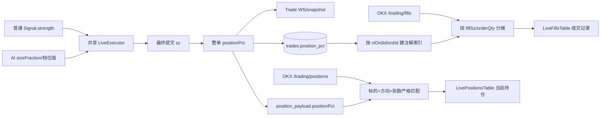

# 自动交易仓位百分比记录与展示设计

> 版本：v2
> 功能标识：`auto-trade-position-percentage`
> 范围：AI 自动交易与普通自动交易的实盘成交、底部当前持仓及成交记录
> 状态：评审通过，待实现

## 评审记录

评审依据为当前仓库的 FastAPI/SQLAlchemy/SQLite、Next.js/React/Zustand 架构，以及
`CLAUDE.md` 中“真实交易数据不得伪造、AI 与普通自动交易共用 `LiveExecutor`、旧 SQLite
必须幂等补列”的约束。以下问题均已在 v2 正文中修复。

| 严重级别 | 问题 | v2 修复 |
|---|---|---|
| P0 | v1 把底部展示目标误判为 `TradesTable`/`PositionPanel`。实盘自动交易只能在 `accountMode="live"` 启动，而 `ChartWorkspace` 此时实际渲染 `LiveBottomPanel`，其子组件是 `LiveFillsTable` 与 `LivePositionsTable`；按 v1 实施后用户界面仍看不到仓位占比。 | 全面改为真实实盘 UI 路径；从文件清单中移除无效目标，补入 `LiveFillsTable`、`LivePositionsTable` 及其真实数据契约。 |
| P1 | v1 只给内部 `Trade` 增字段，没有设计 `/trading/fills` 的 `LiveFill` 响应字段与关联流程。底部“成交记录”轮询的是 OKX fills，不消费自动交易 WS `Trade`。 | 复用现有 `clOrdId`/`ordId` 关联链，把数据库成交快照富化到真实 fill，并在 Pydantic `LiveFill`、前端 `LiveFill` 和表格列中显式声明。 |
| P1 | 一个自动订单可能对应多条部分成交。若把整单比例原样复制到每条 fill，会重复显示并夸大实际成交比例。 | 关联索引同时携带整单 `qty`；每条 fill 显示 `order_position_pct × fillSz / order_qty`，并做有限数、正数与上界校验。完全成交时各 fill 比例之和等于整单比例。 |
| P1 | 实盘“当前持仓”是账户级 OKX 真数据，可能包含手动持仓；直接按 `instId` 贴自动交易比例会误标手动仓或外部干预后的仓位。 | OKX 持仓继续作为真源；只在活动普通/AI 自动交易成员的运行态持仓与 OKX 行的标的、方向、绝对张数均匹配时显示比例，否则显示 `—`。 |
| P1 | v1 的 fill 查询依赖 `explain_json IS NOT NULL`，而仓位比例是一等字段，不应隐式依赖解释 JSON；同时 Pydantic `response_model` 会丢弃未声明的富化字段。 | 仓储查询改为“`explain_json` 或 `position_pct` 任一存在”，关联载荷同时携带解释和比例；`LiveFill.positionPct` 在后端 schema 中显式声明。 |
| P1 | v1 把下单接受后的 `sz × reference_price` 描述为“真实成交”，但当前 `place_live_order` 回执只有订单 ID，没有成交均价/累计成交量；该表述会造成错误审计预期。 | 明确区分“自动订单仓位快照”和“真实 fill 分摊值”：整单快照按最终提交 `sz` 计算，真实 fill 行按 `fillSz/order_qty` 分配；不伪造交易所未返回的成交价。 |
| P1 | v1 要求非有限值显示 `—`，但现有 `fmtPct` 只排除 `NaN`，没有排除 `Infinity`；后端公式也只写了非正校验。 | 后端纯函数统一拒绝所有非有限/非正输入；`fmtPct` 改为 `Number.isFinite` 守卫并补回归测试。 |
| P2 | v1 允许运行态缺失时按预算重新“保守恢复”开仓比例，可能在状态损坏或外部变仓时制造看似精确的错误数据。 | 删除推测恢复；状态缺失即 `None`/`—`，历史数据不回填。 |
| P2 | v1 的前端文件和测试清单覆盖通用回测组件，却遗漏真实实盘组件、fill 关联单测与当前持仓误归因测试，范围既偏离需求又不完整。 | 文件清单与验收改为最小闭环：共享执行器、持久化、fill 富化、实盘底部两个组件及对应测试。 |

## 一、Overview

普通自动交易和 AI 自动交易都通过共享 `LiveExecutor` 把成员预算、杠杆与策略/AI
决策比例换算为最终提交给交易所的合约张数。现有成交快照只保留价格、数量、盈亏、风险和
解释字段，没有记录“本次自动操作占该成员最终生效预算的多少”；实盘底部的 OKX 当前持仓与
真实成交表也没有这个信息。

本功能新增统一的 `positionPct` 仓位快照，口径是“本次自动订单按执行器 sizing 公式占该
成员最终生效预算的比例”，不是组成员的 `allocationPct`，也不是整个账户余额占比。开仓在
交易所接受订单后按最终提交张数计算；整仓平仓沿用对应开仓快照，表示本次释放的预算仓位比例。
该值随内部自动交易 `Trade` 事件发送并写入 SQLite，保证重连和历史查询不丢失。

实盘底部必须遵守现有真实数据架构：当前持仓继续轮询 OKX `/trading/positions`，成交记录继续
轮询 OKX `/trading/fills`。当前持仓仅在真实 OKX 行与活动自动交易成员运行态严格匹配时展示
比例；成交记录通过已有 `clOrdId`/`ordId` 将本地自动交易快照关联到真实 fill，并按部分成交量
分摊比例。手动交易、旧数据、无法关联或状态不一致时统一显示 `—`，绝不猜测。

本次不改变预算上限、分组分配、AI 档位、下单数量、杠杆、OCO、风控或交易所接口；只增加
可审计快照、已有查询的加性富化和展示。

## 二、口径与不变量

### 2.1 三种展示形状

- 内部成交与历史字段：`Trade.positionPct?: number | null`，Python/SQLite 为
  `position_pct`。
- 活动运行态持仓字段：`PaperPositionEvent.positionPct?: number | null`。名字沿用现有公共
  position 事件类型，但只有普通/AI 自动实盘的新持仓保证可计算。
- 真实成交字段：`LiveFill.positionPct?: number | null`，表示这一条 OKX fill 实际分摊到的
  自动订单仓位比例。
- 三者都采用 fraction，范围 `[0, 1]`；`0.25` 在 UI 显示为 `25.00%`。这与 `pnlPct`、
  `stopLossPct` 一致，与取值 `0..100` 的 `allocationPct` 不同。

### 2.2 整单仓位快照

`LiveExecutor._compute_sz` 完成 `lotSz` 向下吸附后，按最终准备提交的 `sz` 计算：

```text
order_notional      = sz * ct_val * reference_price
budget_margin       = order_notional / leverage
order_position_pct  = clamp(budget_margin / member_budget_usd, 0, 1)
```

等价式为：

```text
sz * ct_val * reference_price / (member_budget_usd * leverage)
```

该公式是执行器 sizing 公式的逆运算，衡量自动订单在成员预算中的有效比例。它使用提交张数与
下单参考价，而不是宣称为交易所最终成交保证金；当前下单 API 只返回接受状态和订单 ID，不能
伪造尚未取得的成交均价。交易所步长可能使 40% 的目标最终显示为 39.8%，这是预期行为。

计算辅助函数必须同时满足：`sz`、`ct_val`、`reference_price`、`member_budget_usd`、
`leverage` 均为有限正数；中间结果和最终结果也必须有限。任何条件不满足即返回 `None`，订单
主流程仍按既有行为完成，展示降级为 `—`。

### 2.3 开仓、平仓与部分成交

- 开多/开空：订单成功接受后，把整单 `order_position_pct` 写入开仓 `Trade.positionPct`，并
  保存为执行器瞬态状态 `entry_position_pct`。
- 信号、反手、max-hold、会话停止的整仓平仓：在清空状态前把
  `entry_position_pct` 写入 close `Trade.positionPct`，表示本次释放整个自管仓位的比例。
- OCO/外部全平合成成交：同样在归 flat 前复制开仓快照。若状态缺失，不重算、不猜测，写
  `None`。
- 真实 OKX fill：关联到自动交易整单后，按下式得到该 fill 的比例：

```text
fill_position_pct = clamp(
    order_position_pct * fill_sz / order_qty,
    0,
    order_position_pct,
)
```

  `order_position_pct`、`fill_sz`、`order_qty` 任一非有限，或分母/成交量非正，则返回 `None`。
  同一订单多条 fill 各自显示分摊比例；全部成交时其和等于整单快照，部分成交时只显示已成交
  部分，避免把整单比例重复到每行。

### 2.4 状态生命周期

执行器新增：

```text
entry_position_pct: float | None
```

它与 `entry_qty_sz` 生命周期一致：flat 初始化为 `None`；开仓成功赋值；持仓期间只读；所有
正常、良性无仓、外部全平和停止会话的归 flat 路径均在成交生成后清空；反手先读取并清除旧值，
再写入新开仓值。它不单独持久化，权威历史载体是成交行；活动会话的 snapshot 则通过
`position_payload` 和 `trades` 重放。

## 三、Technical design

### 3.1 架构选择

采用“执行器单点计算 + 一等成交列 + 真实数据安全富化”的方案：



不在 `/trading/positions` 后端响应里直接注入比例：该接口是账户级真实持仓，后端行本身没有
自动/手动所有权，错误关联会污染真源。前端已同时持有活动普通/AI 自动交易成员的 WS position，
适合在展示边界做严格匹配；匹配失败即空，不改变 OKX 数据。

不把比例塞入 `explain_json`：比例需要独立查询、历史序列化和数值测试。解释 JSON 仍只负责
触发原因；fill 注解索引把两个一等数据组合成一次富化载荷。

### 3.2 执行器与持久化路径

1. `LiveExecutor._do_open` 先调用既有 `_compute_sz`，订单接受后调用新的纯函数
   `_position_pct_for_size`；设置 `entry_position_pct`，传给 `_make_trade`。
2. `_make_trade` 增加可选命名参数 `position_pct`；仅有限且非 `None` 时输出 camelCase
   `positionPct`，保持实时协议“缺失即省略”的兼容风格。
3. `position_payload` 加性输出 `positionPct`。普通 `LiveAutoSession` 与 `AiTradeSession` 已共用
   该 payload、trade 分发和 snapshot，无需新增执行分支。
4. `_settle_close`、`_settle_benign_close`、`_on_reconcile_ok`、
   `_synthesize_external_close` 和 `flatten` 成功路径都必须先生成带比例的 close trade，再清空
   `entry_position_pct`。失败且残留仓时保留该状态。
5. ORM `Trade` 增加可空 `position_pct`；`_ensure_trade_risk_columns` 的幂等补列映射加入
   `position_pct FLOAT`。旧行自然为 NULL，不回填。
6. `append_live_trade` 显式将 `positionPct` 映射到 ORM；普通回测 `append_trade` 不计算，保持
   NULL。`trade_out` 用 `getattr(..., None)` 向后兼容地输出 `positionPct`。

### 3.3 真实 fill 富化

现有 `/api/trading/fills` 已按 `clOrdId` 主键、`ordId` 副键关联自动交易解释。v2 在同一条链路
扩展注解，不增加 API 或额外远程请求：

1. 仓储查询从“只查 `explain_json IS NOT NULL`”调整为查
   `explain_json IS NOT NULL OR position_pct IS NOT NULL`，仍受 fills 最早时间和硬上限约束。
2. `fills_explain.py` 保持无 IO 的纯函数特性；索引值由单个 explain 扩展为
   `{explain, positionPct, orderQty}`。同键仍保留最新本地成交。
3. `attach_*` 对每条真实 fill 先按 `clOrdId`、再按 `ordId` 命中；解释原样挂载，比例按
   §2.3 分摊。未命中时两个字段均为空，不影响 fill 可见性。
4. 整段富化继续 best-effort 隔离：数据库/坏 JSON/坏数值异常只记录 warning 并返回未富化的
   真实 fills，不能让审计附加字段遮蔽成交。
5. 后端 `LiveFill` response model 必须声明 `positionPct: float | None`，否则 FastAPI 会在响应
   序列化时丢弃字段；前端 `LiveFill` 同步增加可选字段。

### 3.4 当前真实持仓匹配

新增纯前端辅助函数，从活动自动交易运行态中解析一个 OKX 持仓行的比例。候选仅包括：

- AI 自动交易：`aiTradeGroup.members[instId].position`；
- 普通分组自动交易：`liveAutoGroup.members[instId].position`；
- 兼容单会话路径：`liveAutoPosition`。

普通与 AI 自动交易已有互斥门禁。匹配仍必须全部满足：

1. `instId` 命中活动成员；
2. 运行态 `side` 非 flat，且与 OKX `posSide` 一致；net 模式按 `pos` 正负推导方向；
3. `abs(OKX pos)` 与运行态 `size` 都是有限正数，并在
   `max(1e-9, abs(pos) * 1e-6)` 容差内相等；
4. 运行态 `positionPct` 是 `[0,1]` 内有限数。

满足时 `LivePositionsTable` 新增“仓位占比”列并显示该值；任一不满足显示 `—`。张数匹配门禁
可防止订单刚接受但尚部分成交、手动减仓、外部干预或陈旧 WS 状态被误标。OKX 真实持仓的数量、
均价、浮盈和操作行为均保持不变。

### 3.5 操作时序

开仓：策略/AI 比例 → `LiveExecutor` 按成员预算与杠杆得到目标名义 → `lotSz` 吸附为提交
`sz` → 订单被接受 → 计算并保存整单比例 → trade 先持久化再 WS 扇出 → OKX 持仓轮询与运行态
张数一致后，底部当前持仓显示比例。

成交：OKX 真实 fill 出现在 `/trading/fills` → 本地按订单 ID 命中整单成交 → 按该 fill 的
`fillSz` 分摊 → 底部成交记录显示本条实际成交占比。轮询发生在本地成交持久化之前时第一次可为
`—`，下一次 8 秒轮询命中后补齐，这是 best-effort 富化的既有一致性模型。

平仓：信号、风控、停止或外部全平 → close `Trade` 复制开仓快照并持久化 → 真实卖出/买入
平仓 fills 逐条分摊显示释放比例 → 执行器归 flat 后当前持仓匹配自然消失。

重连/历史：活动会话 snapshot 携带 position 与 trades 的比例；历史详情从 SQLite `trade_out`
返回整单比例。旧数据或混合版本服务缺字段时前端保持 `—`。

## 四、File / module change plan

| 文件 | 类型 | 修改意图 |
|---|---|---|
| `services/quant/app/live_auto/executor.py` | 修改 | 计算、保存、传播开/平仓整单 `positionPct`，在 position payload 中输出，并覆盖所有归 flat 路径。 |
| `services/quant/app/db/models.py` | 修改 | 为 `Trade` 增加可空 `position_pct: Float`。 |
| `services/quant/app/db/session.py` | 修改 | 在现有 `_ensure_trade_risk_columns` 中幂等补 `trades.position_pct FLOAT`。 |
| `services/quant/app/db/repositories.py` | 修改 | 持久化/查询/历史输出所需的比例；注解查询条件改为解释或比例任一存在。 |
| `services/quant/app/schemas.py` | 修改 | `trade_out` 输出 `positionPct`；`LiveFill` response model 声明可空 `positionPct`。 |
| `services/quant/app/live_auto/fills_explain.py` | 修改 | 将现有解释索引扩展为成交注解索引，按部分成交量安全分摊比例。 |
| `apps/web/lib/types.ts` | 修改 | `Trade` 与 `PaperPositionEvent` 增加可选 `positionPct`。 |
| `apps/web/lib/aiTradeTypes.ts` | 修改 | 将 AI 成员 `position` 从 `unknown` 收紧为公共 `PaperPositionEvent | null`，供安全匹配。 |
| `apps/web/lib/tradingTypes.ts` | 修改 | `LiveFill` 增加可选 `positionPct`。 |
| `apps/web/lib/format.ts` | 修改 | `fmtPct` 对所有非有限值显示 `—`。 |
| `apps/web/lib/autoTradePositionPct.ts` | 新建 | 纯函数完成 OKX 持仓与活动自动交易 position 的标的/方向/张数/数值匹配。 |
| `apps/web/components/Live/LiveFillsTable.tsx` | 修改 | 真实成交表新增“仓位占比”列并更新展开行 `colSpan`。 |
| `apps/web/components/Live/LivePositionsTable.tsx` | 修改 | 读取活动普通/AI 自动交易运行态，真实持仓表新增安全归因后的“仓位占比”列。 |
| `services/quant/tests/test_live_executor.py` | 修改 | 覆盖吸附后比例、payload、开平继承、反手、停止、外部全平与坏输入。 |
| `services/quant/tests/test_live_auto_session.py` | 修改 | 验证普通自动交易 trade/position/snapshot 透传比例。 |
| `services/quant/tests/test_ai_trade_session.py` | 修改 | 验证 AI 档位值经共享执行器进入 trade/position/snapshot。 |
| `services/quant/tests/test_live_auto_explain.py` | 修改 | 验证 `append_live_trade` 持久化且 `trade_out` 往返不丢比例。 |
| `services/quant/tests/test_fills_explain.py` | 修改 | 覆盖订单 ID 关联、单 fill、多部分 fill、未完全成交、坏数值、未命中与解释独立性。 |
| `services/quant/tests/test_trade_position_pct_migration.py` | 新建 | 验证老表补列、旧行 NULL 和重复初始化幂等。 |
| `apps/web/lib/autoTradePositionPct.test.ts` | 新建 | 覆盖 long/short/net、AI/普通/单会话、张数不符、手动仓、坏值与 flat。 |
| `apps/web/components/Live/LiveFillsTable.test.tsx` | 修改 | 验证比例列、部分 fill、空值及展开 `colSpan`。 |
| `apps/web/components/Live/LivePositionsTable.test.tsx` | 新建 | 验证匹配自动仓显示比例，手动/错方向/错张数显示 `—`。 |
| `apps/web/lib/format.test.ts` | 修改 | 验证 `NaN`、正负 `Infinity` 均显示 `—`。 |

明确不修改 `ChartWorkspace`、`LiveBottomPanel`、预算/分配算法、AI 决策器、交易所客户端、
`/trading/positions` 数据形状、下单请求或风控参数。`TradesTable`、`PositionPanel`、
`deriveOpenPosition` 属于模拟/回测路径，不是本需求的实盘底部目标。

## 五、Interface design

不新增端点，不修改请求体。以下既有响应/事件加性增加可选字段：

```text
Trade.positionPct?: number | null
PaperPositionEvent.positionPct?: number | null
LiveFill.positionPct?: number | null
```

受影响出口：

- `WS /api/ws/live-auto/{sessionId}` 的 `trade.data.positionPct`、
  `position.data.positionPct` 与 `snapshot.data.{trades,position}`；
- `WS /api/ws/ai-trade/{sessionId}` 的同名字段；
- `GET /api/trading/fills` 的 `fills[].positionPct`，为每条真实 fill 的分摊比例；
- `GET /api/runs/{runId}/trades` 的整单 `positionPct`；
- `GET /api/live-auto/history/{groupId}` 与
  `GET /api/ai-trade/history/{groupId}` 的 `members[].trades[].positionPct`。

`GET /api/trading/positions` 保持原样。当前持仓比例来自前端对 OKX 行与活动 WS position 的安全
匹配，不修改账户真源响应。

实时 `Trade` 在可计算时发送 number、不可计算时可省略；数据库读取和 fill response 为了形状
稳定可恒定返回 `number | null`。前端全部保持可选，兼容旧服务端、旧快照与测试 fixture。

## 六、Data model

SQLite/ORM 仅新增：

```text
trades.position_pct FLOAT NULL
```

约束由应用层保证为有限数且 `0 <= value <= 1`。SQLite 不增加 CHECK，避免旧库
`ALTER TABLE` 复杂化。启动时现有 `_ensure_trade_risk_columns` 读取
`PRAGMA table_info(trades)`；缺列则执行一次
`ALTER TABLE trades ADD COLUMN position_pct FLOAT`，存在则跳过。

旧行不回填：单凭 `qty/price` 无法可靠知道当时成员最终预算、杠杆和合约面值。运行态
`entry_position_pct` 也不单独建表；成交行是审计真源，活动 session snapshot 是实时真源。

fill 的 `positionPct` 是查询时由真实 `fillSz` 与本地整单快照派生的加性字段，不另建 fill 表，
不复制 OKX 数据。当前持仓比例同样只在展示边界匹配，不写入账户持仓模型。

## 七、Testing & acceptance criteria

### 7.1 后端自动化测试

1. 预算 1000、杠杆 2、固定 `ctVal/price/lotSz`，输入 40% 强度，断言开仓
   `positionPct` 等于吸附后张数的逆算比例，而非未经取整的 0.4；position payload 同值。
2. 覆盖 long、short、信号平仓、max-hold、反手、会话停止、`LIVE_NO_POSITION` 与
   reconcile external close；close 在状态清空前继承开仓比例，失败残留仓保留状态。
3. `NaN`、`Infinity`、零/负预算、杠杆、价格、合约面值或张数不抛异常，比例缺失，订单原有
   成败语义不变。
4. 普通与 AI session 各断言 trade、position 和 snapshot 保留比例，证明共享执行器覆盖两类功能。
5. 写入带比例的 live trade，重新查询 ORM 并经 `trade_out` 输出；无字段 trade 仍成功并返回 NULL。
6. fill 注解：一个整单对应一条 fill；对应多条 30%/70% fill；只成交一部分；解释为空但比例存在；
   比例为空但解释存在；坏数值/零 order qty/未命中均安全退化。
7. 从没有 `position_pct` 的旧 `trades` 表执行补列两次，断言列只出现一次且旧行可读为 NULL。

建议命令：

```text
cd services/quant
python -m pytest tests/test_live_executor.py tests/test_live_auto_session.py tests/test_ai_trade_session.py tests/test_live_auto_explain.py tests/test_fills_explain.py tests/test_trade_position_pct_migration.py -q
```

### 7.2 前端自动化测试

1. 持仓匹配纯函数覆盖普通、AI 和单会话候选；long/short/net 正确；错标的、错方向、张数未完成、
   flat、缺字段、NaN/Infinity 均返回 NULL。
2. `LivePositionsTable` 中匹配自动仓显示 `40.00%`；同账户手动仓和状态不一致仓显示 `—`；原有
   持仓数量、浮盈、展开委托与平仓按钮不变，子行 `colSpan` 更新。
3. `LiveFillsTable` 中已关联 fill 显示分摊比例，未关联/手动 fill 显示 `—`，表头存在“仓位占比”，
   展开解释行跨越全部列。
4. `fmtPct` 对 NULL、undefined、NaN 和正负 Infinity 都显示 `—`。
5. TypeScript 检查通过；字段均可选，不要求批量修改既有 fixture。

建议命令：

```text
cd apps/web
npx vitest run lib/autoTradePositionPct.test.ts lib/format.test.ts components/Live/LiveFillsTable.test.tsx components/Live/LivePositionsTable.test.tsx
npx tsc --noEmit
```

### 7.3 手工验收与 Definition of Done

- 在实盘账户模式启动普通自动交易，以非 100% 强度开仓；订单完全成交并完成下一次轮询后，
  底部“当前持仓”显示有效仓位比例，数量/均价仍来自 OKX。
- 启动 AI 自动交易并选择仓位档位；显示值等于档位经交易所张数吸附后的有效比例，不是成员
  `allocationPct`。
- 同一订单产生多条部分 fill 时，底部“成交记录”每行显示各自分摊比例，其和不超过整单比例；
  未完成持仓在张数不匹配期间诚实显示 `—`。
- 信号平仓、停止、反手及外部/OCO 全平的真实 fills 显示释放比例；平仓后当前持仓行消失。
- 同账户手动持仓/手动成交、无法关联成交和旧记录显示 `—`，不被误标为自动交易。
- 刷新 renderer 后通过 status + WS snapshot 重连，活动自动仓比例恢复；停止后历史详情的整单成交
  仍带相同比例。
- 后端定向测试、前端定向测试和 TypeScript 检查通过，且下单张数、预算和风险控制结果未变化。

## 八、Rollout、risks & mitigations

| 风险 | 影响 | 缓解措施 |
|---|---|---|
| 改错 UI 路径 | 功能实现但实盘底部仍不可见 | 以 `accountMode="live" → LiveBottomPanel → LiveFillsTable/LivePositionsTable` 为验收路径。 |
| 把 `allocationPct` 当本次仓位比例 | 多标的分组显示错误 | 分母固定为成员 `budgetUsd`；增加 allocation 与实际比例不同的测试。 |
| 直接存 AI/策略目标值 | 最小张数与步长后显示不实 | 在最终 `sz` 之后逆算整单有效比例。 |
| 多条部分 fill 重复整单比例 | 成交记录夸大仓位 | 按 `fillSz/orderQty` 分摊，并夹到整单比例上界。 |
| 把自动比例贴到手动/外部变化仓 | 当前持仓错误归因 | 标的、方向、张数、数值四重匹配；任一不符显示 `—`。 |
| 富化字段被 response model 丢弃 | 后端已算但前端收不到 | Pydantic `LiveFill` 显式声明并做 API/组件测试。 |
| 解释查询成为比例的隐式依赖 | 无解释时比例丢失 | 查询条件为 explain 或 position_pct；索引载荷分别可空。 |
| 富化失败遮蔽真实成交 | 用户看不到关键账户数据 | 延续 best-effort 隔离，失败返回原始 OKX fills。 |
| 老 SQLite 无列 | 升级后 ORM 查询失败 | 启动幂等补列与真实旧表迁移测试。 |
| NULL/Infinity 被显示为 0% 或 Infinity% | 用户误判仓位 | 后端有限数校验，`fmtPct` 使用 `Number.isFinite`，未知统一 `—`。 |
| 市价参考价与最终成交价有滑点 | 整单预算比例与实际保证金略有差异 | 文案定义为执行器订单 sizing 快照；fill 只按真实成交张数分配，不伪造未返回的成交价。 |

发布顺序：先合入 ORM 列与启动补列，再合入执行器/仓储/schema，最后合入前端可选字段和 UI。
由于前端字段可选、数据库列可空，混合版本期间只会显示 `—`，不会阻断交易。回滚时旧代码忽略
新增可空列即可；无需删除列或回填数据。

## 九、实施顺序

1. 先写迁移、执行器和 fill 分摊失败测试，锁定数值口径、状态生命周期与关联降级。
2. 增加 ORM 列、幂等补列、仓储映射、`trade_out` 与 `LiveFill` response model，完成持久化往返。
3. 在共享 `LiveExecutor` 实现整单快照和 position payload，使普通/AI session 测试通过。
4. 扩展 fill 注解索引，在真实 `/trading/fills` 输出中完成部分成交比例富化。
5. 扩展前端可选类型与有限数格式化；实现当前持仓纯匹配函数。
6. 更新 `LiveFillsTable`、`LivePositionsTable` 及渲染测试。
7. 执行后端/前端定向测试、TypeScript 检查，再按 §7.3 分别手工验证普通与 AI 自动交易。

该顺序先稳定数据库和协议，再接 UI；任何附加字段失败都不得改变或阻塞真实下单与账户数据读取。

## 评审结论

**通过。** v1 的 P0 展示路径错误及全部 P1 数据契约、部分成交、归因安全、响应模型与非有限值
问题已在 v2 正文中就地修复；当前方案与共享 `LiveExecutor`、真实 OKX 底部数据源、现有
fill 解释关联机制和 SQLite 幂等迁移约定一致，范围收敛且可实施。无未解决的 P0/P1 条件。

## 实施过程发现的方案缺陷

- P1：v2 要求“解释为空但比例存在”的成交仍可按 `clOrdId` / `ordId` 富化，但现有 `Trade`
  没有独立订单 ID 列，关联键只保存在 `explain_json.meta`；若直接把无解释成交写成 NULL，查询
  虽能因 `position_pct` 命中，却无法建立关联索引。实施采用最小纠正：`append_live_trade` 在无
  触发解释但存在订单 ID 时，向既有 `explain_json` 写入仅含 `meta` 的内部关联信封；fill 索引
  使用该信封建立关联，但 `trade_out` 和 `/trading/fills` 均把它对外呈现为 `explain: null`。
  这样不新增数据库列、不伪造解释，同时满足比例与解释相互独立的验收要求。
- P2：v2 将 `AiTradeGroupMemberState.position` 从 `unknown` 收紧为
  `PaperPositionEvent | null`，但文件计划遗漏了既有 `AiTradeStatsPanel.test.tsx` 的测试构造器；
  该构造器原样赋值 `unknown` 会令全量 `tsc` 新增一项类型错误。实施仅把该 fixture 改为显式
  构造 `PaperPositionEvent`，不改变组件行为或测试语义。
